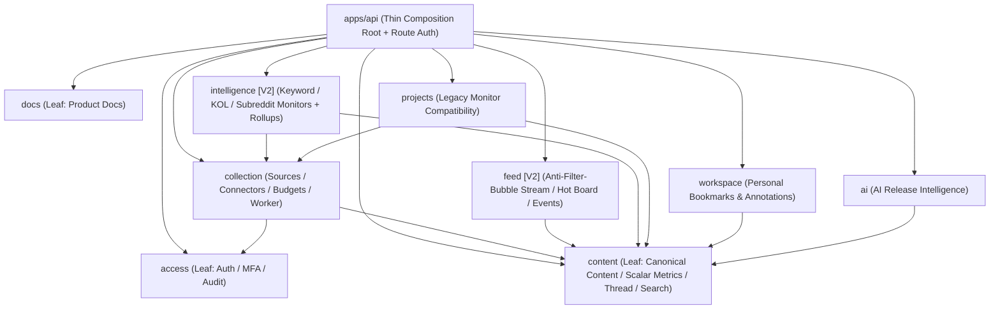

# 主线系统架构与边界规范

本文定义单机 4 GB 运行拓扑、9 域无环依赖图（DAG）、PostgreSQL 16 表所有权、摄入检索引擎、L1–L3/R4 扩源隔离以及核心安全边界。系统不可破坏约束台账见 [invariants.md](invariants.md)，实时进度见 [status.md](status.md)。

---

## 1. 单机 4 GB 运行拓扑与刻意不做清单

在 **4 vCPU / 3.8 GiB RAM / 58 GiB 系统盘** 约束下，生产以三容器编排运行（可选 `deploy/apify-relay.compose.yml` 与 `deploy/tunnel.compose.yml` 隔离外网与入口）：

```text
Web 浏览器 / 移动 Web / 外部 Agent / L3 外部 Sidecar / R4 plugins/zst-archive
                       │  HTTPS (可选 Cloudflare Tunnel 零公网端口)
                 Caddy 2 (proxy, mem_limit=128m, deploy/Caddyfile)
                       │  proxy_transport 内网 (TRUST_PROXY_ADDRESS)
        Fastify 5 单容器应用 (app, mem_limit=1536m, Dockerfile --target runtime)
        ├── HTTP 平面：onRequest @fastify/rate-limit -> preParsing 鉴权 -> apiPool (max=8)
        └── 后台调度：PG LISTEN/NOTIFY (`collection_jobs_ready`) + provider_readiness CTE (LIMIT 32)
                     + WORKER_CONCURRENCY=6 协程 (1500ms hostCooldown) + workerPool (max=4)
                       │
      PostgreSQL 16 (db, postgres:16-alpine, mem_limit=1350m, pg_trgm, LZ4 TOAST)
```

- **构建 Target 铁律**：[Dockerfile](../Dockerfile) 末段为 `AS proxy`（`caddy:2-alpine`），构建后端镜像必须显式传 **`--target runtime`**。
- **刻意不做清单（ESLint + Dependency Cruiser 强制拦截）**：主线严禁引入 **Prisma/TypeORM/Drizzle ORM**、单实现 **`*Repository` / `InMemory*`** 包装、**Redis / BullMQ**、**Elasticsearch / ClickHouse**、多 Node 进程拆分，或容器内 **Headless Chromium / Python / DuckDB**。

---

## 2. 9 域无环架构（DAG）与 55 表所有权

由 `.dependency-cruiser.cjs` 与 `scripts/check-table-ownership.ts` 在 CI (`npm run lint:arch`) 双重强制：**所有业务域之间严禁循环依赖、严禁跨模块引用内部文件或 `routes.ts`，且每张数据库表有且仅有一个写主模块。**



| 模块域 | 允许依赖（仅经 `index.ts` 门面） | 独家写表所有权（V2 · `001..061` 合计 **55 表**） |
| :--- | :--- | :--- |
| **`access`** | 严格叶子域 | **8 表**：`app_user`、`app_user_password`、`app_invite`、`app_audit_log`、`app_session`、`app_auth_challenge`、`app_auth_mfa`、`app_auth_mfa_login`。 |
| **`docs`** | 严格叶子域 | **1 表**：`doc_page`（产品文档中心，支持 `markdown` / `https` 外链 / 8 MiB 内联 PDF）。 |
| **`content`** | 严格叶子域（由 `resolveProjectScope` 注入范围） | **5 表**：`content`、`content_discovery`、`content_observation`、`content_author_profile`、`public_content_search_document`。全库唯一写入入口 `commitContentBatch`；契约许可只读 `JOIN` `collection` 的 `source` 与 `collection_source`。 |
| **`collection`** | `access`、`content` | **9 表**：`source`、`collection_source`、`source_collection_job`、`source_provider_budget`、`source_provider_usage`、`source_worker_heartbeat`、`source_provider_credential`、`plan_collection_policy`、`user_provider_usage`。 |
| **`feed`** | `content` | **4 表**（`060`）：`feed_user_seen`、`feed_user_event`、`feed_user_affinity`、`feed_user_preference`。与 `intelligence`/`projects`/`workspace`/`ai` 物理隔离。 |
| **`intelligence`** | `content`、`collection` | **4 表**（`061`）：`intel_monitor`、`intel_monitor_source`、`intel_monitor_target`、`intel_rollup_bucket`。通过 `collection` 门面创/停源与预估额度。 |
| **`projects`** | `content`、`collection` | **2 表**：`monitor_project`、`monitor_project_source`（现有专题兼容层，概览/水合分别委托 `content` 与 `collection`）。 |
| **`workspace`** | `content` | **2 表**：`content_saved_query`、`content_annotation`（严格浏览器会话隔离）。 |
| **`ai`** | `content` | **19 表**（`054..056`）：全量 `ai_*` 发布、榜单、同步运行与历史导入/回填表。 |
| **`src/storage/`** | 无业务依赖 | **1 表**：`schema_migration` 迁移引导与 SHA-256 不可变校验台账。 |

`src/platform/`（声明式鉴权 `route-auth.ts`、通道白名单 `pg-notify.ts`）与 `src/shared/`（`errors`/`canonical`/`ids`/`language`）保持领域无关；`src/connectors/` 严禁导入 `pg`、`src/storage/` 或业务模块；`apps/web/src/` 严禁导入后端源码。

---

## 3. 内容批写入、热路径物化与检索引擎

### 3.1 `commitContentBatch` 与标量列物化

- **4×`UNNEST` 短事务**：仅 `src/modules/content/index.ts` 可写内容核心表；以 `(content_observed_at IS NOT NULL, COALESCE(content_observed_at, content_version_fetched_at), content_evidence_key COLLATE "C")` 决胜版本并阻止 `deleted`/`removed` 内容复活。
- **零读时 JSONB 解包（`059`）**：入库事务内通过可插拔 `enrich.ts`（当前 `heuristic_v1`，支持 `upgradeContentEnrichment` 版本升级）同步物化 `author_handle`、`community_name`、`external_domain`、`hashtags`、`card_layout`、`clean_excerpt`、`intent_tag`、`metric_*`、`engagement_score`、`discussion_ratio` 并 upsert `content_author_profile`。
- **写放大节流**：`content_observation` 仅在 `payload_hash` 异同时插入；无新指标变化时复用 6 小时窗口降低死元组与磁盘写入。

### 3.2 双字词 GIN 与冷裁剪兼容检索

- `public_content_search_document` 仅在正文或标题变化时更新，正文索引截断于 `MAX_INDEXED_BODY_CHARS = 1500`。
- `compileContentFilter` 对 `>= 3` 连续字母数字走 `pg_trgm`（`gin_trgm_ops`），对中文双字词与短代号（如 `算力`、`降息`、`o3`）走 `public_search_bigrams(search_text)` GIN 索引并回表精确匹配原文。
- 所有列表、详情与标注查询对搜索投影采用 **`LEFT JOIN`**（或免关联），确保未来按需清理旧搜索投影不隐藏原帖与批注。

### 3.3 迁移前向不可变纪律

已合入 `main` 的迁移 `001..058` 严禁改写、移动或删除；V2 新增迁移 `059..061` 及后续 `062+` 必须通过 `npm run lint:policy`、`Squawk` 防锁表扫描、PG16 事务失败完整回滚测试与 `.github/CODEOWNERS` 审查，永不恢复 `050` 已退役的 27 张旧表。

---

## 4. 采集架构：Feed Lane 隔离与外挂边界

`collection_source.feed_lane`（`discussion` | `release` | `monitor_only` | `news`）将高讨论信息流、AI 官方一手发布、专项监测源与历史新闻彻底隔离；默认推荐流仅采信 `discussion` 与 `release`。

| 层级与渠道 | 适用对象与实现位置 | 关键工程策略与隔离约束 |
| :--- | :--- | :--- |
| **L1 · 主线内置直采（\$0）** | `feed`（RSS/Atom + `web_list` + `json_list`）、`newsnow`（`packages/contracts/src/web-boards.ts` 内置 6 榜单）、`bluesky_appview` | 动态 HTTPS 抓取（`FEED_ALLOWED_URLS` 留空时受全局公网 IP DNS 校验放行）、OPML/JSON 批量导入、`ETag`/`304` 1.5× 指数退避（上限 12h）与 `1500ms` 同域冷却。 |
| **L2 · 预算门控付费 API** | Reddit（`kaix` 主力 + `red_crawler` 备源）、X（`twitterapis` 主力 + `scrapebadger` 备源与批量补全） | V2 升级富媒体、社区/外链域名、作者粉丝画像与 `top`/`min_faves` 原生排序；X 多账号监测自动拼装 15–20 人 `from:u1 OR from:u2` 批次查询；单页钳制 `twitterapis <= 20`；触发 `unknown` 状态立即熔断停采。 |
| **R4 / L3 · 外部物理隔离外挂** | `plugins/zst-archive/`（Python/DuckDB 离线归档转换器）与未来 L3 无头/反爬采集器 | 严禁进入主线 Dockerfile 与 `release:pack` 清单；必须独立部署并仅持锁死 `allowedSourceIds` + `ingest` scope 的 Machine Key 调 `POST /v1/sources/:id/ingest`（单批 `1..100` 条、`<= 1 MiB`、`Idempotency-Key` 幂等）。 |

> 已退役的 `twitterapi_io` 与 `arctic_shift` 连接器代码已在主线物理删除，并由 `scripts/check-docs.ts` 与 `eslint.config.mjs` 防止回流；历史观测中的 `provider` 标识保留只读溯源。

---

## 5. 安全、连接池与 AI 运行边界

- **鉴权与防刷**：`/v1/*` 执行 Default-Deny 声明式 `config.auth`（启动期 `onRoute` + 请求期 `preParsing` 双重检验）；`@fastify/rate-limit` 置于 `onRequest`（先于鉴权查库，确保 `429` 零 DB 查询）；浏览器写请求校验同源 `Origin`。
- **SSRF 防护（`src/connectors/web/http.ts`）**：强制 HTTPS、拒绝带凭证/非标端口/裸 IP URL；总超时 `[3000, 15000]ms`；`dns.resolve4/6` 校验全地址为公网 IP 后绑定 Socket `lookup`；最多手动 3 跳且逐跳重验；响应体与解压严格限 `2 MiB`（AI 注册表与归档分别限 `16 MiB` / `2 MiB`）。
- **连接池与流式导出锁**：总池预算 **`12`**（`apiPool: 8` + `workerPool: 4`）；`/v1/content/export` 全局单进程单槽并发锁（`429 + Retry-After: 5`）、`REPEATABLE READ READ ONLY`、`35s` 空闲超时、客户端断流立即销毁 `QueryStream`。
- **AI 模块并发与预算（`AI_SYNC_ENABLED` 默认关闭）**：注册表/同步/可选 LLM 抽取共走公网 DNS 固定连接与进程内有界并发（每进程最多 2 路），访问供应商前在 PG 原子预扣 UTC 日预算，未知结果保持占用不重放。
