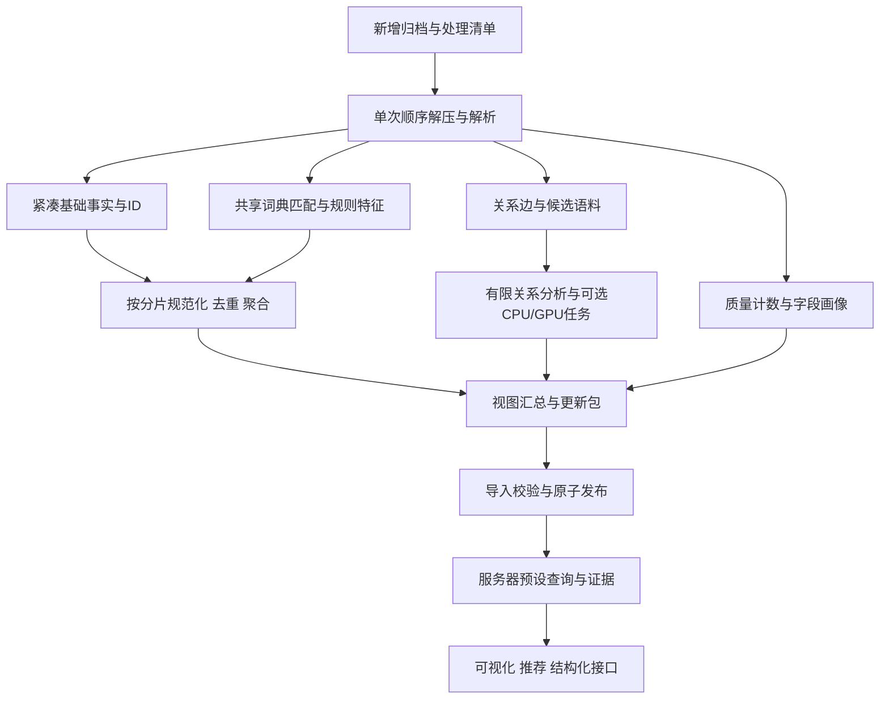

# 分析能力与计算存储架构设计 v0.1

日期：2026-11-12。性质：可讨论、可实施细化的架构设计，不是已完成的软件或性能测试报告。

本设计继承对话中已确认的要求；原《Arctic Shift 离线分析能力与工程成本矩阵》作为能力参考，其中人工标注、人工抽检、高成本 LLM 和阶段划分不构成本项目的执行要求。

## 1. 已确认的架构边界

- 预先覆盖主要主题、品类和行业；丰富的预设视图为主，有限维度组合为辅。分类体系与视图可预配置齐全，实际覆盖和可用能力由数据决定。
- 历史归档在本地加工；服务器保存汇总、有限分析明细、证据及版本信息。历史重计算不依赖服务器；本地不是在线产品的常驻组件。
- 每个新增压缩归档在正常成功处理时，目标只解压、解析一遍。后续计算访问列式特征、关系或候选语料，不再反复扫描原始包。
- 先处理 2026-09；之后导入 2026-04～08。必须支持乱序补月、跨月关系修订、覆盖范围更新、同批次重试和版本替换。
- 无人工逐条标注或审核的必要步骤；允许词典配置、规则和现成小模型。不承诺自动语义标签的真实准确率。
- API 是服务器独立的限量采集与轻量分析链路，不调用本机、不借用本机 GPU；结果可复用展示契约，但默认不与归档相加。
- 人与 agent 共用同一指标、查询、证据及导出语义。
- 后续已确认在线用户为本人和少量受邀用户，目标Linux 4核8～16GB、Docker部署；搜索覆盖已导入文本，较大明细按权限与配额导出。技术选型详见同目录《在线平台技术栈与部署决策-v0.1.md》。
- 可用空间目前约 151.54 GB（141.13 GiB），用户预计可扩展至约 350 GB；扩展尚未实际完成。CPU 16 逻辑处理器，内存约 63.73 GiB；以上为本机只读查询，非吞吐实测。
- GPU 为用户提供的 RTX 4060 Laptop，目前集显模式；CUDA 可见性、显存、功耗和驱动未验证。GPU 为可选离线加速器，非基础依赖。

## 2. 三种遍历必须分开预算

| 遍历类型 | 代价与政策 | 正常增量是否重做旧数据 |
|---|---|---|
| 原始 `.zst` 全量解压与 JSON 解析 | 最应减少；多个消费者共享一次解析；对读取中的压缩字节计算文件摘要，避免额外整文件校验扫描 | 否；新月份只扫描新文件 |
| 精简元数据或稀疏特征遍历 | 比原始层小，但数十亿行仍可能昂贵；按列、分区和依赖图只读必要部分 | 只读受影响列/分区，或明确要求的全期间汇总 |
| 汇总表和精选候选集遍历 | 多数视图的来源；鼓励复用、小表合并与物化 | 是，允许低成本重建相关小表 |

不能承诺“半年全部分析只遍历一次”。排序、规范化去重、跨月连接、近重复等需要后处理；承诺是尽量不再解压旧原档，并压缩后处理的数据规模。

也不能同时保证：不保留全文、不重读原档、未来任意新规则精确覆盖所有历史内容。对遗漏的词项或未保留文本，新规则只适用于保留语料/新数据，或者需要显式历史重处理。

## 3. 一次扫描、多路输出的生产流程



### 3.1 首次解析时必须完成的共享工作

1. 归一内容身份、时间、社区、父节点与根帖子 ID；字段类型异常和原始状态分开记录。
2. 统计记录数、时间范围、缺失、删除占位符、正文长度、抓取延迟等质量信息。
3. 在同一文本处理中匹配主题、品类、品牌、型号、问题词、意图线索及别名；复用规范化结果和命中位置。
4. 输出紧凑数值事实、稀疏特征，以及之后需要的候选文本。派生统计可以在分片结束后读取这些事实，避免内存堆积。
5. 保存证据候选、分层探索样本和必要关系；区分完整特征覆盖、候选筛选覆盖、证据展示覆盖。
6. 以有界队列连接解压、解析、特征提取、写入。消费者来不及时背压，不允许为了速度无限积压文本。

跨品牌、跨主题词典优先用共享多模式匹配器；不能为 27 个主题各解压一遍，也不能为每一个品牌分别扫描全文。Aho–Corasick 的单次文本遍历适用于预定义词项集合，但词边界、大小写、语言、歧义和输出命中数仍需控制。[S4]

### 3.2 扫描前冻结“处理配置”

冻结 taxonomy、词典、别名、规则、语言支持、所需字段、统计粒度、候选保留策略、算法预算和版本；此配置不是冻结未来产品，而是保证本轮扫描可解释、可重复。

9 月确定的配置用于之后五个月。若配置升级，优先用保留特征重算；依赖缺失原文的变更不混入旧版本结果。规则变更影响分母时，应同时修订分子和分母。

### 3.3 失败恢复的真实限制

提交单位是已完成的数据分片，临时文件写完校验后重命名提交。记录源文件、逻辑记录位置、分片 ID、代码/配置指纹；重试不得重复计数。

普通 Zstd 流不能仅凭一个任意压缩字节偏移恢复解压。若原档没有可用的独立帧/索引，失败可能必须从文件头重新解压至检查点；已提交分片可跳过解析后业务写入，但不能假装省掉前缀解压。支持可靠 seek 的格式必须实测后另行启用。单次扫描目标针对正常运行，不是零失败重读保证。

## 4. 共享特征与结果表目录

以下是逻辑表，不要求每个表独立数据库。所有事实包含 `dataset_release`、来源范围和特征版本；空值与未知状态保留，不默认补零。

| 特征组 | 保存内容 | 复用能力 | 默认范围 |
|---|---|---|---|
| F0 质量 | 字段存在/类型、状态、解析计数、时间边界 | A01～A07、可靠性提示 | 全部输入记录 |
| F1 基础事实 | kind、ID、created、community、互动快照、类型、长度、域名/Flair键 | 时间/社区/分布及多种交叉分析 | 预算允许时全范围紧凑保存 |
| F2 稀疏特征 | content ID、topic/entity/issue/intent ID、规则、匹配依据 | 品牌、型号、问题和阶段分析 | 对所支持语言/规则的全部匹配内容 |
| F3 词项特征 | 词项/短语、文档频次、日期、社区、选择概率 | 新词、主题候选、关键词推荐 | 固定词典广覆盖；开放词汇有界抽样 |
| F4 关系 | comment ID、root ID、parent ID、created、必要作者键 | 帖评结构、时延、树及转帖 | 根级摘要尽量广；完整边按预算 |
| F5 候选文本 | 规范化文本、内容哈希、文本版本、语言、选择原因 | 规则改算、近重复、小模型 | 按分层预算保留，不承诺全文 |
| F6 证据 | 片段、必要上下文、来源、命中位置、关系完整性 | 证据查看、模板简报 | 固定上限，单独记覆盖 |
| F7 统计状态 | count/sum/histogram、可合并去重草图及参数 | 低成本跨月归并 | 只为白名单分组保存 |

| 结果表 | 最小逻辑粒度 | 主要内容 |
|---|---|---|
| M01 quality | batch × kind × 日期 × quality_metric | 原始/有效/异常计数、字段覆盖 |
| M02 activity | 日期 × community × kind | 内容数、状态数、长度及互动统计状态 |
| M03 rhythm | community × 月 × 星期 × UTC小时 × kind | 活跃节律；不重复计入 M02 总量 |
| M04 content_mix | 月 × community × 指定分类轴 | 类型、域名、Flair、长度分布 |
| M05 topic | 日期 × topic × kind × assignment_basis | 主题匹配量与对应基线 |
| M06 entity | 日期 × topic_scope × entity × kind | 提及文档数、互动状态、分母 |
| M07 issue | 日期 × topic_scope × issue × kind | 问题词/规则候选数及分母 |
| M08 entity_issue | 日期 × topic_scope × entity × issue × kind | 共现数、局部绑定数、歧义数、对应实体文档分母 |
| M09 intent | 日期 × topic_scope × intent × kind | 购前/使用/退换等规则线索 |
| M10 terms | 时间窗 × topic_scope × term | 有界语料上的 DF、基线、首次观测、样本说明 |
| M11 thread | root ID × relation_release | 可见评论数、时延、缺父计数、树摘要 |
| M12 pairs | relation_type × source ID × target ID × window | 有限社区/品牌共现、转帖或回复边 |
| M13 signals | window × topic_scope × signal ID | 已计算信号、分项、适用视图、资格门槛 |
| M14 evidence | evidence ID，另有视图分组到证据的稀疏映射 | 来源文本、片段、截断与选择说明 |
| M15 dimensions | namespace × stable ID × version | 主题树、实体、规则、社区、指标定义 |
| M16 distributions | metric × 已发布分组 × bin/sketch | 分布、分位数状态、直方图边界 |

不构造日期×社区×主题×品牌×型号×问题×阶段的全组合立方体。M08 等只存实际出现且允许的组合，保留规则命中统计；对截断/合并的长尾单独记账。社区等附加维度，仅在注册的子表中开放。多个多标签桥接表不能直接任意 Join 后 COUNT，否则会放大计数。

## 5. 原矩阵 38 项逐项落实

成本说明：B=基础扫描共享成本，G=精简特征上的分组/排序成本，R=关系处理，T=有界文本算法，O=可选小模型；这些不是耗时实测。凡“完整/精确”仅指声明的输入与覆盖范围，不代表 Reddit 全站真实完整。

### 5.1 质量与基础统计

| ID | 分析内容与视图 | 共享输入 | 方法与输出粒度 | 输出表 | 范围与成本 | 允许交互 | 解释边界 |
|---|---|---|---|---|---|---|---|
| A01 | 月度覆盖日历、缺口与计数 | F0/F1 | 日期计数、排序检查；唯一键另验证 | M01/M02 | 广覆盖 B；精确去重增加 G | 日期、kind、社区 | 无记录不等于确定漏采；原始行数与去重内容数分开 |
| A02 | 社区覆盖与长尾 | F1 | 社区计数、排名、累计占比 | M02 | 广覆盖 B+G | 月、kind、主题映射 | 归档覆盖不等于平台覆盖 |
| A03 | 正文与内容状态 | F0 | 空白、占位符、删除/移除状态分组 | M01 | 广覆盖 B | 日期、kind、状态 | 不把空正文都当删除 |
| A04 | 收集与二次观测延迟 | F0/F1 | created到retrieved的固定桶分布 | M01/M16 | 广覆盖 B | 月、kind、观测类型 | 不是连续抓取或热度曲线 |
| A05 | 正文长度与类型分布 | F1 | 长度桶、合并统计状态 | M04/M16 | 广覆盖 B | 月、kind、社区子集 | 长度按字符/字节/词分别定义 |
| A06 | 跨月字段与口径一致性 | F0/F2 | schema/type/规则版本对照 | M01/M15 | 小表 G；ID核验另预算 | 月、字段、规则 | 类型相同不保证语义相同 |
| A07 | 处理与存储成本看板 | 运行遥测 | 按分片记录吞吐、输出字节、峰值资源 | M01 | 随处理记录 B | 批次、处理器、数据层 | 不用开头100条外推整月性能 |
| A08 | 社区活跃排行 | F1 | 按社区内容数、占比、名次 | M02 | B+小表 G | 月、kind、Top N | 活跃讨论量不是成员人数 |
| A09 | 日周月讨论趋势 | F1 | 可加计数按UTC日汇总 | M02/M05 | B+小表 G | 已发布日期与主题 | 未下载月份显示不可用，不补零 |
| A10 | 发帖与回复结构 | F1/F4 | 同期事件比、按根帖子队列的可见回复分开 | M02/M11 | 事件比 B；根级 R | 社区、月、统计口径 | 当月评论/帖子之比不是当月帖子回复率 |
| A11 | 互动长尾与分布 | F1/F7 | score/回复数桶、分位状态 | M16 | B+G | 月、kind、已发布社区组 | 快照值；score可为负，桶需支持负值 |
| A12 | 高参与讨论榜 | F1 | 固定比较组排名、可见互动Top K | M13/M14 | B+G | 月、社区、指标 | 本地Top K不能直接拼成任意分组的精确Top K |
| A13 | 内容形式与外链结构 | F1 | 文本、链接、媒体标记、域名分组 | M04 | B+G | 月、社区、形式 | 不读取图片/视频内容 |
| A14 | 社区Flair结构 | F1 | 社区内标签归一和占比 | M04 | B+G，限制长尾 | 社区、月、Flair | 不默认把不同社区同名标签合并 |
| A15 | 小时与星期节律 | F1 | UTC小时×星期计数 | M03 | B+G | 月、社区、kind | 其他时区若需精确夏令时重分桶，要保留日期小时粒度或预计算 |

### 5.2 文本、实体与词项

| ID | 分析内容与视图 | 共享输入 | 方法与输出粒度 | 输出表 | 范围与成本 | 允许交互 | 解释边界 |
|---|---|---|---|---|---|---|---|
| A16 | 品类提及及构成 | F2 | 词典+社区背景；每内容每品类去重 | M05/M06 | 匹配广覆盖 B+G | 已发布品类、日期、kind | 社区推定与文本命中分开 |
| A17 | 品牌提及与相对份额 | F2 | 别名归一、词边界、歧义拒判 | M06 | B+G | 品牌、品类、日期 | 不是市场份额；多品牌内容可重叠 |
| A18 | 产品型号结构 | F2 | 品牌约束的型号规则、命中span | M06 | B+G | 品牌、型号、日期 | 通用数字/简称不强行归因 |
| A19 | 问题词候选分布 | F2 | 行业问题词典、否定/问句等规则标记 | M07 | B+G | 问题、品类、日期 | 命中问题词不是核实投诉 |
| A20 | 品牌×问题共现矩阵 | F2 | 同文共现、同句绑定分别计数 | M08 | B+G，限制每文组合数 | 品类、品牌、问题、期间 | 共现不能证明产品发生该问题 |
| A21 | 问题提及率演变 | F2/F7 | 数量与分母、率差、同比较窗口差异 | M07/M08/M13 | 小表 G | 问题、实体、时间 | 分子/分母需相同语言与规则覆盖 |
| A22 | 新兴词与短语 | F3/F5 | 固定词广覆盖；开放词汇有界抽样、DF与突增 | M10/M13 | T，词表与样本有上限 | 已发布主题、时间窗 | 采样发现词不能称全量精确词频；首次观测不是首次出现 |
| A23 | 主题与研究候选 | F2/F3 | 主题规则+新词组合；未知池单独保留 | M05/M10/M13 | B+T | 主题、规则、候选类型 | 不承诺无词典新主题被全部发现 |

### 5.3 关系与重复内容

| ID | 分析内容与视图 | 共享输入 | 方法与输出粒度 | 输出表 | 范围与成本 | 允许交互 | 解释边界 |
|---|---|---|---|---|---|---|---|
| A24 | 帖子—评论关联 | F1/F4 | root ID归一、分桶连接、缺失根保留 | M11 | R；根摘要广、详细关联有界 | 根帖子、覆盖状态 | 9月评论可指向4～8月或更早帖子 |
| A25 | 可见评论树 | F4/F6 | 预计算父子边、缺父/截断标记 | M11/M14 | 有界 R | 已发布根、展开已保存子树 | 不承诺完整树；截断深度不叫完整深度 |
| A26 | 深度、分支与参与结构 | F4/F7 | 对已保留树计算深度、宽度、作者数 | M11/M16 | 有界 R | 已发布树组、月 | 结构缺失会造成指标偏差 |
| A27 | 回复互动结构 | F4 | 限定子图的边数、互惠与集中度 | M12 | 有界 R，默认不做全站中心性 | 已发布社区/线程子图 | 不做人群身份或独立消费者推断 |
| A28 | 跨社区转帖网络 | F1/F4 | crosspost_parent显式关系，按社区聚合 | M12 | R，边稀疏但仍预算 | 月、社区、边类型 | 非转帖的复制与站外传播不可见 |
| A29 | 回复时延 | F4 | 父子或根到评论的时间差固定桶 | M11/M16 | R | 关系类型、已发布分组 | 缺父样本不计入时延有效分母 |
| A30 | 重复文本与相似问题候选 | F5 | 先规范化哈希，再有界MinHash/LSH候选验证 | M11/M13/M14 | 有界 T；无两两全比较 | 已发布重复组、阈值版本 | 文本相似不是同一问题；近重复不证明独立体验 |

### 5.4 消费者语义的低成本版本

| ID | 分析内容与视图 | 共享输入 | 方法与输出粒度 | 输出表 | 范围与成本 | 允许交互 | 解释边界 |
|---|---|---|---|---|---|---|---|
| A31 | 问题自述/询问/转述候选 | F2/F5 | 自述、否定、问句、转述规则；可选小分类器 | M07/M09 | B；模型仅有界 O | 规则标签、语言、期间 | 替代核实投诉分类；保留unknown，不公布无依据准确率 |
| A32 | 多维问题标签 | F2 | 性能、可靠性、兼容、价格、易用、服务等分行业规则 | M07/M08 | B+G | 行业、问题、品牌 | 展示规则候选；未命中不代表无痛点 |
| A33 | 型号—问题局部绑定 | F2/F5 | 同句/短窗口实体span与问题绑定；多实体歧义拒判 | M08/M14 | B或有界 T | 绑定方式、型号、问题 | 没有可靠关系就只显示共现 |
| A34 | 购买使用阶段线索 | F2 | 购前、购买、使用、维修、退换、停用的规则信号 | M09 | B+G | 阶段、品类、日期 | 可多标签/未知；不是实际交易事件 |
| A35 | 需求与功能请求候选 | F2/F5 | wish/need/lacks等语言模板及上下文约束 | M07/M09/M14 | B+有界 T | 需求类型、品类、期间 | 不是经过验证的未满足需求或付费意愿 |
| A36 | 同类品牌问题比较 | F2/F7 | 同口径分母、社区分层、数量与率并列 | M08/M13 | G | 同类品牌、指定问题、比较窗 | 不是故障率；社区组成不同需提示或标准化 |
| A37 | 多样化证据摘录 | F5/F6 | 按社区/时间/内容组分层，固定种子选取，模板摘录 | M14 | 有界 T | 已保存证据、选择策略 | 替代人工精读；多样性不等于统计代表性 |
| A38 | 跨期问题变化 | F2/F7 | 稳定规则、匹配覆盖、分层率差、低基数门槛 | M08/M13 | 小表 G | 问题、品牌、同口径期间 | 9月单月不做月环比；规则变化不能充当趋势 |

## 6. 在共享结果上扩展的 30 项分析切面

这些是复用特征的分析内容，不声称是30种新的独立算法；与原38项相关的视图有意复用。每项仍需覆盖条件和计算预算。

| ID | 分析内容与视图 | 共享输入 | 方法与输出粒度 | 输出表 | 范围与成本 | 允许交互 | 解释边界 |
|---|---|---|---|---|---|---|---|
| E01 | 主题讨论份额与变化 | F2/F7 | 主题数/同口径有效内容数 | M05/M13 | G | 月、topic、kind | 多标签份额和可大于100% |
| E02 | 主题×社区分布 | F1/F2 | 白名单主题社区交叉表 | M05/M12 | G，限制基数 | 主题、Top社区 | 长尾other不是一个真实社区 |
| E03 | 社区主题集中度 | F2/F7 | 主主题份额、固定标签体系的熵 | M12/M13 | G | 社区、月 | 多标签归一口径固定；不解释为专业水平 |
| E04 | 社区对主题的贡献 | F1/F2 | 社区内外同主题内容数占比 | M12 | G | 主题、月 | 不是社区用户对全体人口的贡献 |
| E05 | 品牌讨论集中度 | F2/F7 | 品牌份额分布、HHI等描述量 | M06/M13 | G | 品类、月 | 是讨论集中，不是市场集中 |
| E06 | 品牌社区覆盖面 | F1/F2 | 达到最小计数的社区数、分布 | M06/M12 | G | 品牌、月 | 阈值影响覆盖数，必须显示 |
| E07 | 型号问题画像 | F2 | 型号×问题向量、小倍图 | M08 | G | 品牌、型号、问题 | 低样本型号不作稳定排名 |
| E08 | 问题组成变化 | F2/F7 | 同规则问题标签份额变化 | M07/M13 | G | 品类、期间 | 多标签共现，不能当互斥构成 |
| E09 | 问题相对富集 | F2/F7 | 某品牌问题率对品类基线比值 | M08/M13 | G | 可比品牌组 | 最小分母与平滑参数公开，不称风险倍数 |
| E10 | 讨论量与互动强度对照 | F1/F2/F7 | 数量、每文互动、分布对比 | M06/M16 | G | 品牌、主题、期间 | 快照年龄与社区规模影响比较 |
| E11 | 无可见回复讨论占比 | F1/F4 | 根队列中可见评论为0的比例 | M11 | R | 已发布帖子队列 | 区分归档可见0与num_comments快照0 |
| E12 | 首条可见回复时延 | F4 | root创建时间与最早可见评论时间差 | M11/M16 | R | 已发布分组 | 可能不是实际第一条回复 |
| E13 | 发言账号集中度 | F1/F7 | 限定分组的账号计数分布与Top份额 | M02/M16 | G，需高基数预算 | 指定社区月 | HLL不能直接给Top账号份额；删除账号合并另处理 |
| E14 | 问题跨社区持续性 | F2/F7 | 每月达到门槛的社区数与连续窗 | M07/M13 | G | 问题、品类 | 同文本转载影响独立性 |
| E15 | 重复内容占比对照 | F5 | 原始候选数、完全重复组数、近重复组数 | M13 | T | 规则与去重版本 | 仅对应候选语料，不外推全站 |
| E16 | 外链来源与变化 | F1 | 规范化域名计数与趋势 | M04 | B+G | 主题/社区白名单、月 | 不分析链接网页正文 |
| E17 | 产品与服务讨论类型 | F1/F2 | 评测、比较、求助、促销等规则线索 | M09 | B+G | 品类、类型 | 促销候选不是确定广告或商业合作 |
| E18 | 词项—问题共现 | F2/F3 | 已选词项与问题计数 | M10/M12 | 有界 T+G | 已发布词项、问题 | 不支持任意新词全历史精确查询 |
| E19 | 周期性与反复出现的问题 | F2/F7 | 有效窗中重复出现、间隔与频率 | M07/M13 | G | 问题、期间 | 半年不足以确认年度季节性 |
| E20 | 询问与自述结构 | F2 | 询问、自述、转述、unknown份额 | M09 | B+G | 主题、问题 | 标签可重叠，非人工验证类别 |
| E21 | 售后与退换线索 | F2 | 维修、联系支持、退款、退换词组 | M09/M08 | B+G | 品类、品牌、阶段 | 不叫售后成功率或真实退货率 |
| E22 | 需求与解决方案同现 | F2/F5 | 需求模板与建议/替代线索共现 | M12/M14 | 有界 T | 需求类、品类 | “未找到建议”不等于市场缺口 |
| E23 | 功能请求排行 | F2/F3 | 功能词与请求模板联合命中 | M07/M10 | B+T | 品类、功能、期间 | 未知功能仍可能漏报 |
| E24 | 证据可用性看板 | F0/F6 | 有来源/片段/上下文/父节点的覆盖率 | M01/M14 | G | 分析项、批次 | 数据充分性不是语义准确率 |
| E25 | 多帖子与多账号支持线索 | F2/F4/F7 | 不同根帖子数与有效作者数分别报告 | M08/M13 | G/R，指定分组 | 品类、问题 | 不称独立消费者数；近重复仍可能未去净 |
| E26 | 采集状态敏感性对照 | F0/F2 | 包含/排除缺失、删除、异常的指定口径 | M01/M13 | G，预计算口径 | 预设口径切换 | 不在没有全文时推断被删内容语义 |
| E27 | 社区主题画像相似性 | F2/F7 | 小规模主题分布余弦相似，限制候选对 | M12 | 有界 G | 已发布社区画像 | 不代表用户群相同；不做全社区两两比较 |
| E28 | 关注主题的分析推荐 | 已发布视图与M13 | 兴趣匹配、有效门槛、确定性重排 | M13/M15 | 小表查询 | 关注项、权重、过滤 | 未计算词无趋势；推荐分不是机会概率 |
| E29 | 可引用分析简报 | 汇总与证据 | 模板填充、版本与证据引用绑定 | M13/M14 | 小表查询 | 视图参数、格式 | 不生成超出数据的因果解释 |
| E30 | 社区组成变化对照 | 分层分子/分母 | 原始率与固定社区权重标准化率并列 | M08/M13 | G | 已发布可比社区组 | 交集覆盖与固定权重公布，不能消除所有偏差 |

## 7. 主题与维度设计的复用方式

沿用对话中的27个一级主题，二级范围配置化，跨平台映射到本项目稳定ID；IAB和Reddit目录是参考，不是对每条内容正确分类的保证。[S1][S2]

主题、实体、问题、意图、社区形态、语言、内容形式、地区分别建维度。社区形态参考公开研究，但该研究的122个社区分类不代表完整全站标签集。[S3]

预置主题范围如下。它是产品分类草案，尚未包含每个社区的映射和所有品牌别名；完整配置需要在首次正式扫描前编制，不能把下面的目录等同于已实现的分类器。

| 稳定ID | 一级主题 | 二级范围示例 |
|---|---|---|
| topic.01 | 科技与消费电子 | 手机、电脑、外设、音频、摄影设备、可穿戴、智能家居 |
| topic.02 | 软件、互联网与AI | 应用、操作系统、网络服务、AI工具、隐私、安全、开源 |
| topic.03 | 编程、数据与工程 | 软件开发、数据、数据库、运维、电子、机械 |
| topic.04 | 游戏与互动娱乐 | PC、主机、手游、电竞、VR、桌游、游戏开发 |
| topic.05 | 影视与流媒体 | 电影、电视剧、纪录片、流媒体、节目 |
| topic.06 | 动漫、漫画与同人 | 动画、漫画、角色、同人、Cosplay |
| topic.07 | 音乐与音频创作 | 曲风、艺人、乐器、制作、演出、播客 |
| topic.08 | 阅读、写作与文学 | 图书、文学、网络文学、写作、出版 |
| topic.09 | 艺术、设计与影像 | 绘画、平面、建筑设计、摄影、视频、工具 |
| topic.10 | 体育与赛事 | 球类、格斗、赛车赛事、其他竞技 |
| topic.11 | 运动、户外与自然 | 健身、跑步、骑行、露营、徒步、钓鱼、自然观察 |
| topic.12 | 汽车与交通 | 汽车、电动车、摩托、通勤、公交、维修 |
| topic.13 | 家居、园艺与DIY | 家电、清洁、家具、装修、工具、园艺、手工 |
| topic.14 | 食品、饮品与烹饪 | 食材、厨艺、烘焙、咖啡、茶、酒饮、餐饮 |
| topic.15 | 时尚、美容与护理 | 服饰、鞋履、配饰、护肤、彩妆、头发护理 |
| topic.16 | 健康与身心状态 | 健康、营养、睡眠、心理、慢性病、无障碍 |
| topic.17 | 家庭、关系与人生 | 婚恋、关系、育儿、家庭、养老、人生经验 |
| topic.18 | 宠物与动物 | 猫、狗、水族、其他宠物、用品、动物福利 |
| topic.19 | 教育、职业与成长 | 学习、学校、高教、求职、职业、生产力 |
| topic.20 | 商业、创业与行业 | 企业经营、创业、营销、电商、自由职业、行业 |
| topic.21 | 财经与个人财务 | 预算、银行、保险、投资、税务、加密资产、经济 |
| topic.22 | 房地产与居住 | 买房、租房、住房成本、物业、搬迁、社区生活 |
| topic.23 | 新闻、政治与公共事务 | 时事、政策、国际关系、治理、公共事件 |
| topic.24 | 科学、人文与社会 | 科学、历史、哲学、宗教、法律、社会文化 |
| topic.25 | 地域、旅行与文化 | 国家、城市、旅行、移居、地方文化、语言学习 |
| topic.26 | 兴趣、收藏与流行文化 | 收藏、模型、名人、粉丝文化、复古、其他兴趣 |
| topic.27 | 互联网文化与综合交流 | 梗图、幽默、故事、综合问答、媒体分享、平台讨论 |

另设topic.unknown，允许多个主题。科学与健康等边界交叉通过多标签解决，不强迫所有内容互斥归类。内容成熟度/成人状态独立于主题，不能用一个杂项类别替代。

同一个品牌可属于多个研究范围；指标计算先确定scope，再对content ID去重。社区推定主题与文本命中主题分开，支持unknown。地区不从发帖时间或语言强行推断用户位置。

默认开放的组合：日期+kind+社区；日期+主题；日期+品类+品牌；日期+品牌+问题。加入型号、语言或社区的额外组合，由视图注册且要求对应分母存在。默认禁止任意7维交叉、全文新词扫描、未知字段排序和动态图全计算。

## 8. 数据存储：高效导出与后续本地遍历

### 8.1 本地层级

```text
local-work/
  registry/          归档清单、版本、配置、分片提交与依赖
  core/              精简事实；kind/month/hash_bucket，有限固定桶
  features/          稀疏标签；kind/month/bucket，按content关联
  relations/         根级摘要、保留边、未解析关联
  corpus/            有界候选文本及选择元数据
  marts/             M01～M16及统计状态
  export/            清单、字典、汇总、有限明细、证据、补丁
  temp/              可重建、受配额控制的排序/连接临时文件
```

基础格式优先 Parquet；配置 JSON、说明 Markdown。按月份与kind分区，桶数固定或显式版本化；不要每个 subreddit 一个目录导致大量小文件。文件内部排序服务于常用过滤，如社区/日期；关系表按root/parent键组织。不同访问模式需要不同数据布局，不能指望一个排序满足全部用途。

文件目标先以约128～512 MiB作为可调实验范围，不是强制值；小结果表自然可以更小。压缩优先比较轻量 Zstd 与 Snappy 的写入CPU、体积和读取吞吐。原始`.zst`不应再包进一个压缩容器；Parquet默认不额外套整包 gzip。结果包可以是目录+清单，无需一个巨大ZIP。

使用整数维度ID和字典编码，类型按范围选择；内容身份始终包含平台和kind。将base36 ID编码成整数前验证范围与可逆性，不能盲目缩到32位。嵌套媒体、HTML和无用途长字段不复制到core；标题/正文与基础事实分开，避免统计被大文本列拖累。

Parquet支持所需列读取和条件下推；能否跳过数据块取决于数据组织和统计信息，不能把任意字符串匹配当成索引查询。[S5]

### 8.2 350 GB如何用，而不是假定一定足够

规划容量必须明确350 GB是“包含待下载原档的总空间”，还是“原档之外的工作空间”。用户目前的补充尚未消除这一歧义，不影响先设计可配置流程。

`总峰值 = 保留原档 + core + features + relations + corpus + marts + 临时空间 + 导出暂存 + 运行余量`。

9月实测每行输出字节、每压缩输入GB的产出、匹配率、关系保留率和临时放大，再按其他月份实际文件量估算；不将2025-09的记录数套入2026半年，不假定压缩率固定。仅作容量敏感性例子：10亿行×32字节=32 GB，×96字节=96 GB，这是未计压缩/索引的算术例子，不是本批记录数或真实行宽预测。

保留优先级：已发布汇总与版本 > 后续合并必要状态 > 紧凑事实与稀疏特征 > 分层候选语料 > 扩展关系边 > 可选向量。原始包是否移至外盘由用户决定；不自动删除任何原始归档。

产物可校验后清理中间临时文件；删除core/corpus会永久减少无需原档重算的能力，必须先给出受影响能力清单。空间配额可调整，超额时先停可选任务；不得静默裁掉统计范围还标作完整。

### 8.3 后续本地读取

- 先查询manifest和分区统计，选择文件与列；日期/社区等条件在读取阶段下推。
- 高频研究读取marts，规则复算读取F2，文本算法只读取corpus；不把所有Parquet读成一个Pandas DataFrame。
- 同一特征上的多种汇总合并批处理；需要不同高基数分组时按任务拆开，不让多个阻塞算子争用内存。
- 合并输出大小合适的文件；避免每条记录/每主题创建一个文件。数据版本采用清单指针，不复制整套数据形成版本。
- 研究任务声明输入列、分区、产物、规则/模型指纹；输入不变则复用产物。缓存失效按依赖传播，而非“重新运行全部”。

## 9. 9月先运行、五个月后补的增量规则

### 9.1 首次9月发布

生成不可变的月分片和release_1。只展示9月实际可计算的日周变化；4～8月状态为not_imported。9月内的日均比较可以开放，月环比、半年持续性和长周期异常暂不可用。

9月评论指向早期帖子时，保存缺根状态和所需ID；预算允许时保存紧凑边/根级摘要。不能因根缺失而丢掉当月评论的事件统计。

### 9.2 后补4～8月

每个新增RS/RC文件各扫描一遍，使用同一配置。推荐本批新增RS先形成帖子目录，再处理新增RC；9月已经发布的数据不因此解压重扫。

更新三类产物：

1. 新月份自身的基础事实、特征及月表。
2. 小范围跨月修订：用新增帖子目录连接已保留的9月缺根ID/关系，补充可得上下文；新增评论可能改变旧根的可见回复数、树和时延。
3. 基于月表/统计状态重建半年视图、排名、基线、信号及首页推荐。月表合并很便宜的前提是相应状态已保留；不承诺所有指标都可相加。

对没有保留的9月评论文本、边或作者明细，之后不能只凭新月份恢复详细树和精确独立账号数。发布 `missing_parent`、`not_retained`、`outside_window`、`truncated` 等不同状态，必要时只修正根级摘要。若要求未来所有新发现根都有完整历史子树，就必须为9月保存完整紧凑关系层并支付容量/连接成本。

### 9.3 依赖与幂等

归档内容摘要+提取配置版本确定输入身份；分片键包括source+kind+month+shard。重复导入同一发布包无操作。文件修订或规则变更创建新版本，并声明替换旧分区，不能再次累加。

所有月份共享同一维度注册表。逻辑键使用命名空间和规范名称/外部ID，新增维度通过注册表分配稳定ID；不能把每月局部字典里的数字直接拼接。跨平台同名实体需要映射依据，同名不自动代表同一对象。内容身份跨文件保持稳定；遇到跨月重复ID，应按记录版本策略处理并修订所属统计分区，而非每月分别计一次。

跨月关系、信号、分母、证据引用都维护依赖；补充历史根节点可能修订9月关系视图，但不改变9月事件创建时间计数。发布新release时原子切换汇总、字典、证据和能力状态；失败不暴露混合版本。

9月已经具备的能力与之后新增月份按相同schema运行，不是两个开发阶段。新月份下载顺序不决定分析结果顺序。

### 9.4 指标合并契约

| 指标 | 正确增量方式 | 禁止做法 |
|---|---|---|
| 计数、和、固定桶直方图 | 只对不重叠规范内容/分区相加；修订时替换 | 同一批重复累加 |
| 均值与率 | 合并sum/count或分子/分母再计算 | 平均月均值、平均月比例 |
| 独立作者/根帖子数 | 同参数可合并草图或精确键集合；指定范围预计算 | 把月份/社区独立数相加 |
| 分位数 | 合并相同算法参数的状态或重读所需数值列 | 平均月p95 |
| 排名/Top K | 归并完整分组计数或有保证的候选/重算 | 将各月Top K当半年精确榜单 |
| 近重复组 | 边界候选复查、组映射修订，或明确按月组口径 | 相加月去重组当半年独立问题 |
| 评论树与回复时延 | 更新受影响根和缺父关系 | 所有月树当作互不关联 |
| “首次出现” | 历史补月后修订为更早的首次观测 | 因9月先导入就固定为9月首次 |

草图算法/精度、哈希种子、作者键策略必须跨批一致；删除账号占位符不能视作一个正常作者。小分组避免每组分配巨大草图，限定注册分组；精确统计与近似统计分别标记，近似值不能作为精确集合证据。

## 10. CPU、GPU和算法预算

### 10.1 CPU默认，GPU可选

解压、JSON解析、多词匹配、聚合、外部排序和大多数ID连接先使用CPU。GPU可能适合大批有界文本推理，但加载、tokenization、传输和磁盘等待都可能抵消收益。

可选GPU任务：候选文本的小编码器embedding、有限主题聚类前的表征、轻量分类器推理。先完全重复去重、语言过滤、长度限制及分层选样，输出结果后再导入；服务器不加载这些模型。

默认不部署生成式LLM，不全量embedding，不做所有向量两两相似度，不用大模型零样本分类替代低成本规则。小模型也不能自动证明语义正确。

实际启用前验证CUDA可见性和可用显存；当前集显模式是否能访问独显未确定。Sentence Transformers文档提供CPU、GPU和不同推理后端的优化路径，效果依任务和硬件而变，不能照搬官方基准到本机。[S8]

### 10.2 可配置的起始预算示例

以下是工程起点，不是测试结果、硬件保证或已确认的服务器规格。

| 项目 | 初始控制策略 |
|---|---|
| 本地并行 | 默认一个原始流主任务，多个有界批处理消费者；CPU先4～8工作线程试跑，避免多任务争抢磁盘 |
| 内存 | 为主进程、解析缓存、数据库、模型分别记账；约64GiB机器先设置进程组总预算24～32GiB，并保留系统余量 |
| 临时磁盘 | 任务开始前根据预计放大量检查，保留至少约15%工作空间余量；达到配额停可选任务 |
| 候选文本 | 按主题×月×语言分层，以条数和总字节双重限额；探索样本与热门证据样本分开 |
| 近重复 | 每分片候选数、每LSH桶数量、候选对数三重上限；超大桶单独处理/排除并报告 |
| 可选embedding | 先1万条代表性候选做吞吐/质量用途验证；通过后单任务最多10万条或达到token/时间配额先停 |
| GPU | 从单模型、小batch开始，按实际显存调整；不在GPU上等待全量原始数据流；失败可跳过增强能力 |
| 在线查询 | 初始最多3个受支持分类维度+时间范围，返回至多约5000行；更大结果走限额异步导出 |
| 在线超时 | 初始交互目标2秒、查询硬限5秒，需数据库实测；不能把目标写成承诺 |
| API后台任务 | 默认1个，按来源限制页数、记录数、总字节、执行时间与重试次数；不因积压无限扩容 |

1万/10万是任务护栏，并非所有主题每月都发放同等额度；应有全局预算避免“每主题限量”累计成全量。候选表若非随机样本，输出只描述候选集；概率抽样需保存抽样框、入样概率和权重，复杂加权去重率不默认提供。

作为向量载荷算术示例：10万×384维×float16约76.8 MB；不含文本、模型、索引、激活和计算开销，不能据此推断显存峰值。模型升级或GPU任务改batch只重读候选语料，不重扫`.zst`。

### 10.3 有限算法的退化规则

资源紧张时依次：降低可选GPU额度、缩小近重复/开放词项发现候选、减少证据数量、减少详细树保留范围。基础已定义计数与规则覆盖不得静默变成样本。

某算法超限时返回budget_exceeded/partial，不临时换成意义不同的结果。近重复LSH有误报漏报，候选验证只能减少误报，不能消除候选召回遗漏。[S6]

## 11. 在线查询、首页推荐与agent

### 11.1 在线只读预设数据路径

视图登记输入表、允许维度组合、指标、分母、过滤条件、最大窗口、行数上限和下钻类型。后端拒绝未发布组合，不在请求到来时扫描历史正文或运行模型。

常用图表直接查M表；有限组合查询只访问已索引/按范围裁剪的明细。缓存键包含release、view、参数和权限范围。大量静态结果可预导出文件；不将任意Parquet扫描放进每次网页请求。

逻辑部署：一个应用后端+关系数据库+文件/对象存储+限额任务进程。DuckDB/Parquet适用于本地批处理；不因本地使用DuckDB就默认它是在线高并发数据库。官方说明其优化方向偏较大、较低频查询。[S7]

### 11.2 首页推荐

离线发布M13候选卡片：主题/实体、变化窗口、指标、分母、数据充分性、证据可用性、目标视图。登录后按用户主动关注进行确定性匹配和小表重排，可结合热度、变化和主题多样性；门槛先于分数。

无关注时展示主题覆盖、预设分析路径和多样化候选。未计算的关注词保存为pending_coverage；不触发原档扫描、模型训练或编造趋势。历史卡片显示归档期间；9月卡片不冒充当前实时新闻。

### 11.3 人与agent共用结果

提供机器可读的能力目录、主题目录、指标字典、视图查询、证据查询和导出接口；接口文档可用OpenAPI描述，MCP将来作为薄适配器，不复制分析逻辑。

结果响应至少有：view_id、dataset_release、source、coverage_window、event_time_basis、filters、dimensions、metric_definitions、rows、total_rows或unknown、next_cursor、truncated、approximation、rule_version、coverage_notes、evidence_scope、query_fingerprint。

JSON默认携带上述元数据；CSV附metadata.json；大表可提供Parquet/JSONL；Markdown为模板简报。导出与图表共用相同过滤与权限，明确Top N/抽样/other/截断。agent分页拉取不会触发更高算力权限。

表格图表只加载显示所需行；不将几十万行传到浏览器“省服务器”。精选证据标作示例，只有完整证据映射和文本覆盖存在时才提供“所有匹配内容”。

## 12. 结果包与更新契约

```text
release-package/
  manifest.json          release、base_release、依赖、覆盖、文件摘要
  catalog/               主题、实体、规则、指标、能力状态
  marts/                 发布汇总和必要合并状态
  details/               允许在线组合的精简明细
  evidence/              证据与必要上下文
  patches/               替换分区、关系修订、删除标记
  reports/               质量、资源、覆盖与限制说明
```

manifest包含schema_version、producer_version、taxonomy_version、rule_version、model_version或null、source_file_digest、input_record_counts、canonical_count_status、partition_keys、row_counts、file_bytes、checksums、metric_merge_policy、capability_status、sample_policy、requires_release及操作类型。

离线算法的内部宽表、临时向量、全部作者边、未采用候选，不默认导入服务器。导出时按manifest引用已有不可变文件；可以硬链接/流式上传，避免为导出再复制一份完整本地湖。若环境不支持链接，则将实际暂存副本计入容量。

导入先校验schema、文件、身份和依赖，再写暂存区；校验行数、分子分母、抽样范围与外键覆盖，最后事务或版本指针切换。更新支持append_partition、replace_partition、upsert_relation、tombstone，不能把所有任务都实现成append。

原始质量统计是逐行记录数；要声明“规范化去重内容数”须完成ID去重验证。基础层可按ID哈希桶外部去重后再生成最终汇总，一次原档扫描后多遍紧凑列式数据是允许的；在线结果只发布最终口径，预览计数单独标记。

## 13. 不需要人工标注时如何验证

自动校验schema、类型、时间边界、重复ID、外键缺失、分子不超过同口径分母、分片合并对账、重试幂等、旧新release一致性。

规则可用合成样例验证否定、转述、歧义、别名、词边界和格式变体；合成样例通过不代表真实语料精确率/召回率。没有真实标注集时，不声称规则或模型达到某准确率，也不把模型分数称为可信概率。

语义视图保存规则命中依据、未知率、歧义率、语言覆盖、样本策略；未知与未处理内容在产品和agent接口中显式可见。跨期规则不一致时阻止默认趋势对比或只展示兼容子集。

对短期信号设置最小分母、至少两个有效比较窗、稳定覆盖条件；未满足时不推荐。大量主题同时检验时避免把随机波动命名为确定异常；默认提供描述性变化，若发布统计显著性需另定义多重比较及相关性处理。

## 14. 9月运行应输出的成本证据

不是拆成多阶段开发，而是在统一流水线中记录是否可承受：压缩读取字节、解压字节、解析行数、各处理器CPU时间、峰值内存/显存、输出字节、临时峰值、每层行宽、规则命中率、候选保留率、关系缺失率及导出体积。

使用多段连续块观察不同时段/社区的数据分布，作为处理过程中的遥测，不为每个实验重解压整档。开头小样本只验证格式。需要比较多个算法时，先从这次扫描留出的固定候选/基准块反复读，不再次读取原档。

预算预测：`CPU时间≈解析字节/解析吞吐 + 匹配字节/匹配吞吐 + 分组/连接成本 + 模型token数/端到端token吞吐`。不同流水段可重叠，不能简单相加当墙钟时间；需记录瓶颈和队列等待。

决定GPU是否启用：相同输入、同结果用途，比较CPU/GPU从加载到写出的总耗时、峰值资源与输出一致性；只在它改善实际瓶颈时启用。没有这一步，不承诺4060会缩短半年处理多久。

## 15. 已明确的能力取舍与仍需实测的参数

默认纳入基础统计、固定规则与实体分析、低成本变化比较、结构化导出、首页推荐及证据摘录；详细树、近重复、开放词项和小模型采用有界范围。无监督语义主题可做候选增强，不将其作为全部行业正确分类的基础。

暂不承诺真实故障率、市场份额、交易转化、真实购买阶段、技术根因、完整传播、全站完整树、自动发现全部未满足需求。研究级跨品类迁移和任意自然语言深度分析不列为基础能力。

待9月遥测确定：完整紧凑core是否可长期保留、关系边的广度、候选语料与证据容量、每个视图的可开放维度、GPU模型及token额度、在线数据库索引与容量。在线环境现以Linux 4核8～16GB和PostgreSQL为设计基线，尚非性能保证。上述不确定性不阻碍先固定目录、schema、导入与发布契约。

## 16. 参考来源

本文件中的算法与格式说明参考以下一手资料；视图、表结构、预算示例及调度政策是本项目设计推导，不是来源中的现成性能结论。

- [S1 Reddit 官方社区探索目录](https://www.reddit.com/explore/)
- [S2 IAB Content Taxonomy 3.1 结构化目录](https://raw.githubusercontent.com/InteractiveAdvertisingBureau/Taxonomies/main/Content%20Taxonomies/Content%20Taxonomy%203.1.tsv)
- [S3 Weld 等：What Makes Online Communities Better，含社区形态分类附录](https://behavioral-data.github.io/resources/pubpdfs/weld2022community_values.pdf)
- [S4 pyahocorasick 官方文档：多模式字符串匹配](https://pyahocorasick.readthedocs.io/en/latest/)
- [S5 DuckDB 官方文档：Parquet 读取、列投影与过滤下推](https://duckdb.org/docs/2.0/data/parquet/overview)
- [S6 datasketch 官方文档：MinHash LSH 的候选与误差](https://ekzhu.com/datasketch/lsh.html)
- [S7 DuckDB 官方文档：内存、临时磁盘与工作负载调优](https://duckdb.org/docs/2.0/guides/performance/how_to_tune_workloads)
- [S8 Sentence Transformers 官方文档：推理效率与CPU/GPU后端](https://sbert.net/docs/sentence_transformer/usage/efficiency.html)
- [S9 Arctic Shift 官方归档内容说明](https://github.com/ArthurHeitmann/arctic_shift/blob/master/file_content_explanations.md)

配套目录位于`config/analysis_catalog.json`，由`tools/build_analysis_catalog.py`从本文A/E矩阵导出，供agent阅读与后续实现追踪，状态均为design_only，不是已运行的API或完整运行配置。
