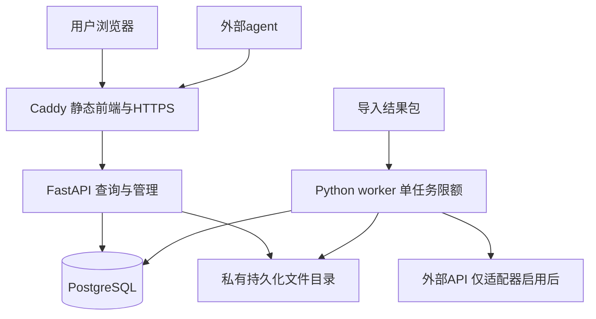

# 在线平台技术栈与部署决策 v0.1

日期：2026-11-12。架构讨论稿；不是已部署系统，也不是容量或性能测试结论。

## 1. 本轮确定的条件

- 使用者为本人和少量受邀用户，不按公开注册SaaS设计。
- 目标环境为Linux、4核、8～16GB内存，允许Docker部署；实际服务器尚未购买或确定。
- 支持检索全部已导入且声明可搜索的文本、导出当前筛选结果及对应证据；较大明细导出按账号权限和配额开放。
- 用户已确认：入选证据优先保存完整正文，以入选范围和数量控制容量；超长内容可以截断，但搜索、页面与导出必须明确说明。此政策不缩减宏观统计范围。
- “已导入文本”不等于半年全部Reddit原文。原始归档和重计算仍在离线生产线中，在线端不依赖本机。
- API采集与有限分析独立于离线生产线；当前只预留适配契约，不承诺任何外部API已经可用。

## 2. 推荐技术组合

| 层 | 默认选择 | 职责与约束 |
|---|---|---|
| 前端 | React、TypeScript、Vite | 构建静态应用；界面筛选状态可保存到URL |
| 图表 | Apache ECharts | 统一图表组件、图例、联动与交互；按需加载图表模块 |
| 查询与管理后端 | Python、FastAPI | 登记式分析查询、身份与权限、导入/导出管理、机器接口 |
| 数据访问与迁移 | SQLAlchemy、Alembic | 普通业务数据访问及schema迁移；批量导入允许使用数据库原生批处理路径 |
| 在线数据库 | PostgreSQL | 用户、任务、版本、汇总、有限明细、可搜索文本及必要索引 |
| 任务执行 | 独立Python worker、PostgreSQL任务表 | 默认一个较重任务并发；有租约、心跳、重试与幂等 |
| 文件存储 | 单机持久化文件目录，封装存储接口 | 不可变数据包、大文件导出、备份；以后可替换为对象存储 |
| Web入口 | Caddy | 静态资源、反向代理、HTTPS；证据/导出文件不直接公开 |
| 部署 | Docker Compose | 代理、API、worker、数据库四个服务；API与worker复用后端镜像 |
| 离线生产线 | Python、DuckDB、Arrow/Parquet | 单次原档扫描、列式特征、聚合、有限CPU/GPU任务；独立运行环境 |

软件具体版本在实现时选择兼容的稳定版本并锁定；此处不指定未经验证的版本组合。业务依赖与可选GPU依赖分别安装，在线镜像不打包CUDA与模型权重。

初期不引入Redis、Celery、Elasticsearch、ClickHouse、向量数据库、Kubernetes或单机MinIO。它们并非永远不需要，而是目前没有负载证据支持为它们增加常驻资源与维护工作。

## 3. 单机部署与模块关系

公开入口仅代理Web服务；数据库与worker走Compose内部网络。生产数据库使用持久化卷，不放在容器可写层。前端构建在构建环境完成，不在每次线上请求时构建或做服务端渲染。

同一后端代码库按模块组织：auth、catalog、views、queries、evidence、imports、exports、jobs、connectors、storage。模块并非独立微服务；本地生产线与在线后端共享结果契约和规则定义，不共享运行时连接。

## 4. 4核8GB基线与16GB配置

以下是待验证的起始预算，以GiB记内存；容器限制不是实际占用，也不能单靠限制保证性能。

| 服务 | 约8GB主机的起点 | 约16GB主机的起点 |
|---|---|---|
| PostgreSQL容器内存上限 | 2.5GiB | 4GiB |
| API容器内存上限 | 0.75GiB | 1GiB |
| worker容器内存上限 | 1.25GiB | 2GiB |
| Caddy容器内存上限 | 0.125GiB | 0.25GiB |
| 其余内存 | 留给系统、缓存与运行余量 | 留给系统、缓存与运行余量 |

API先运行一个Uvicorn进程；数据库查询与网络I/O为主，不按4核机械启动4份进程。worker初始最多约1核CPU，一个较重任务；导入、批量导出、API分析互相排队。数据库可能并行用CPU，仍需实测总峰值。

数据库初始连接池保持小规模；各进程连接数合计预算，避免为API/worker各开一个大池。数据库work_mem、索引创建内存和临时文件上限按实际容器限制配置，不把单查询内存参数误认为全数据库总内存上限。

8GB作为设计验证基线；16GB主要增加缓存、索引与导入余量。服务器磁盘容量、I/O性能及导入结果规模尚未知，因此不能承诺该规格可承载任意数量的明细或任意搜索范围。本地可扩展至350GB的空间不等于服务器空间预算。

## 5. 数据在数据库和文件之间的边界

数据库保存：账户与偏好、维度与指标目录、发布版本、任务、常用汇总、白名单明细、证据映射、可搜索文本。用于搜索的文本放数据库并建索引；不能一方面把文本只留在未索引文件，一方面承诺全量在线搜索。

文件保存：完整发布包、较大预导出表、任务导出文件和可选的大段上下文。数据库保存文件定位、摘要、权限范围及版本；小片段可直接入库以减少细碎文件。保持规范文本实体单份，使用稀疏映射关联多个视图，不为每张卡片复制同一全文。

内部离线core、完整特征库、临时向量和未采用候选不默认上传。需要进入在线明细的字段，由分析视图和搜索范围决定。

数据库容量估算需要包括表、索引、WAL峰值、导入暂存、旧版本及备份。发布包压缩后大小不能直接当数据库占用。更新时若保留旧release，需计入共存峰值。

## 6. 文本搜索的功能与计算边界

默认优先支持英文文本词项搜索、指定字段过滤、排序及分页。使用PostgreSQL全文检索和GIN索引，不为每次请求执行全文LIKE扫描；索引建立是导入成本的一部分。[S1]

搜索必须同时返回searchable_corpus_id、release、语言配置、覆盖范围、结果截断状态。图表筛选与证据搜索使用相同范围定义，但搜索结果不自动变成已预计算历史指标：找到某词的100条证据不代表能得出该词在全站的月度趋势。

词项匹配、短语匹配、品牌精确别名、任意子串、拼写模糊是不同功能。默认只开放有适合索引路径的功能；中文/其他语言在分词方案明确前不承诺与英文等价。短词、停用词与纯符号型号需要专门处理，不通过强制退回无界全表扫描解决。

默认先缩小数据集/期间，再搜索；限制查询长度与复杂度。大结果使用游标分页，不反复深OFFSET。跨页固定release及排序键，避免中途发布新版本造成遗漏或重复。

搜索精确总数不是每次必算；超过预算可返回unknown或明确的估计。相关性排序不承诺任意超大结果集即时完成。

## 7. 受邀用户、偏好与agent权限

初始角色：管理员、受邀读者。管理员发布数据、管理用户、配置API来源与配额；读者查询、保存关注、按权限导出。首期共享同一发布数据范围，个人关注和保存视图隔离，不引入组织/团队多租户模型。

浏览器使用服务端可撤销会话与安全Cookie；写操作处理CSRF。agent使用可撤销、可过期、服务端仅保存摘要的访问令牌；作用域区分catalog/query/evidence/export，不默认授予导入或管理权限。

视图查询、文本搜索、证据接口和下载都执行同一权限校验；不能只保护页面而公开文件链接。优先让导出任务记录归属与到期时间，下载时再次鉴权。

关注词只做目录匹配、规则词项匹配与推荐，不触发任意历史全文重算。推荐使用小表与缓存，解释匹配依据。

## 8. 持久化任务与导出

任务表至少记录kind、owner、input_release、参数指纹、幂等键、status、attempt、not_before、lease_until、heartbeat、checkpoint、结果文件和错误分类。

领取任务使用短事务中的行锁与SKIP LOCKED；提交后执行任务，不在整个下载/导出期间占用行锁。该机制适合队列表使用，不是业务查询一致性的替代品。[S2]

租约过期只代表可重试，不能保证恰好执行一次。执行器与写入操作需要幂等；提交产物使用任务/分片身份和原子发布，防止重试重复导入。API写入按来源原生ID和观测版本去重；重试错误区分限流、网络、认证和数据异常。

小结果直接JSON或CSV；大结果创建后台任务，流式从数据库/已有文件读取并写出，不在Python列表中累计全部数据。CSV附元数据，JSONL/Parquet用于大明细，Markdown为模板简报。导出同时受最大行数、字节、耗时、并发、用户额度及保留时间限制；具体数值用结果规模和实测确定。

交互响应上限约5000行不代表导出也只能5000行。导出额度较大，但同样不允许任意SQL、原始归档请求或绕开查询权限。相同release与参数可复用已生成且权限相容的导出。

## 9. 发布、回滚与备份

导入在staging中批量校验/入库，建立必要索引并更新统计信息，再原子切换current_release。导入时保留旧版本可查询；worker配额控制索引创建和写入对交互的影响，必要时安排维护窗口。

全部文件写入并校验完成后数据库才能引用它们；文件采用不可变版本路径。发布事务同时更新指标、字典、证据可用性和能力状态，缓存键包含release。回滚切换到仍完整保留的旧release，不声称任何已清理版本都可恢复。

备份覆盖数据库和被引用文件；备份必须能离开这台服务器，不能只依赖本地历史分析电脑。备份后可恢复的release必须同时具有数据库元数据与全部引用文件；恢复演练验证两者一致。导出临时文件可按TTL清理，当前/保留release文件不得被普通缓存清理删除。

基本可观测性记录请求耗时、慢查询、任务状态、导入行数、错误、磁盘与内存水位。先使用结构化日志和管理看板，不默认部署完整监控集群。

## 10. 下一步应编制的具体设计

技术方向可按本文固定，仍需细化的重点是数据库实体与导入字段：

1. 分析视图目录如何映射到M表，哪些筛选有对应分母与索引。
2. 哪些候选文本进入服务器，以及搜索索引预计大小。
3. release、partition、内容、证据、标签、视图映射的主键和外键。
4. 9月首包和后续补月包的append/replace/relation_patch事务边界。
5. 查询、搜索、证据、导出接口的请求/响应schema。

这些是同一架构的细化，不要求拆成大量开发阶段。API供应商和GPU模型可以晚于这些契约确定，不阻塞平台核心设计。

## 参考

- [S1 PostgreSQL 官方全文搜索索引说明](https://www.postgresql.org/docs/current/textsearch-indexes.html)
- [S2 PostgreSQL SELECT 与锁定说明](https://www.postgresql.org/docs/current/sql-select.html)
- [Docker Compose 网络](https://docs.docker.com/compose/how-tos/networking/)
- [FastAPI 多进程部署](https://fastapi.tiangolo.com/deployment/server-workers/)
- [Caddy 自动HTTPS及适用条件](https://caddyserver.com/docs/automatic-https)

技术组合和内存预算属于本项目建议；来源不构成本项目已经达到性能目标的证明。
