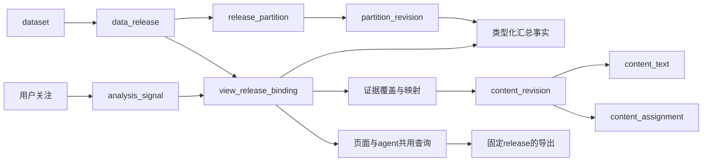

# 服务端数据模型与查询方案 v0.1

日期：2026-11-12。方案建议与利弊分析；未实施DDL、接口或性能测试。本文件细化已确认的4核8～16GB、小范围受邀使用、预计算为主、有限查询、独立API链路。

## 1. 本轮推荐结论

使用“类型明确的分析汇总表＋有限规范化明细＋可搜索文本＋版本化分析目录”。

不把所有指标塞进一个万能JSON表，不把每个图表保存成一份独立数据副本，也不把本地全量特征库搬入在线数据库。核心是既能便宜地查询，又能解释每个数字的范围和分母。

逻辑模型先确定字段职责、粒度和约束；物理分区、索引及容量按9月输出再细化。下文表名是建议，尚未创建。

## 2. 三种主存储方案

| 方案 | 优点 | 代价与限制 | 适用判断 |
|---|---|---|---|
| A：每视图一份静态JSON/Parquet | 服务端计算低，缓存和下载简单 | 数据重复；组合筛选受限；指标口径分散；跨月修订可能产生大量文件 | 用于固定首页卡片、静态快照与预导出 |
| B：通用属性/指标大表，字段和值尽量动态 | 增加字段看似方便，通用接口简单 | 类型/分母/索引难约束；多标签连接容易放大；查询与统计更难审核 | 只用于低频扩展属性和目录元数据 |
| C：有限类型化事实表＋目录配置＋证据层 | 粒度和分母明确，索引可设计，数据复用好 | 需要预先定义分析族；新统计粒度可能需改schema和产物 | 推荐作为主架构 |

JSONB支持索引和灵活结构，但这不意味着把高频分析维度、计数和分母全做成JSON会自动高效。采用类型化列是本项目的可维护性选择。[S1]

## 3. 从用户路径反推数据

以“用户关注某家电主题，查看品牌与可靠性问题”为说明，不代表真实分析结果。

1. 用户关注主题/品牌/词项：读取catalog，保存到个人watchlist，不读取历史正文。
2. 首页匹配analysis_signal：只从当前release的合格候选选择，记录推荐原因和目标视图。
3. 打开品牌问题视图：读取注册视图的汇总表，返回分子、分母、率、口径和覆盖。
4. 用户增加社区过滤：若当前汇总存在社区粒度与兼容分母，则查询；否则根据有限完整明细做允许的查询，或明确不支持该组合。
5. 点击某个单元格：查询证据映射/已导入匹配明细；显示匹配总量和可展示证据量的区别。
6. agent导出：复用同一view_id、release_id、参数与权限；大导出固定release，后台分页生成。

不因同一图上有筛选控件，就默认任意组合都有正确数据；不将“搜索出的文本”临时拼成全历史预计算指标。

## 4. 六类逻辑实体

### 4.1 来源、批次与发布

| 表 | 关键字段 | 作用 |
|---|---|---|
| dataset | dataset_id、platform、source_kind、coverage_policy | 区分离线归档、API及未来平台数据集 |
| import_batch | batch_id、source_digest、producer/config版本、时间范围、status | 跟踪传入数据包，幂等和审计 |
| partition_revision | revision_id、dataset、logical_partition_key、内容摘要、行数、状态 | 一份不可变数据分区或产物版本 |
| data_release | release_id、dataset、parent_release、规则/词典版本、status | 一套对外一致可读的数据状态 |
| release_partition | release_id、logical_partition_key、revision_id | 声明该发布使用哪个分区版本 |
| capability_coverage | release、view/metric、scope、状态、限制与样本政策 | 判断能力是否可用与覆盖多少 |

batch是“送来一包数据”，release是“对外可见的一套结果”，二者不等同。一个release可以复用多个旧分区并新增/替换少量分区。

分区revision既可以是月度活动事实，也可以是线程关系、半年信号等产物；不将所有修订强行绑定事件月份。release引用必要产物的完整集合后才发布。

### 4.2 维度与规则目录

| 表 | 关键字段 | 作用 |
|---|---|---|
| topic、topic_revision | 稳定ID、版本、parent、名称 | 主题树；父级归属变更需要版本 |
| entity、entity_alias | 稳定实体ID、类型、规范名、别名、适用范围、规则版本 | 品牌、产品、型号及去歧义 |
| community | platform、native_id/name、名称版本 | 平台上的社区/频道，不混用平台身份 |
| issue、intent、rule_definition | 稳定ID、名称、行业适用范围、定义与版本 | 问题/阶段标签及识别依据 |
| metric_definition | ID、单位、粒度、分子、分母、合并规则、近似说明 | 同时供页面和agent解释指标 |

主题归属、别名与规则版本可变；实体身份不因显示名改变而改变。新字典版本不能让旧数值悄悄获得新的解释。按父主题合并时需判断子类是否互斥；多标签子类不能简单相加得到父主题的独立文档数。

### 4.3 分析汇总事实

第一批物理表按分析族设计，对应现有M表：

| 表族 | 必要粒度示例 | 指标 |
|---|---|---|
| activity_day | revision × 日期 × community × kind | 内容数、状态数、互动sum/count |
| topic_day | revision × 日期 × topic × assignment_basis × kind | 主题文档数、有效基线 |
| entity_day | revision × 日期 × scope × entity × kind | 品牌/型号文档数及有效基线 |
| entity_issue_day | revision × 日期 × scope × entity × issue × kind | 同文共现、局部绑定、歧义计数 |
| entity_denominator_day | revision × 日期 × scope × entity × kind × eligibility_profile | 符合问题分析条件的实体文档数 |
| intent_day、distribution_bin | 各自固定粒度 | 意图线索与分布，不强塞入同一大表 |
| thread_summary | relation_revision × root ID | 可见回复、缺失、树摘要、时延 |
| analysis_signal | signal_revision × window × scope × signal ID | 推荐资格、数值、依据、目标视图 |

row粒度中未包含community的表，不能支持任意社区过滤。只为确有需要的视图增加含community的事实变体；不默认给所有表增加全部维度。

分母可以存入同粒度事实，也可以像上面那样单独存表；本设计优先把跨多个issue复用的实体分母单独保存。查询先对分子和分母分别按目标粒度归并，再一对一连接，不能在issue展开后重复累加分母。

### 4.4 有限内容、标签与文本

| 表 | 关键字段 | 作用 |
|---|---|---|
| content_identity | content_id、platform、kind、native_id | 跨批次稳定身份，原生ID通常只在平台/kind范围内唯一 |
| content_revision | revision ID、content ID、created/observed、community、文本状态 | 区分同一内容的不同时点与文本版本 |
| content_text | content revision、语言、title/body、search_vector、截断说明 | 搜索和证据读取；规范文本仅存一份 |
| content_assignment | content revision、标签类型/ID、规则、命中依据 | 导入内容的主题/实体/问题/意图标签 |
| content_relation | relation revision、child、parent/root、关系类型、缺失状态 | 已保留关系；不默认导入所有原始边 |

content_revision的observed_at是来源观测时间，不是导入服务器的时间；二者分别记录。一个内容可多次观测，但某一统计口径只能选定规范观测或明确计为多个观测，不得重复算成多个内容。

全文只针对选择进入服务器的内容保留。过长文本如果截断，必须在搜索覆盖和证据响应中表明；不能仍宣称搜索完整原文。多语言索引分别声明支持状态。

已确认的保留原则：用户同意优先保存入选内容的完整正文，通过入选范围和数量控制容量；超长内容再明确截断。命中片段是完整正文上的展示派生，不默认作为唯一留存文本。此决定不缩减宏观统计范围，也不表示全部统计贡献内容都入选。具体入选配额、长度阈值和上下文范围尚待制定与实测。

文本至少记录original_length、retained_length、is_truncated、truncation_policy、text_hash和语言。发生截断时，搜索仅覆盖保留部分；页面与agent响应均说明，导出不得将截断正文标作完整原文。相同规范文本通过内容版本复用，避免每个视图重复保存。

### 4.5 证据覆盖与映射

| 表 | 关键字段 | 作用 |
|---|---|---|
| evidence_group | ID、release、scope/window、选择政策、总匹配量、保留量 | 声明某个结果的证据范围 |
| evidence_membership | group、content revision、匹配类型、rank、snippet/span、context状态 | 关联到同一份规范文本 |
| evidence_group_coverage | group、支持筛选、完整性、采样/截断状态 | 阻止超出证据覆盖的承诺 |

不为每个任意查询生成永久evidence_group。预设结果可有精选证据组；任意受限过滤从已有内容标签查询，响应明确“当前保留语料中的匹配”，不能假设它覆盖全部统计贡献文档。

选择两种证据模式并存：

- curated_examples：保留有预算的分层示例，适合宏观视图。能解释结果，但不能导出全部贡献内容。
- retained_complete：某个声明scope内匹配内容与必要标签完整保留，可以在该scope内搜索/筛选/导出全部匹配。完整性只对该scope成立。

如果图表的完整统计量是N，而可查看的证据是K，明确返回N与K、各自覆盖条件。任意筛选后没有精选示例，应显示“当前未保留匹配证据”，不能把图表数值改成0。

### 4.6 视图、偏好与导出

| 表 | 作用 |
|---|---|
| analysis_view | 稳定view_id、图表和接口输入规范、允许的metric/dimension/filter、查询实现ID |
| view_release_binding | 在某release上绑定到哪些事实revision、分母、证据模式及可用条件 |
| user_watchlist、saved_view | 用户关注及保存的参数，引用稳定目录ID |
| job、export_artifact | 参数、固定release、用户、配额、状态、产物摘要和过期时间 |

analysis_view不允许管理员上传任意SQL文本直接执行。可配置展示、白名单参数和指标映射，查询实现仍在受版本控制的后端代码中。

## 5. 核心关系

## 6. 分母与多标签是正确性的关键

示例仅用于说明：某品牌1200份符合条件内容中有100份命中可靠性问题规则，则候选提及率为100/1200，约8.33%。这里1200必须与100具有相同期间、社区范围、kind、语言、内容状态与规则可处理条件。

它不等于：100/所有Reddit内容、100/所有问题词命中次数、100/已精选证据数量，也不是实际故障率。

同一内容多次提到品牌，只计一份品牌文档；多个问题可各命中一次。因此“可靠性100＋兼容性80”不能推断共有180份有问题内容。需要“任意问题文档数”时，离线另算去重并集；不能从边际汇总还原集合交集。

多品牌同文允许进入多个品牌讨论组；跨品牌总计若要独立内容数，也必须单独预计算。率比较同时返回分子分母，不只返回百分比。零分母返回null/insufficient_data。

跨日文档计数在内容按创建日期唯一归属且无重复时可累加；跨社区同文ID是否能重复由来源模型决定。作者数、根帖子数、分位数与近重复组数继续执行各自合并契约。

## 7. 查询路径与利弊

| 查询类型 | 路径 | 优点 | 限制 |
|---|---|---|---|
| 固定视图 | 直接读取/归并少量汇总行 | 最稳定、省资源，便于缓存 | 新维度需对应汇总 |
| 受限交叉 | 白名单事实变体，或已验证范围的完整明细 | 有分析自由度 | 明细越多，索引与查询成本越高 |
| 文本搜索 | 搜索content_text索引后连接允许的过滤 | 证据可发现、agent可读 | 覆盖仅限保留文本，不是全量趋势引擎 |
| 证据下钻 | group映射或保留明细中的标签匹配 | 可追溯 | 精选组不能保证每个过滤都有例子 |
| 大导出 | worker固定release分页/流式写文件 | 可控内存、可重试 | 有等待、配额与文件有效期 |

在线筛选不得静默忽略不支持的维度。API返回unsupported_combination和支持组合；页面预先禁用或说明。大结果可以返回有限预览，但截断状态必须可见。

只有保留明细在对应scope中完整且查询预算允许时，才能把明细聚合用作准确统计的备用路径；精选样本不作为全量图表计算来源。

## 8. 发布版本三种方案

| 方案 | 优点 | 代价 | 建议 |
|---|---|---|---|
| 原地覆盖 | 结构简单、磁盘少 | 更新中可能混合口径；旧导出无法复现；回滚困难 | 不作为正式发布方式 |
| 每release复制全部数据 | 版本直观、隔离强 | 新增5个月或小修订都复制旧数据，存储放大 | 小型静态目录可用，大事实不采用 |
| 不可变分区revision＋release清单 | 旧数据复用，乱序补月与局部替换清楚 | 增加清单、引用管理和清理逻辑 | 推荐 |

release_1引用9月分区；release_2引用同一9月活动分区＋新增4～8月分区，并引用重算后的关系/信号revision。若9月活动计数未变，则不用复制或重算；缺根关系改变只修订相应关系产物。

查询开始固定release，不在分页中途自动切换。旧release的查询/导出只在其引用产物仍被保留时承诺复现；过期后明确返回release_expired。新发布不代表必须无限保留所有历史版本。

逻辑分区revision不等于PostgreSQL物理分区。可先在普通表中用revision_id区分；大事实再按查询与数据量考虑月分区，不为每个微小revision创建物理分区。分区裁剪与批量维护有收益，但分区并非越多越好。[S2]

## 9. 汇总表还是数据库物化视图

推荐历史分析结果使用离线产出的普通汇总表；本地算好后直接导入。服务器对它们做有限小表归并与读取。

PostgreSQL物化视图可以持久保存查询结果，但刷新依赖服务器重新执行定义查询。[S3] 对需要本地原始特征或昂贵连接的历史分析，不采用服务器REFRESH作为默认机制。对小型API数据或很小的目录汇总，可以单独评估物化视图。

同一分析视图可对应多种图形展示，图表配置与统计事实分离；折线变柱状不产生一份新的事实副本。

## 10. 9月与补月的导入策略

1. 校验manifest、输入身份、schema、版本兼容性、分区行数及引用文件。
2. 流式把Parquet转为数据库可接受的批次输入，采用COPY等批量路径写staging，不逐条ORM插入。PostgreSQL官方将COPY列为大量数据加载的优先方式。[S4]
3. 验证主键、必要外键、分子分母范围、候选覆盖与统计状态；建立必要索引、更新统计信息。大表约束与发布检查不能仅靠应用假定。
4. 注册新的不可变partition_revision；导入失败的revision不可被current_release引用。
5. 在短事务中发布release清单和视图绑定；不在一笔超长事务里执行整个文件上传、索引创建和发布。
6. 缓存键包含release；完成后旧release按保留政策管理。

补月可能更新“首次观测”、过去比较基线与9月缺根状态；这些变化由新产物显式声明。服务器不扫描全部原文补算。如果缺少某个必需产物，则保持能力不可用，或等待新的结果包。

## 11. 查询与导出的统一响应

建议一个查询请求明确包含：view_id、release_id或current、scope、date_range、dimensions、metrics、filters、sort、page/cursor。

响应包含：resolved_release、metric_definitions、分子/分母、rows、next_cursor、截断状态、approximation、覆盖、规则版本、证据模式、查询指纹。是否返回精确total_rows按查询预算决定，unknown不伪装为0。

export请求引用规范化查询参数与resolved_release。查询指纹包括权限范围、时区、语言、规则口径和排序，不能只哈希用户可见的几个筛选值。图表Top N和完整导出是两种选择，用户显式指定，导出元数据记录是否包含other与长尾。

API数据使用独立dataset和观测时间；只有显式兼容的metric_profile才能比较，不默认合并归档与API，不用API结果偷偷填补历史归档证据缺口。

## 12. 本轮建议保留的取舍

1. 汇总覆盖尽量广；完整在线文本按范围与容量选择。完整分类目录不要求完整原文全部在线。
2. 宏观视图提供分层证据示例；选定scope可提供完整保留语料。无论哪种都显示覆盖，不把示例当全集。
3. 预设分析族用类型化事实表，扩展信息用JSONB；新增主题主要改目录与规则，新增统计粒度可能需要新产物或schema。
4. 不可变revision和release清单承担版本复杂性，换取可复现、乱序增量和回滚；避免给每条事实复制全部release。
5. 暂不追求零等待的任意交叉或任意全文搜索；服务端容量用于已定义的交互和检索。

下一项需要具体编制的是“在线保留与查询覆盖表”：按68项分析条目逐项声明完整统计范围、可查询维度、保留文本/关系范围、证据模式与导出权限。入选证据按已确认的完整正文优先政策保存；按9月实测确定入选条数、字节配额和超长阈值，避免现在凭空承诺保存全部文本或固定压缩比例。

## 参考

- [S1 PostgreSQL JSON与JSONB类型](https://www.postgresql.org/docs/current/datatype-json.html)
- [S2 PostgreSQL表分区](https://www.postgresql.org/docs/current/ddl-partitioning.html)
- [S3 PostgreSQL物化视图](https://www.postgresql.org/docs/current/rules-materializedviews.html)
- [S4 PostgreSQL批量加载](https://www.postgresql.org/docs/current/populate.html)

表结构、发布方案与路径取舍是本项目建议；上述来源不代表已测试本项目的容量或性能。
