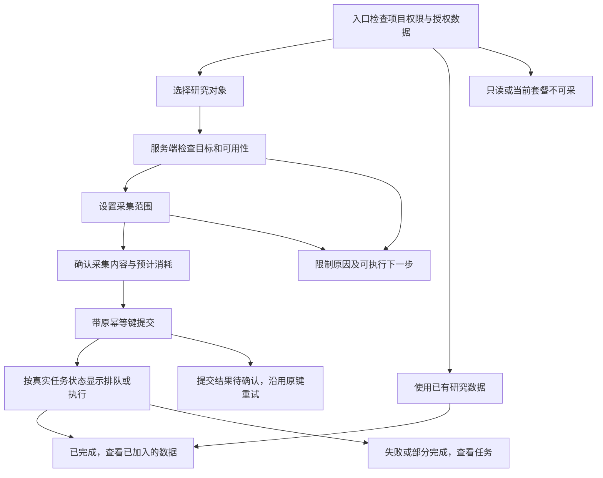

# PR30 第二轮工作台 UX 审计与交互设计

基线为 PR30 1e6e780。原图来自任务目录“第二轮截图”，文件按 1.png 至 6.png 编号；前次任务包的 viewer_intake_preview、admin_research_preview、admin_feed_preview 为原型参考。原图的项目抬头来自较早实现，1e6e780 已移除固定运行徽标。本轮继续收紧接入视图，仅呈现任务相关信息。

| 原图 | 使用者、决策和中断 | 真实接口与改后设计 |
| --- | --- | --- |
| 1 首次接入 | 研究者想为项目添加数据。两张同权按钮将空项目带向未知库存 | 项目批次、近期项目任务与授权研究数据并行读取。只有确有可添加的数据才显示入口；主操作为开始采集。 |
| 2 目标填写 | 用户先填平台、目标类型、范围与数量。资源限制与登记状态尚不可知 | 先列当前账号可选对象；其他目标经服务端检查。进入范围后显示服务端约束和评论能力。 |
| 3 已有数据空态 | 用户进入可预知的空清单，最终只能退出 | 获取项目范围内可添加的研究数据。加载、失败与确实为空各有反馈，数量和最近时间从接口获取。 |
| 4 目标不支持 | 用户已完成范围填写，却在消耗确认页才发现拦截 | 检查发生在选目标时。负责人可带目标去配置来源，Viewer 可更换目标或联系管理员。阻断不显示确认控件。 |
| 5 研究源失败 | 运维要确认是否可采及如何恢复，英文 failed 藏在多块指标和四个局部视图中 | 目录仅保留搜索、单一状态筛选与折叠筛选；右侧以可用性和最近运行开头，后接自动采集、关联项目及诊断。 |
| 6 资讯推送源 | 内容运营要检查最新文章和推送记录，被订阅抓取术语及 UTC 空值干扰 | 文章列表及新鲜度在前，后接接入与更新。拉取才出现预览、抓取及计划，推送显示接入说明和记录。 |

## 研究接入状态

确认面只属于可执行结果。未知覆盖、无样本、已保存数据分别表述。服务方消耗按请求和额度展示，不承诺时间或价格。刷新可依任务深链恢复，项目切换隔离草稿。

## 双来源工作台

- 研究来源按目标、健康、运行、自动采集、项目关系组织。失败描述、恢复点和执行入口在同一处，配置与诊断按需展开。
- 资讯来源按频道、最新文章、检查状态、订阅或外部推送组织。主动抓取与外部推送采用不同操作。高频查看和低频配置可独立进入。
- 原型保留纸白内容面、浅绿工作台、选择反馈和资料分组。原型中的示例统计、平权入口和重复标签由真实授权与实际状态决定。原图用于问题对应，隔离浏览器使用固定外部响应复拍验证。

[PR32 兼容与迁移方案](PR30-PR32-INTEGRATION-PLAN.md)
