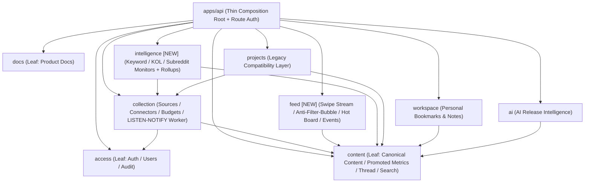

# Backend V2 产品与架构演进蓝图：高价值信息流 × Semrush 级社媒/GEO 监测

> [!NOTE]
> **架构约束时效**：本蓝图撰写于 2026-11-23，文中"9 域严格单向 DAG""业务表跨模块读隔离"是当时的强约束。2026-11-24 治理调整后，`lint:arch` 只强制**零循环依赖、公开门面、`access`/`content` 严格叶子域、单写表归属与凭证表读隔离**；其余依赖方向不设白名单，业务表允许跨模块 `SELECT/JOIN`。现行规则以 [architecture.md](../architecture.md) 与 [invariants.md](../invariants.md) 为准，本文保留原始设计上下文。

> [!IMPORTANT]
> **审批定案与执行决议（2026-11-23）**
> 1. **信源清洗策略**：通过迁移 `061` 归档传统新闻媒体 RSS 及 V2EX 等营销类讨论源（完整保留 `ai_vendor_source` 官方发布源）；高讨论度 L1/L2 信源由维护者在上线后按需精选补充。
> 2. **摘要与意图识别**：先以低复杂度可插拔规则引擎（`src/modules/content/enrich.ts` `heuristic_v1` + `upgradeContentEnrichment` 升级钩子）落地 `clean_excerpt` 与 `intent_tag`，为后续模型升级保留稳定契约。
> 3. **直调 API 预算上限**：X + Reddit 全站直调 API 联合上限校准为 `<= 20,000` 条/天，复用 `collection` 配额与 `estimate -> collect` 预估门禁。
> 4. **前后端分期节奏**：先在 PR #32 收口后端数据结构、9 域边界、算法与 BFF 契约（冻结现有前端 `apps/web/**`），降低后续前端重做复杂度；匿名访客在信息流采用非个性化高价值混排（`hot` + `explore` + `rising`）。

> **文档定位**：本蓝图面向即将重做的前端，先一步完成**后端数据底座、算法引擎、模块边界与 BFF 接口契约**的完整设计。核心目标只有两条：
> 1. **后端高内聚、零耦合、低复杂度（4 GB 单机 PG16 预算）**，延续严格单向 DAG 与单一写归属；
> 2. **前端极简适配** —— 前端每个页面只调用 **1–2 个 BFF 接口**，零 JSONB 解包、零跨平台字段分支、零多接口前端拼装。

---

## 1. 现状根因诊断（基于已核实源码与生产基线）

| 瓶颈维度 | 已观测的源码与生产事实 | 对前端重做与产品体验的直接伤害 |
| :--- | :--- | :--- |
| **采集字段严重丢失** | `src/connectors/reddit/red-crawler.ts` 硬编码 `media: []`；`kaix-content.connector.ts` 仅取单条 `linked` 外链，丢弃 Reddit 缩略图/图集/视频、awards、外部域名与社区信息；`twitterapis.ts` 与 `scrapebadger.ts` 丢弃 `author` 粉丝数/认证/头像/简介及 `entities`（hashtags/mentions） | 信息流只能渲染“纯文字墙/报纸列表”，X 与 Reddit 账号监测无法展示粉丝基数与真实互动率（ER） |
| **强制仅拉 `Latest/new`** | `kaix-content.connector.ts` 硬编码 `sort: "new", time: "all"`；`red-crawler.ts` 硬编码 `search_sort: "new"`；`twitterapis.ts` 与 `scrapebadger.ts` 硬编码 `Latest` | 关键词监测爬回大量零赞噪音帖，浪费付费额度，无法直取高赞/高讨论帖 |
| **热路径指标沉在 JSONB** | 互动指标（`reddit.score`、`x.likes`、`x.views`）只存在 `content_observation.metrics` 历史追加表中；作者与社区仅在 JSONB 内 | 按热度/讨论率排序需逐行 `LATERAL JOIN`，作者主页与 Subreddit 聚合无法走轻量索引 |
| **信源构成严重偏斜** | 线上 99 个活跃分组源中 ~60% 为传统媒体/生活方式 RSS；生产库（2026-11-22 采样）有 3,492 篇 Web 文章，仅 10 条 Reddit 帖、5 条 X 帖 | `stories.ts` 按 `tierWeight * 0.5^(age/24)` 排序，高讨论社区内容被高频新闻 RSS 淹没 |
| **前端编排负担过重** | 前端需自行组合 `/v1/sources`、`/v1/projects`、`/v1/source-jobs`、`/v1/content`、`/v1/content/facets`、`/v1/projects/:id/overview` 等多个底层接口，且需自行区分 `reddit.num_comments` 与 `x.replies` | 前端状态机庞杂、页面易耦合、每加新功能都要大改多处胶水代码 |

---

## 2. 目标 9 域无环架构与数据库所有权边界

保持主线 `Fastify 5 + TypeBox + PostgreSQL 16`（零 ORM、零 Redis/BullMQ、零 Python/Chromium Sidecar），在现有 7 域 DAG 上升级为 **9 域严格单向无环架构**。**所有顶层产品域（`feed`、`intelligence`、`projects`、`workspace`、`ai`）之间严禁相互引用**，全部通过 `.dependency-cruiser.cjs` 与 `scripts/check-table-ownership.ts` 强制门禁。



### 跨模块数据契约铁律

1. **全库唯一内容写入口**：只有 `src/modules/content/index.ts` 的 `commitContentBatch` 可以写入 `content`、`content_discovery`、`content_observation`、`public_content_search_document` 与新增的 `content_author_profile`。
2. **`feed` 与 `intelligence` 绝对解耦**：两者不得相互 `import`；`feed` 只读 `content` 公共门面（只读推荐候选与详情）并独占用户反馈/已读表；`intelligence` 只写监控配置与聚合指标表，并通过 `collection/index.ts` 创建/调度底层采集源（不重复造队列或凭证系统）。
3. **`platform` / `shared` 保持领域无关**：限流、路由鉴权、PG Notify 保持纯粹底层原语。

---

## 3. PostgreSQL 16 前向增量 Schema 设计（迁移 `059`–`061`）

所有新迁移严格前向追加、通过 `Squawk` 锁表检查，并在 4 GB 预算下控制索引膨胀（TTL 清理 + 部分索引）。

### 3.1 Migration `059`：内容增强与热路径标量物化（Owner: `content` / `collection`）

在 `content` 表将高频筛选/排序字段**物化为标量列**（由 `commitContentBatch` 与历史观测追加同一事务内原子更新；同时保留 `content_observation` 作为时序历史台账用于计算增量速度）：

| 新增字段 / 表 | 类型与语义 | 写入方 | 用途 |
| :--- | :--- | :--- | :--- |
| **实体与分类列 (`content`)** | `author_handle TEXT`、`community_name TEXT`、`external_domain TEXT`、`hashtags TEXT[] NOT NULL DEFAULT '{}'`、`has_media BOOLEAN`、`primary_media_url TEXT`、`card_layout TEXT`（`hero_media` \| `quote_social` \| `discussion_thread` \| `link_preview` \| `compact_signal`）、`clean_excerpt TEXT`、`intent_tag TEXT`（`discussion` \| `question` \| `comparison` \| `pain` \| `launch` \| `news`） | `content` (`commitContentBatch`) | 零 `JSONB` 解包直接按社区/作者/外链域名/意图/媒体类型检索，支撑前端直接按卡片视觉模板渲染 |
| **最新标准化指标镜像 (`content`)** | `metric_score INT`、`metric_comments INT`、`metric_views BIGINT`、`metric_likes INT`、`metric_reposts INT`、`metric_bookmarks INT`、`upvote_ratio REAL`、`engagement_score REAL`、`discussion_ratio REAL`、`velocity_score REAL` | `content` (`commitContentBatch`) | 消除列表页 `LATERAL JOIN content_observation`；统一跨平台讨论深度与热度计算口径 |
| **`content` 关键索引** | 部分索引 `(engagement_score DESC, published_at DESC) WHERE availability = 'available'`；`(source_id, community_name, published_at DESC)`；`(source_id, author_handle, published_at DESC)`；`(external_domain) WHERE external_domain IS NOT NULL`；`GIN(hashtags)` | `content` | 毫秒级支撑高赞过滤、KOL 帖子分页、Subreddit 榜单、GEO 外链引用排行 |
| **新表 `content_author_profile`** | 主键 `(platform_id, author_handle)`：`author_external_id`、`display_name`、`avatar_url`、`bio`、`verified BOOLEAN`、`followers_count BIGINT`、`following_count INT`、`statuses_count INT`、`last_seen_at TIMESTAMPTZ`、`metrics_updated_at TIMESTAMPTZ` | `content` (`commitContentBatch`) | 支撑 KOL/高价值账号整合页、头像展示与准确互动率（ER）分母 |
| **`collection_source.feed_lane`** | `TEXT NOT NULL DEFAULT 'discussion' CHECK (feed_lane IN ('discussion','release','monitor_only','news'))` + `quality_grade TEXT` | `collection` | **彻底隔离高讨论信源、专项监控信源与传统新闻 RSS**，确保付费抓取与新闻抓取互不污染 |

### 3.2 Migration `060`：信息流推荐、去重与防茧房状态表（Owner: `feed`）

| 表名 | 核心结构与主键 | 设计要点（防膨胀 & 高性能） |
| :--- | :--- | :--- |
| **`feed_user_seen`** | `(user_id UUID, content_id UUID)` 复合主键 + `seen_at TIMESTAMPTZ` | 每次下拉刷新执行 `NOT EXISTS / ANTI JOIN`，**保证像抖音一样滑走后绝不重复**；后台每 6h 自动清理超过 14 天的记录，表体积恒定 |
| **`feed_user_event`** | `(id BIGSERIAL, user_id, content_id, event_type, dwell_ms INT, created_at)`；唯一防重约束按 `(user_id, content_id, event_type)` | `event_type ∈ ('impression','dwell','open','bookmark','useful','dismiss','mute_source','mute_topic','mute_author')`；仅在前台可视后上报，禁止把网络预取算作阅读；30 天滚动清理 |
| **`feed_user_affinity`** | `(user_id, dim_type, dim_key)` 主键；`weight REAL`、`exposure_count INT`、`positive_count INT`、`negative_count INT`、`updated_at` | `dim_type ∈ ('topic','source','platform','author','community')`；采用 **14 天半衰期指数衰减** 并在写入时钳位在 `[-2.0, +2.0]`，同时记录 `exposure_count` 给探索惩罚/奖励使用 |
| **`feed_user_preference`** | `(user_id PK, explore_ratio REAL DEFAULT 0.20, followed_topics TEXT[], muted_sources UUID[], muted_keywords TEXT[], muted_authors TEXT[], updated_at)` | 显式兴趣控制与自由调节探索比例（破茧滑块 0%–50%） |

### 3.3 Migration `061`：Semrush 级社媒/GEO 监测与预聚合表（Owner: `intelligence`）

借鉴 `umami-software/umami` 时序预聚合表思想（在 PG16 内跑通，不引入 ClickHouse）：

| 表名 | 核心结构与主键 | 设计要点 |
| :--- | :--- | :--- |
| **`intel_monitor`** | `id UUID PK`, `owner_user_id UUID`, `kind CHECK ('keyword','author_list','community_bundle')`, `name TEXT`, `config JSONB`（关键词、竞品词、最低赞/评门槛、账号列表、板块列表、平台集合）, `revision INT` | 三大产品场景（关键词监测 / 高价值用户监测 / 板块全量监测）统一模型，配置版本乐观锁控制 |
| **`intel_monitor_source`** | `(monitor_id, collection_source_id)` 复合主键，`role TEXT`（`primary` \| `competitor` \| `bundle_member`） | **100% 复用 `collection` 域调度与配额器**，不自建第二套爬虫队列 |
| **`intel_monitor_target`** | `(id UUID, monitor_id, target_kind CHECK ('keyword','competitor_keyword','author','subreddit'), target_value TEXT, platform, meta JSONB)` | 结构化拆分关键词与竞品词，直接生成多关键词声量占比（SoV）对比矩阵 |
| **`intel_rollup_bucket`** | `(bucket_at TIMESTAMPTZ, bucket_size CHECK ('6h','1d'), scope_kind CHECK ('monitor','keyword','author','subreddit'), scope_id TEXT, platform)` 主键；包含 `post_count`, `comment_count`, `unique_authors`, `sum_score`, `sum_comments`, `sum_views`, `sum_likes`, `avg_engagement_rate`, `intent_counts JSONB`, `top_domains JSONB`, `top_terms JSONB` | **核心提速表**：采集任务完成事件或每 5 分钟增量重算当前活跃分桶，DashBoard 趋势图/对比矩阵查询稳定 **< 15 ms** |

---

## 4. 板块一深化设计：高价值讨论流、破茧推荐算法与综合热榜

参考 `xai-org/x-algorithm` (`FairShareRankingFilter` + `PageRlExplorationScorer` + `PopularTopicsAuthorDedupFilter`)、`gorse-io/gorse` 与 `RSSNext/Folo`：

### 4.1 信源清洗与高讨论 L1/L2 扩源

1. **信源车道重构**：现有传统新闻类 RSS（如通用媒体、日常资讯）标记为 `feed_lane = 'news'`，**默认不进入信息流主卡片池**（可选保留在“新闻档案”开关中）；默认刷流只从 `discussion` 与 `release` 车道取样。
2. **零成本/低成本高讨论源扩充**：
   - **L1（\$0）**：Hacker News（Frontpage / Best / Show HN / Ask HN，原生带分数与评论数）、Reddit 高价值技术/AI/创业/产品社区 `.rss`（作全量轻量雷达，命中高讨论后按需触发评论补采）、Lobsters、~~V2EX 热议~~（已按 2026-11-23 决议剔除 V2EX 等营销类源）、GitHub Trending & Discussions、HuggingFace Papers、Bluesky 科技流。
   - **L2（付费受控）**：X 核心高价值 KOL 账号继续按 15–20 人拼装一条 `from:u1 OR from:u2` 批次查询（较单号轮询节省 ~95% 配额），全部进入 `feed_lane = 'discussion'`。

### 4.2 四池混合 + 破茧重排流水线（`GET /v1/feed/stream`）

每次下拉/上滑拉取 `20` 张卡片，执行严格的四阶段确定性流水线：

1. **Stage 1 · 候选检索（250 条有界池）**：过去 72h 内 `availability = 'available'`、未出现在 `feed_user_seen`、排除用户静音的信源/作者/关键词，仅限 `feed_lane IN ('discussion', 'release')`。
2. **Stage 2 · 多维正交打分（杜绝唯兴趣论）**：
   - `qualityScore`：跨平台百分位归一化互动分 + **讨论密度加权**（评论占比高的深度讨论帖显著高于纯点赞转发帖）+ 信源等级权重 + 完整度/媒体加分。
   - `freshnessDecay`：时间重力衰减 $1 / (\text{ageHours} + 2)^{1.4}$。
   - `affinityScore`：读取 14 天衰减后的用户 `(topic, source, author, community)` 偏好，**严格钳位在 $[-1.5, +2.0]$，绝不允许兴趣分压倒内容本身的高讨论质量分**。
   - `ucbExploreBonus`：针对质量达到平台前 25%（$P_{75}$）但用户**最少接触的话题/源**给予上置信界探索加分：$\sqrt{\ln(N_{\text{total}} + 1) / (N_{\text{topic}} + 1)}$。
3. **Stage 3 · Fair-Share 比例配额（防止回音室锁死，可由用户调探索率 `exploreRatio`）**：
   - **50% 个性化高质池（`affinity`）**：匹配兴趣且经过质量门控的高价值内容；
   - **25% 全网高讨论破圈池（`hot`）**：全平台跨领域高热度讨论，强制让用户知道外部发生什么；
   - **15% 高质量未知探索池（`explore`）**：来自用户平时很少看的社区/领域的 Top 25% 精品内容，附上“跨领域高赞探索”理由；
   - **10% 6h 新锐飙升池（`rising`）**：短时快速爬坡的新讨论，保持社区敏锐度。
4. **Stage 4 · Plackett-Luce 采样 + $O(N \log S)$ 滑动窗口打散**：
   - 在每个配额池的候选头部引入可控温度 $\tau = 0.25$ 的 **Plackett-Luce 随机采样** —— **像抖音一样每次下滑/刷新总有鲜活变化，同时不会把垃圾随机插进来**；
   - 用已在后端就位的滑动窗口去重结构强制约束：**每 10 张卡同一作者 $\le 1$ 篇、每 5 张卡同一信源 $\le 1$ 篇、每 6 张卡同一主题 $\le 2$ 篇、同平台连续不超 3 张**；
   - 每张卡携带可解释 `reason: { channel, label }`（例如 `"r/LocalLLaMA 热议中 · 142 条讨论"` 或 `"探索未知领域 · Dev-Infra 高赞"`）。

### 4.3 跨平台综合热榜（`GET /v1/feed/hot`）

解决过去 Reddit/X/HN/RSS 无法在同一榜单横向比较的问题：
- 平台内先做 `log1p(metric_score + 2 * metric_comments)` 相对过去 7 天基线的 **百分位标准化（`0..100`）**；
- 结合基于 `content_observation` 两次快照差值的 **`velocityScore`（小时级增量爬坡速度）**；
- 叠加 `story-groups.ts` 的 SimHash 多源跨站共振加分（同一话题同时在 HN + Reddit + X 被讨论时热榜权重跃升）；
- 支持按时间窗（`6h | 24h | 48h | 7d`）、平台、主题标签实时切片输出，附带 48h 热度折线 `sparkline` 与精选高赞神评预览 `topCommentsPreview`。

---

## 5. 板块二深化设计：Semrush 级社媒/GEO 智能监测（Reddit & X）

### 5.1 Apify 与 X 采集字段全量清洗与挖掘清单

| 连接器 | 现存字段浪费 | V2 强制提取并入库字段 | 产品直接收益 |
| :--- | :--- | :--- | :--- |
| **`kaix` / `red_crawler` (Reddit)** | `red-crawler` 丢弃所有媒体；两者均硬编码 `sort=new` 且丢弃板块统计、奖励、置顶与媒体画廊 | ① **富媒体提取**：`thumbnail`、`preview.images`、Reddit Gallery 多图、`reddit_video`/`is_video`、外链预览；② **社区与结构字段**：`domain`（外链域名用于 GEO 引用统计）、`is_self`、`stickied`、`num_crossposts`、`all_awardings/total_awards_received`、`author_flair_text`；③ **原生高质排序参数**：支持 `sort: "top" \| "hot" \| "relevance" \| "new"` 与 `time: "hour" \| "day" \| "week" \| "month" \| "year" \| "all"` | 搜索高赞/高评论帖子直出结果，废帖过滤 **>85%**；外链域名直接产出“GEO 品牌/站点被引用排行” |
| **`twitterapis` / `scrapebadger` (X)** | 硬编码 `Latest`；丢弃作者粉丝/头像/认证及推文实体标签 | ① **`content_author_profile` 全量入库**：`followers_count`、`following_count`、`statuses_count`、`isBlueVerified`、`profilePicture`、`description`、`location`；② **语义实体**：`hashtags`、`user_mentions`、`cashtags`、外链展开域名；③ **查询语法自动编译**：自动注入 `min_faves:N`、`min_replies:N`、`-is:retweet` 与 `product="Top"` | **付费 X API 不再为 0 互动垃圾推文买单**；账号监测自动拥有实时粉丝数分母计算 ER，无需额外调粉丝接口 |

### 5.2 三大监控工作流与底层复用架构

所有监测在后端统一抽象为 `intel_monitor`，前端呈现清晰的三入口页面：

1. **关键词 SEO / GEO 监测 (`kind = 'keyword'`)**：
   - 用户输入目标关键词 + 可选竞品关键词（如 `"cursor"` vs `"windsurf"`）及最低高赞/高评阈值；
   - 后端创建/绑定 `collection_source`（设置 `sort='top'` + X `min_faves`/`min_replies`），执行前调用 **Pre-flight 预估费用接口**；
   - **产出图表与洞察**：声量与互动双口径 **Share of Voice (SoV)** 趋势对比、声量飙升 **Velocity** 曲线、内容意图占比（求助提问 `question` / 对比评测 `comparison` / 痛点吐槽 `pain` / 产品发布 `launch`）、**GEO 高频引用外链域名榜（哪些文章/文档/GitHub 仓库正在被 Reddit/X 大量引用从而喂给大模型）**、高频共现词、Top 高讨论原帖+评论树下钻。
2. **高价值用户 / KOL 整合监测 (`kind = 'author_list'`)**：
   - 用户维护关注的一组 Reddit `u/` 或 X `@` 账号名单；
   - 后端在 `collection` 层将每 15–20 个同平台 X 账号**自动打包合并**为一条批量查询源，Reddit 账号采用 `.rss` + 周期 `kaix` 补采；
   - **产出视图**：所有关注账号整合而成的“大 V 动态统一工作台” + 点击任意账号进入 **专属 KOL 画像页**（头像/简介/认证、粉丝量、日均发帖频率、平均互动率 ER、互动走势折线、常驻 Subreddit/话题分布、代表作 Top 榜单）。
3. **板块自动化全量监测 (`kind = 'community_bundle'`)**：
   - 用户勾选一揽子 Subreddit（如 `r/LocalLLaMA`, `r/SaaS`, `r/SEO`, `r/Entrepreneur`）；
   - **高低搭配自动采集**：全量社区新帖用零成本或高性价比批采保持不断流；系统**自动识别**突破该板块 P80 讨论热度的帖子，**自动按预算触发 `red_crawler` / `kaix` 抓取 Top 评论树**；
   - **产出视图**：① **多板块对比象限矩阵（散点图：发帖量 vs 平均互动深度）** 与排名表格；② 单板块深挖视图（热度趋势、Flair 主题分布、最佳发帖时段热力图 Heatmap、板块核心活跃作者榜、高赞高评论精华贴流）。

### 5.3 严谨指标口径与诚实度不变量（零黑盒伪造指标）

| 指标 | 确定性计算公式 | 缺失 / 边界处理规则 |
| :--- | :--- | :--- |
| **X 互动率 (ER)** | $(\text{likes} + 2\cdot\text{replies} + 2\cdot\text{reposts} + 3\cdot\text{bookmarks}) / \max(\text{views} \text{ 或 } \text{followers}, 1)$ | 标注分母口径（`by_views` 还是 `by_followers`）；两者皆缺失返回 `null`，绝不显示 `0%` |
| **Reddit 讨论深度** | $\text{metric\_comments} / \max(\text{metric\_score}, 1)$ 与 $\text{upvote\_ratio}$ | 明确给出原始 `score` 与 `num_comments` |
| **讨论飙升速度 (Velocity)** | 同一内容或话题在当前窗口相对上一等长窗口的提及量或互动增量 $/ \Delta t$ | 前窗无采集覆盖或分母为 `0` 时 `deltaPct = null`（标为 `new` 或 `coverage_gap`），遵守口径一致性红线 |
| **GEO 外链引用占比** | 匹配关键词样本中携带某 `external_domain` 的高讨论贴加权占比 | 区分原文作者引用与评论区高赞引用 |
| **样本覆盖声明** | `{ coverage: "known_sample" \| "partial", sampleSize, windowFrom, windowTo, jobSuccessCount, jobFailedCount }` | 随每个图表总览 DTO 强制下发，前端清晰展示数据边界 |

---

## 6. 极简前端 BFF 接口契约总览（每页 1–2 个请求完成渲染）

### 6.1 信息流域接口 (`/v1/feed/*`)

| 方法与路径 | 鉴权边界 | 核心职责与返回结构 |
| :--- | :--- | :--- |
| `GET /v1/feed/stream` | `public_read` (带 `machineScope: "read"`) | **滑动刷新流核心接口**。Query: `mode=foryou\|hot\|following\|explore`, `topic?`, `platform?`, `limit=20`, `sessionExclude?`。返回 `{ items: FeedCard[], nextCursor, meta: { exploredCount, hotCount, unseenRemaining } }` |
| `GET /v1/feed/hot` | `public_read` (`read`) | **跨平台综合热榜**。Query: `window=6h\|24h\|48h\|7d`, `platform?`, `topic?`, `limit=30`。返回带 `unifiedHeat`、`heatBreakdown`、`sparkline` 与 `topCommentsPreview` 的 `HotBoardItem[]` |
| `POST /v1/feed/events` | `authenticated` (仅浏览器) | 批量上报曝光与行为事件（一次最多 50 条：`impression` \| `dwell` \| `open` \| `bookmark` \| `useful` \| `dismiss` \| `mute_*`），事务内写入去重表并实时轻权重更新 `feed_user_affinity` |
| `GET` / `PATCH /v1/feed/preferences` | `authenticated` (仅浏览器) | 读取/调整用户偏好：破茧探索比例滑块（`exploreRatio: 0..0.5`）、关注主题、屏蔽列表与“重置兴趣” |

#### 视觉化 `FeedCard` 标准化 DTO（前端零数据拼装）

```typescript
interface FeedCard {
  id: string;
  platform: "reddit" | "x" | "web" | "bluesky";
  cardLayout: "hero_media" | "quote_social" | "discussion_thread" | "link_preview" | "compact_signal";
  headline: string;                 // 清洗后的清晰标题或首句要点（X 长帖自动抽取首段金句）
  tldr: string | null;              // 纯净结构化摘要，绝不原样抛出脏 Markdown/HTML 文本墙
  media: Array<{ type: "image" | "video" | "link"; url: string; previewUrl: string | null; domain?: string | null }>;
  discussion: {
    score: number | null;
    comments: number | null;
    views: number | null;
    upvoteRatio: number | null;
    unifiedHeat: number;            // 0..100 跨平台统一热度刻度
    heatVelocity: "surging" | "rising" | "steady";
  };
  author: { handle: string; displayName: string | null; avatarUrl: string | null; verified: boolean; followersCount: number | null } | null;
  source: { id: string; label: string; community: string | null; flair: string | null; lane: string };
  topCommentsPreview: Array<{ author: string; text: string; score: number | null }>; // 提前随主卡下发 1–2 条神评，无需再查详情
  tags: string[];
  intentTag: string | null;
  publishedAt: string | null;
  reason: { channel: "affinity" | "hot" | "explore" | "rising" | "following"; label: string };
  viewerState: { bookmarked: boolean; useful: boolean };
}
```

### 6.2 社媒/GEO 智能监测域接口 (`/v1/intelligence/*`)

| 方法与路径 | 鉴权边界 | 解决的前端痛点 |
| :--- | :--- | :--- |
| `GET` / `POST /v1/intelligence/monitors` | `authenticated` / `viewer_write` | 一键新建“关键词追踪”、“KOL 账号组”或“一揽子 Subreddit 监控”，自动编排/复用底层 `collection_source` |
| `GET` / `PATCH` / `DELETE /v1/intelligence/monitors/:id` | `authenticated` / `viewer_write` | 监控详情、修改关键词/阈值/账号/板块集合、删除监控（乐观锁 `revision`） |
| `POST /v1/intelligence/monitors/:id/estimate` & `.../collect` | `viewer_write` (`Idempotency-Key`) | **先估价、再付费抓取**；触发高赞/多评论模式采集并直接返回任务追踪 ID |
| `GET /v1/intelligence/monitors/:id/overview` | `authenticated` (`read`) | **单请求拉齐 Semrush 仪表盘全套图表**：KPI + 环比增量、时间序列折线、SoV 对比、意图分布饼图、GEO 外链引用 Domain 排行、共现热词、样本覆盖声明 |
| `GET /v1/intelligence/monitors/:id/posts` | `authenticated` (`read`) | 监控下的高价值帖子下钻（按 `unifiedHeat \| score \| comments \| er \| newest` 排序，直接支持回跳线程评论树） |
| `GET /v1/intelligence/authors` & `.../authors/:platform/:handle` | `authenticated` (`read`) | **高价值账号聚合中枢** + **单个 KOL 深度主页**（粉丝、ER、发帖频率、活跃社区矩阵与历史代表作） |
| `GET /v1/intelligence/communities` & `.../communities/:subreddit` | `authenticated` (`read`) | **一揽子 Subreddit 对比象限表** + **单板块深度分析**（趋势、Flair 占比、发帖时段 7×24 热力图、高赞精华帖流） |

---

## 7. 增量交付切片（5 个独立可验收纵向 PR）

| 切片 | 范围与迁移 | 验收门槛 |
| :--- | :--- | :--- |
| **Slice 1 · 连接器富化 + 标量底座** | 升级 `red_crawler`/`kaix`/`twitterapis`/`scrapebadger`（提取富媒体、作者粉丝/头像、实体标签与 `Top`/`min_faves` 排序）；落地 Migration `059`（`content` 热路径列与 `content_author_profile`） | 连接器单测、PG16 回滚测试、`commitContentBatch` 幂等与触发器耗时达标 |
| **Slice 2 · Pillar 1 信息流推荐与热榜** | 新建 `src/modules/feed/`；落地 Migration `060`；信源 `feed_lane` 清洗；4 池破茧推荐与 `/v1/feed/{stream,hot,events,preferences}` | DAG 零违规、滑刷不重复 PG16 集成测试、防茧房多样性数学单测、OpenAPI 100% 声明鉴权 |
| **Slice 3 · Pillar 2 监测底座与预聚合引擎** | 新建 `src/modules/intelligence/`；落地 Migration `061`；实现 `intel_rollup_bucket` 增量计算与费用预估门禁 | 单writer表归属全过、高并发配额不超发、`overview` < 15ms 压测 |
| **Slice 4 · Semrush 三场景 BFF 全面落地** | 完成关键词 SoV/GEO 引用、KOL 批量整合（15–20 号打包）与 Subreddit 矩阵热力图全接口与完整 OpenAPI 契约 | 100% 覆盖 PG16 集成测试 + 前端零 JSONB 直出契约验证 |
| **Slice 5 · 前端重做对接与兼容收口** | 基于干净的 `/v1/feed/*` 与 `/v1/intelligence/*` 重做前端 UI/UX；视需要收缩/归档旧 `/v1/projects/*` 冗余端点 | 全链路端到端 Playwright/API 验收、4 GB 单机容器压测绿灯 |

---

## 8. 实施对齐与当前收口状态

Backend V2 已合入，接口边界、候选修复与待办事项由[当前状态与路线](../status.md#2-v2-已合入的集成边界)跟踪。迁移 `062` 为 Feed 收藏与有用反馈增加了数据库去重约束。
