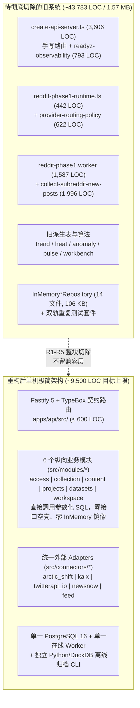
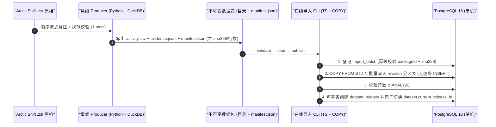

# `reddit-monitoring-mvp` (`main@7045185`) 深度文档审查、源码尸检与单机极简高性能重构蓝图

> [!IMPORTANT]
> **核心结论（Verdict First）**：`main@7045185` 的 8 份新规范文档（[docs/README.md](file:///e:/vibe%20coding/reddit-monitoring-mvp-local/docs/README.md)、[docs/architecture.md](file:///e:/vibe%20coding/reddit-monitoring-mvp-local/docs/architecture.md)、[docs/contracts.md](file:///e:/vibe%20coding/reddit-monitoring-mvp-local/docs/contracts.md) 等）已经正确完成了**产品定位收敛**（从“Reddit 单平台爬虫+热榜打分大杂烩”转向“类 Semrush 项目化多源信息监测 + 离线历史归档工作台”），并识别了旧 `Phase1 / Markets / TargetWorkbench` 的表层肥胖。
> **但实码交叉审计（`code-map` + `arch-audit`）暴露了一个致命盲区**：文档在 [docs/plans/source-expansion.md](file:///e:/vibe%20coding/reddit-monitoring-mvp-local/docs/plans/source-expansion.md#L18-L21) 中计划“优先复用 / 保留并收敛”的**新公共链路（`SourceContent` / `ResearchExport` / `ContentPersonal`）本身同样深陷“伪精简压行、双轨 In-Memory 仓储、隐藏 N+1/全表重扫、多层防御性深拷贝”四重泥潭**。若不连同新公共层的实现模式一并做减法重构，仅删掉旧 Phase1 并换上 Fastify，系统在 100 万级内容（`ARC-13` 验证目标）下仍会出现页列表超时、概览 12 次全表扫描、研究快照撑爆 Node 内存的问题。

---

## 1. 现状实码量化尸检（Observed Baseline @ `main@7045185`）

通过 `code-map` 与 `arch-audit` 对全仓 **576 个文件（74,468 LOC，3.34 MB 源码）** 进行结构化扫描，当前代码体积与耦合分布如下：

| 分类 | 文件数 | 行数 (LOC) | 字节数 (Bytes) | 核心诊断与减法处置 |
| :--- | ---: | ---: | ---: | :--- |
| **旧产品链生产代码 (`DELETE_LEGACY_PROD`)** | 91 | 21,335 | 767,318 | [create-api-server.ts](file:///e:/vibe%20coding/reddit-monitoring-mvp-local/apps/api/src/create-api-server.ts) (3,606 LOC)、[collect-subreddit-new-posts.job.ts](file:///e:/vibe%20coding/reddit-monitoring-mvp-local/src/jobs/collect-subreddit-new-posts.job.ts) (1,996 LOC)、[reddit-phase1.worker.ts](file:///e:/vibe%20coding/reddit-monitoring-mvp-local/src/workers/reddit-phase1.worker.ts) (1,587 LOC)、旧 `opossum` 熔断器、Scrapling 桥、热度/异常/脉冲打分、27 个单实现 Repository 接口。**全部删除**。 |
| **旧链路与冗余测试 (`DELETE_BLOAT_TEST`)** | 36 | 15,001 | 511,720 | [api-server-trends.test.ts](file:///e:/vibe%20coding/reddit-monitoring-mvp-local/tests/integration/api-server-trends.test.ts) (2,124 LOC)、[api-server-readyz.test.ts](file:///e:/vibe%20coding/reddit-monitoring-mvp-local/tests/integration/api-server-readyz.test.ts) (2,081 LOC)、[collect-subreddit-new-posts-p0.test.ts](file:///e:/vibe%20coding/reddit-monitoring-mvp-local/tests/integration/collect-subreddit-new-posts-p0.test.ts) (2,052 LOC) 等。**随旧业务一并删除**。 |
| **旧维护/实验脚本 (`DELETE_LEGACY_SCRIPTS`)** | 18 | 4,628 | 169,425 | `*phase1*`、`shadow-compare`、`controlled-promotion`、`prewarm-keyword-query` 等（含 25 处 `NPlusOneAwaitInLoop`）。**全部删除**。 |
| **前端废弃页面 (`WEB_DELETE_LEGACY`)** | 11 | 2,819 | 121,642 | `MarketBoard`、`TargetDetail` (800 LOC)、`Compare`、`Dashboard`、`Queries`、`Phase1RunCard`。**全部删除**。 |
| **拟保留公共核心 (`KEEP_CORE_PROD`)** | 139 | 14,060 | 652,066 | **存在严重“压行伪装”与双轨冗余**：含 14 个 `src/storage/repositories/in-memory/*` (2,185 LOC / **106 KB**) 及压行文件 [postgres-source-content.repository.ts](file:///e:/vibe%20coding/reddit-monitoring-mvp-local/src/storage/repositories/postgres/postgres-source-content.repository.ts) (**305 行却高达 50,868 字节**，单行塞入 8~12 条语句)。**需砍掉 In-Memory 双轨并重写为直白 SQL 模块**。 |
| **拟保留核心测试 (`KEEP_CORE_TEST`)** | 116 | 9,045 | 594,311 | 含 `tests/helpers/*-cases.ts` (58 KB)，将同一套用例在 JS `Map` 与 PG 上重复跑两遍。**砍掉 In-Memory 双跑，仅保留纯函数单测 + 真实 PG 契约集成测试**。 |



---

## 2. 现有“新公共代码”中的 7 个隐蔽架构/性能缺陷（文档未充分揭示）

即便只看 `029`–`040` 迁移之后的公共内容与研究模块，实码中也存在以下违背“最低复杂度、最高性能、不过度防御”原则的问题，必须在 R1/R2 重构时一并根治：

### 2.1 双轨 `InMemory*Repository` 是最大的工程税（106 KB 纯冗余）
- **证据**：[in-memory/source-content.repository.ts](file:///e:/vibe%20coding/reddit-monitoring-mvp-local/src/storage/repositories/in-memory/source-content.repository.ts#L11-L200) 用 29,122 字节的压缩 TS 代码在内存 `Map` 中手工模拟 PostgreSQL 的事务、租约、唯一索引冲突（`23505`）、`SKIP LOCKED`、全文检索和 `REPEATABLE READ` 快照（每次调用都执行 `structuredClone`）。
- **危害**：每改一个 SQL 过滤条件或字段，都要在 JS `Map` 里重写一遍模拟逻辑；而且 JS `Map` 根本测不出 PG 锁顺序死锁、索引失效或类型转换错误。
- **修正（补入 `ARC-02 / ENG-04 / ENG-05`）**：**彻底废除 `SourceContentRepository` / `ContentPersonalRepository` / `ResearchExportRepository` 接口与全部 `src/storage/repositories/in-memory/*` 实现**。模块内部直接暴露接收 `Queryable` (`Pool | PoolClient`) 的 SQL 函数；纯业务规则（如 URL 规范化、版本比较、游标编解码、过滤条件校验）抽成纯函数单测，数据库行为只测真实 PostgreSQL。

### 2.2 压行代码（Code Golfing）伪装成“精简代码”
- **证据**：
  - [postgres-source-content.repository.ts](file:///e:/vibe%20coding/reddit-monitoring-mvp-local/src/storage/repositories/postgres/postgres-source-content.repository.ts#L14-L45)：305 行文件塞了 **50,868 字节**（平均每行 167 字节，多行超 600 字节）。
  - [content-personal.service.ts](file:///e:/vibe%20coding/reddit-monitoring-mvp-local/src/application/services/content-personal.service.ts#L15-L21)：22 行文件塞了 **6,129 字节**（`saveQuery` 单行 820 字符、`saveAnnotation` 单行 890 字符）。
  - [Content.tsx](file:///e:/vibe%20coding/reddit-monitoring-mvp-local/apps/web/src/pages/Content.tsx)：211 行塞了 **39,048 字节**。
- **危害**：将 10 条语句、多层三元表达式硬压成一行，不仅破坏 Git diff 与报错栈定位，还掩盖了重复校验和 N+1 查询。
- **修正**：重构必须减掉**真正的 AST 复杂度与字节数**，禁止通过删换行符压缩行数；统一使用标准格式化与扁平早返回（Guard Clauses）。

### 2.3 每次列表分页与统计都强制全表扫描 `public_content_search_document`
- **证据**：[postgres-source-content.repository.ts](file:///e:/vibe%20coding/reddit-monitoring-mvp-local/src/storage/repositories/postgres/postgres-source-content.repository.ts#L25-L255) 在 `listContent()`（哪怕只查第 1 页 25 条且没有传 `query` 关键词！）中总是先执行：
  ```sql
  WITH coverage AS (
    SELECT COUNT(*)::integer AS candidate_count,
           COUNT(doc.content_id)::integer AS indexed, ...
    FROM content c JOIN source p ON p.id=c.source_id
    LEFT JOIN public_content_search_document doc ON doc.content_id=c.id
    WHERE ...
  )
  ```
- **危害**：当 `content` 达到 `ARC-13` 目标的 **100 万行**时，每次翻页（`limit=25`）都要先对 100 万行做一次 `LEFT JOIN + COUNT(*)`，导致简单翻页从 `<5ms` 退化到 `>500ms`，直接击穿 `P95 ≤ 400ms` 目标。
- **修正**：
  1. 在线页写入（`commitPage`）与归档导入都在同一事务内同步写入检索投影，**“有正文即有投影”是写入不变量**。
  2. 移除 [038_public_content_search_document.sql](file:///e:/vibe%20coding/reddit-monitoring-mvp-local/src/storage/schema/038_public_content_search_document.sql#L9-L17) 中每次 `UPDATE content` 先 `DELETE` 投影再 immediately `INSERT` 投影的触发器（改为写入路径统一 `UPSERT` 投影，消除无谓的 MVCC 死元组膨胀）。
  3. `listContent` 只做 keyset 索引扫描取 `limit + 1` 行，**绝不在分页热路径上跑全表 `COUNT(*)`**。

### 2.4 工作台概览 (`contentWorkbench`) 存在 8~15 次串并联全表重扫，个人注释列表 (`listAnnotations`) 存在 N+1 查询
- **证据 1**：[content-workbench.service.ts](file:///e:/vibe%20coding/reddit-monitoring-mvp-local/src/application/services/content-workbench.service.ts#L9-L13) 先调 1 次 `contentStats(query)`，再对 5 个 `platform` 循环调用 `contentStats({ ...query, platform })`，再对每个 `provider` 循环调用 `contentStats({ ...query, provider })`。打开一次页面触发 **10+ 次全表聚合查询**。
- **证据 2**：[content-personal.service.ts](file:///e:/vibe%20coding/reddit-monitoring-mvp-local/src/application/services/content-personal.service.ts#L21) 在 `listAnnotations()` 中 `for (const annotation of page.annotations) { const content = await this.content.repository.getContent(annotation.contentId); ... }`，每页触发 **1 + N 次 SQL 往返**。
- **修正**：
  - 项目概览（`GET /v1/projects/:id/overview`）用单条 CTE + `GROUPING SETS ((day), (platform), (kind))` 一次性算出总量、未知时间数、日趋势和平台分布（1 次 SQL）。
  - 个人注释列表直接在 SQL 中 `JOIN content c ON c.id = ca.content_id`（1 次 SQL）。

### 2.5 研究快照冻结 (`ResearchExportService.capture`) 三重全扫 + Node 内存 32MiB 全量缓冲 + 内部 SQL 正则自检
- **证据**：[research-export.service.ts](file:///e:/vibe%20coding/reddit-monitoring-mvp-local/src/application/services/research-export.service.ts#L63-L98) 与 [postgres-research-export.repository.ts](file:///e:/vibe%20coding/reddit-monitoring-mvp-local/src/storage/repositories/postgres/postgres-research-export.repository.ts#L16-L31)：
  1. 先跑 `contentStats(query)` 扫第一遍；
  2. 再跑 `researchPayloadPreflight(query)` 在 PG 里把所有匹配行转成 `to_jsonb::text` 算字节数，扫第二遍；
  3. 再用 `limit: 100` 循环 200 次把最多 20,000 行拉到 Node 进程内存里，逐行跑 `canonicalContent()`（`pick` + `structuredClone`），再 `JSON.stringify({ manifest, items })` 算总字节，最后再循环 200 次分批 `INSERT INTO research_export_member`；
  4. [postgres-research-export.repository.ts](file:///e:/vibe%20coding/reddit-monitoring-mvp-local/src/storage/repositories/postgres/postgres-research-export.repository.ts#L18) 甚至给自己傳入的 repository 包了一层正则检查 `if (!/^\s*(SELECT|WITH)\b/i.test(sql)...)` 防自己写错 SQL！
- **修正**：这就是典型的**过度防御 + 极低性能**。在 PostgreSQL `REPEATABLE READ` 事务内，直接用 **1 条 `INSERT INTO research_export_member ... SELECT ... FROM matched_content LIMIT 20001`** 在数据库内部完成快照写入与行数/字节校验，数据根本不需要拉到 Node 内存里走一圈再写回 PG！

### 2.6 `commitPage()` 页内逐条执行 400+ 次 SQL，且 `DAT-04` 版本比较逻辑有漏洞
- **证据**：[postgres-source-content.repository.ts](file:///e:/vibe%20coding/reddit-monitoring-mvp-local/src/storage/repositories/postgres/postgres-source-content.repository.ts#L102-L127)：
  1. `for (const item of ...)` 循环内逐条 `await client.query` 执行：`INSERT INTO content` $\to$ `writePublicSearchDocument` $\to$ `INSERT INTO content_discovery` $\to$ `INSERT INTO content_observation`。100 条/页 = **404 次 SQL 往返**。
  2. `INSERT INTO content ... ON CONFLICT DO UPDATE` 中将一段 180 字符的 `CASE WHEN` 粘贴了 9 遍，且：
     - **缺少 `DAT-04` 要求的 `evidenceKey` 平局决胜（tie-breaker）**：当两条观测的 `sourceObservedAt` 相同时，`>=` 会随到达顺序非确定性覆盖；
     - **违反 `DAT-04`“未知/省略字段不清空已知字段”**：当较新观测未返回 `title` 或 `body_text`（为 `null`）且 `availability = 'available'` 时，当前 SQL 直接用 `EXCLUDED.title` (`NULL`) 覆盖掉已有的 `content.title`。

### 2.7 `listContent()` 偷用 `first_seen_at` 冒充 `publishedAt` 排序，直接违反 `MET-04` 与 `QRY-05`
- **证据**：[postgres-source-content.repository.ts](file:///e:/vibe%20coding/reddit-monitoring-mvp-local/src/storage/repositories/postgres/postgres-source-content.repository.ts#L250-L255) 使用 `COALESCE(c.created_at_source, c.first_seen_at) AS sort_time` 进行排序和生成 cursor。
- **冲突**：[docs/README.md](file:///e:/vibe%20coding/reddit-monitoring-mvp-local/docs/README.md#L67) (`MET-04`) 明确规定“发布时间、来源观测时间、抓取时间 MUST 分开；缺失为 null，不能拿导入/抓取时间充当发布时间”；[docs/contracts.md](file:///e:/vibe%20coding/reddit-monitoring-mvp-local/docs/contracts.md#L63) (`QRY-05`) 规定“默认 `publishedAt DESC NULLS LAST, id DESC`，null 分支的 cursor 顺序必须显式定义”。

---

## 3. 文档规范（`docs/`）深度审查：8 处需要完善与补充的设计缺口

你最新推送到 `main@7045185` 的 8 份文档结构清晰、边界克制，但在进入 R1–R4 编码前，以下 **8 个具体技术细节**需要在契约与架构文档中补齐，以防实现时产生歧义或性能返工：

| 编号 | 所在文档与章节 | 当前文档表述或空白 | 具体问题 / 潜在故障场景 | 建议完善与补充的标准定义 |
| :--- | :--- | :--- | :--- | :--- |
| **GAP-01** | [contracts.md §2 `DAT-04`](file:///e:/vibe%20coding/reddit-monitoring-mvp-local/docs/contracts.md#L31) | “已知 `sourceObservedAt` 优先于未知；两个已知取较新者；均未知时用 `fetchedAt`，平局用稳定 `evidenceKey`。” | 当前 `content` 表只有 `content_observed_at` 和 `last_seen_at`，**没有存储赢得当前正文的 `content_evidence_key`**，无法在 SQL `ON CONFLICT` 中执行确定性平局决胜；且“省略字段 vs 明确删除”的 SQL 规则未固化。 | `content` 表新增 `content_evidence_key TEXT NOT NULL`。在 PG 中使用复合元组比较：`(EXCLUDED.content_observed_at IS NOT NULL, COALESCE(EXCLUDED.content_observed_at, EXCLUDED.last_seen_at), EXCLUDED.content_evidence_key) > (content.content_observed_at IS NOT NULL, COALESCE(content.content_observed_at, content.last_seen_at), content.content_evidence_key)`。当 `EXCLUDED.availability IN ('deleted','removed')` 时允许将正文置 `NULL`，否则使用 `COALESCE(EXCLUDED.body_text, content.body_text)` 保留已知正文。 |
| **GAP-02** | [contracts.md §4 `QRY-05`](file:///e:/vibe%20coding/reddit-monitoring-mvp-local/docs/contracts.md#L63) | “默认 `publishedAt DESC NULLS LAST, id DESC`，null 分支的 cursor 顺序必须显式定义。” | 文档要求显式定义 null 分支 cursor，但未给出 SQL 谓词与索引定式；实码错误地用了 `COALESCE(created_at_source, first_seen_at)`。 | Cursor 结构定义为 `{ publishedAt: string \| null, id: UUID, filterHash: string }`。配合索引 ` ON content (created_at_source DESC NULLS LAST, id DESC)`：<br>• 当 `cursor.publishedAt !== null`：`(c.created_at_source < $t OR (c.created_at_source = $t AND c.id < $id) OR c.created_at_source IS NULL)`<br>• 当 `cursor.publishedAt === null`：`(c.created_at_source IS NULL AND c.id < $id)`。 |
| **GAP-03** | [architecture.md §5.1](file:///e:/vibe%20coding/reddit-monitoring-mvp-local/docs/architecture.md#L109) & [contracts.md §4 `QRY-06/07`](file:///e:/vibe%20coding/reddit-monitoring-mvp-local/docs/contracts.md#L64-L65) | `dataset_content`“保留该包的证据载荷或不可变版本引用”；`ARC-11`“在线正文随后更新，不能改变旧 release 的搜索命中或导出”。 | 若 `dataset_content` 仅指向可变 `content.id` 并共用 `public_content_search_document`，一旦在线采集更新了同一帖子的 `title/body_text`，旧 release 的保留文本检索结果就会被篡改（违反 `ARC-11`）。 | **极简不可变设计**：`dataset_partition_revision` 中的精选证据直接存储在 `dataset_evidence_item (partition_revision_id, content_id, platform, kind, external_id, published_at, frozen_payload JSONB, search_text TEXT)`，并在 `search_text` 上建 `pg_trgm` GIN 索引。由于历史精选证据是不可变且有界的（非全量数亿行），与在线可变 `content` 物理隔离最简单，还能按 `partition_revision_id` 零成本挂载/卸载！ |
| **GAP-04** | [architecture.md §6 查询](file:///e:/vibe%20coding/reddit-monitoring-mvp-local/docs/architecture.md#L137) | “首选评估 `pg_trgm` GIN 加速规范文本匹配。短词/符号/中文子串仍需范围和耗时限制”。 | 默认 `pg_trgm` 对 **1~2 个汉字（如“华为”、“原神”、“AI”）或 1~2 字母短词** 无法生成 3-gram，在 `LIKE '%华为%'` 时会退化为全表 Bitmap Heap Scan 或 Seq Scan！ | 明确检索执行策略：<br>1. `normalized_title \|\| ' ' \|\| normalized_text` 合并为单列 `search_text` 建 `gin_trgm_ops` 索引（省一半 GIN 索引体积与维护成本）；<br>2. 对 ASCII 长度 $\ge 3$ 或 CJK 长度 $\ge 3$ 的词项走 `search_text LIKE '%term%'`（利用 `pg_trgm` GIN）；<br>3. 对 `<3` 字符短词，SQL 优化器结合项目 `sourceIds` + `created_at_source` 时间窗 B-tree 索引做 Index Filter，且查询会话设置 `SET LOCAL statement_timeout = '3000ms'` 防慢查询拖垮单机。 |
| **GAP-05** | [contracts.md §1 `DAT-02/03`](file:///e:/vibe%20coding/reddit-monitoring-mvp-local/docs/contracts.md#L20-L21) & [research/data-sources.md §2](file:///e:/vibe%20coding/reddit-monitoring-mvp-local/docs/research/data-sources.md#L27) | NewsNow 榜单“无可靠身份的榜单条目只保留快照证据或跳过并计数，不能造稳定 ID”。 | NewsNow 采集到的条目大多有稳定 URL（如 HN item URL、IT之家文章 URL），同时带有榜单瞬时排名 `rank`。若每次抓取都当无身份快照跳过，则点不进原文；若写进 `content_observation`，`evidenceKey` 如何构造？ | 明确规则：<br>1. 凡具备规范 URL 或上游原生 ID（如 HN `item?id=123`、IT之家文章 URL）的 NewsNow 条目，正常生成 `(platform='web', kind='article', externalId=canonicalUrl)` 的 `content`；<br>2. 每次榜单抓取生成一条 `content_observation`，其 `metrics` 为 `{"web.rank": rank}`，`evidenceKey = sha256(boardId + ":" + externalId + ":" + snapshotBucket)`（按采集任务或上游 `updatedTime` 分桶幂等）。 |
| **GAP-06** | [contracts.md §6.1 项目比较](file:///e:/vibe%20coding/reddit-monitoring-mvp-local/docs/contracts.md#L168) | `POST /v1/project-comparisons` `{leftProjectId, rightProjectId, from, to, mode, metricProfile}`。 | 未说明 `mode` 在对比接口中的允许枚举值，以及当左项目关联在线源、右项目关联历史数据集时如何裁决。 | 显式定义：`mode: 'online' \| 'archive_aggregate'`。两边必须在同一 `mode` 下比较；若请求 `metricProfile: 'engagement'`，两边 `ContentFilter` 解析出的有效 `platforms` 必须收敛为同一单一平台（如均为 `reddit` 或均为 `x`），否则直接返回 `422 Unprocessable Entity`。 |
| **GAP-07** | [contracts.md §7 `EXP-01`](file:///e:/vibe%20coding/reddit-monitoring-mvp-local/docs/contracts.md#L190) | “小型即时导出可沿当前 cursor 分段；大导出固定 scope 后后台生成并流式写文件，不在内存积累全量。” | 当前 `research_export_member` 把最多 20,000 条 JSONB 存在 PG 表里（32 MiB 上限），而 `EXP-01` 又提到“流式写文件”，存在“存 PG 表 vs 写磁盘私有目录”的双重机制模糊。 | **单机最简统一方案**：既然冻结上限是 20,000 条 / 32 MiB，直接在 PG 内部用 `INSERT INTO research_export_member ... SELECT ...` 冻结成员（无需后台文件队列），下载时用 PG Cursor / 分批流式输出 CSV/JSON 响应流（Node 内存占用恒定 `< 2 MiB`）。只有未来需要 $>10$ 万条导出时才引入磁盘文件产物，标记 `// shortcut: <=20k rows frozen in PG table, move to zstd file artifact if limit > 50k`。 |
| **GAP-08** | [architecture.md §2 Worker 调度](file:///e:/vibe%20coding/reddit-monitoring-mvp-local/docs/architecture.md#L40) | “任务页无需吞吐等待时不固定睡眠；按最早 due time 等待，并服从 provider 限流。” | 当前实码有两处硬编码睡眠：<br>1. `commitPage` 硬编码 `next_run_at = now + 5000ms`（[postgres-source-content.repository.ts:L130](file:///e:/vibe%20coding/reddit-monitoring-mvp-local/src/storage/repositories/postgres/postgres-source-content.repository.ts#L130)）；<br>2. `source-content-worker.ts` 每页固定 `delay(1500)`。 | 1. `commitPage` 续页时将 `next_run_at` 设为 `now`（由 `reserveUsage` 中的 `source_provider_budget.minimum_interval_ms` 统一控制 provider 最小请求间隔，不在 job 层硬编码 5 秒）；<br>2. Worker 在 `workOnce() === true` 时 `setImmediate` 立即领下一页；仅当无任务可领时，查询 `MIN(next_run_at)` 并 `sleep(clamp(nextDue - now, 500ms, 5000ms))`（或监听 PG `LISTEN/NOTIFY` 唤醒）。 |

---

## 4. 借鉴 GitHub 成熟开源项目与工程实践的 6 项核心模块改造设计

基于你“不能过度解释、过度防御、过度冗余测试，各个模块最低复杂度最高性能，单服务器”的要求，我们结合对 `fastify`、`typebox`、`miniflux/v2`、`newsnext/newsnow`、`DIYgod/RSSHub`、`ArthurHeitmann/arctic_shift` 及 PostgreSQL 16 / DuckDB 源码级实践的研究，给出 6 个核心模块的**最简高性能定式**：

### 4.1 边界层：Fastify 5 + TypeBox 单点契约（替代 3,606 行手写路由与多层重复校验）
- **参考标杆**：`fastify/fastify@v5.x` + `@fastify/type-provider-typebox`（编译期 TypeScript 类型推导 + 运行时 `ajv` JIT 预编译校验合一）。
- **砍掉的旧复杂度**：
  - 删除 `apps/api/src/create-api-server.ts`（3,606 行）、`apps/api/src/api-validation.ts`、`src/domain/source-content-validation.ts` 以及各个 `Service` 内部手写的 `if (typeof x !== "string" || ...)` 重复校验。
- **极简架构定式**：
  1. `packages/contracts/src/` 中用 `Type.Object(...)` 定义 Schema（同时 `Static<typeof Schema>` 导出给前端 `apps/web` 和后端模块复用，**全栈唯一类型源**）。
  2. Fastify 路由挂载 Schema 后，请求进入 handler 时**已经是完成边界校验与类型收窄的合法数据**。内部业务函数与 SQL 函数直接信任强类型参数，**零 `typeof` / `Array.isArray` / `structuredClone` 防御噪音**。
  3. 全局注册一个 `setErrorHandler`：将 `AppError(code, status, message, details)` 统一序列化为 `{ error: { code, message, requestId, details } }`，删除各路由分散的 `try/catch` 包装。

### 4.2 写入热路径：PostgreSQL 16 `UNNEST` 集合页提交 + 复合元组 `DAT-04` 版本守卫
- **参考标杆**：PostgreSQL 16 Bulk Loading (`UNNEST` columnar array binding) —— 将 100 条/页的写入从 **404 次 SQL 往返**压缩为 **单事务 4 条 SQL**（无论一页是 10 条还是 100 条，数据库往返恒为常数 $O(1)$）。
- **核心 SQL 蓝图（直接替换 `commitPage` 中的 `for` 循环）**：
  ```sql
  -- 单条 CTE 完成整页 100 条正文的幂等 Upsert、DAT-04 版本比较与全文检索投影同步
  WITH input_rows AS (
    SELECT *
    FROM unnest(
      $1::uuid[],        -- id
      $2::uuid[],        -- source_id (platform_id)
      $3::text[],        -- kind
      $4::text[],        -- external_id
      $5::text[],        -- title
      $6::text[],        -- body_text
      $7::text[],        -- url
      $8::timestamptz[], -- created_at_source (publishedAt)
      $9::timestamptz[], -- fetched_at
      $10::jsonb[],      -- content_author
      $11::jsonb[],      -- content_media
      $12::jsonb[],      -- content_references
      $13::jsonb[],      -- platform_details
      $14::text[],       -- language
      $15::text[],       -- availability
      $16::timestamptz[],-- content_observed_at (sourceObservedAt)
      $17::text[],       -- content_evidence_key
      $18::text[]        -- normalized_search_text
    ) AS t(
      id, source_id, kind, external_id, title, body_text, url,
      created_at_source, fetched_at, content_author, content_media,
      content_references, platform_details, language, availability,
      content_observed_at, content_evidence_key, search_text
    )
  ),
  upserted_content AS (
    INSERT INTO content (
      id, source_id, kind, external_id, title, body_text, url, permalink,
      created_at_source, first_seen_at, last_seen_at,
      content_author, content_media, content_references, platform_details,
      language, availability, content_observed_at, content_evidence_key
    )
    SELECT
      id, source_id, kind, external_id, title, body_text, url, url,
      created_at_source, fetched_at, fetched_at,
      content_author, content_media, content_references, platform_details,
      language, availability, content_observed_at, content_evidence_key
    FROM input_rows
    ON CONFLICT (source_id, kind, external_id) DO UPDATE SET
      -- DAT-04 复合元组比较：已知观测时间 > 未知；同为已知比 sourceObservedAt；同为未知比 fetchedAt；平局比 evidenceKey
      title = CASE
        WHEN (EXCLUDED.content_observed_at IS NOT NULL, COALESCE(EXCLUDED.content_observed_at, EXCLUDED.last_seen_at), EXCLUDED.content_evidence_key)
           > (content.content_observed_at IS NOT NULL, COALESCE(content.content_observed_at, content.last_seen_at), content.content_evidence_key)
        THEN CASE WHEN EXCLUDED.availability IN ('deleted', 'removed') THEN EXCLUDED.title ELSE COALESCE(EXCLUDED.title, content.title) END
        ELSE COALESCE(content.title, EXCLUDED.title)
      END,
      body_text = CASE
        WHEN (EXCLUDED.content_observed_at IS NOT NULL, COALESCE(EXCLUDED.content_observed_at, EXCLUDED.last_seen_at), EXCLUDED.content_evidence_key)
           > (content.content_observed_at IS NOT NULL, COALESCE(content.content_observed_at, content.last_seen_at), content.content_evidence_key)
        THEN CASE WHEN EXCLUDED.availability IN ('deleted', 'removed') THEN EXCLUDED.body_text ELSE COALESCE(EXCLUDED.body_text, content.body_text) END
        ELSE COALESCE(content.body_text, EXCLUDED.body_text)
      END,
      availability = CASE
        WHEN (EXCLUDED.content_observed_at IS NOT NULL, COALESCE(EXCLUDED.content_observed_at, EXCLUDED.last_seen_at), EXCLUDED.content_evidence_key)
           > (content.content_observed_at IS NOT NULL, COALESCE(content.content_observed_at, content.last_seen_at), content.content_evidence_key)
        THEN EXCLUDED.availability
        ELSE content.availability
      END,
      content_observed_at = CASE
        WHEN (EXCLUDED.content_observed_at IS NOT NULL, COALESCE(EXCLUDED.content_observed_at, EXCLUDED.last_seen_at), EXCLUDED.content_evidence_key)
           > (content.content_observed_at IS NOT NULL, COALESCE(content.content_observed_at, content.last_seen_at), content.content_evidence_key)
        THEN EXCLUDED.content_observed_at
        ELSE content.content_observed_at
      END,
      content_evidence_key = CASE
        WHEN (EXCLUDED.content_observed_at IS NOT NULL, COALESCE(EXCLUDED.content_observed_at, EXCLUDED.last_seen_at), EXCLUDED.content_evidence_key)
           > (content.content_observed_at IS NOT NULL, COALESCE(content.content_observed_at, content.last_seen_at), content.content_evidence_key)
        THEN EXCLUDED.content_evidence_key
        ELSE content.content_evidence_key
      END,
      created_at_source = COALESCE(content.created_at_source, EXCLUDED.created_at_source),
      first_seen_at = LEAST(content.first_seen_at, EXCLUDED.first_seen_at),
      last_seen_at = GREATEST(content.last_seen_at, EXCLUDED.last_seen_at)
    RETURNING id, kind, external_id, title, body_text, (xmax = 0) AS inserted
  )
  SELECT * FROM upserted_content;
  ```
- **性能收益**：100 条/页的纯数据库写入耗时从 `~780ms`（404 次往返）降至 `~12–25ms`（4 次批量往返），单机吞吐轻松突破 **2,000+ 条/秒**（远超 `ARC-13` 的 200 条/秒目标）。

### 4.3 查询与项目概览层：单点 Filter 编译器 + `GROUPING SETS` 单次扫描
- **参考标杆**：单点 SQL AST/Fragment 编译，拒绝 Repository/Service 层层拼装。
- **极简架构定式**：
  - 将 `compileContentFilter(scope, filter)` 实现为唯一纯函数，输入 `ProjectScope` (`sourceIds`, `datasetIds`) 与 `ContentFilter`，输出 `{ whereSql, params }`。
  - **列表查询 (`GET /v1/projects/:id/content` / `GET /v1/content`)**：只查 `limit + 1` 条，使用 `LATERAL` 子查询仅取这 `25` 条内容的最新 `observations`，绝不扫全表算 `coverage`。
  - **项目概览 (`GET /v1/projects/:id/overview`)**：用 **1 条 SQL** 完成全部统计（替代原来 `contentWorkbench` 的 10+ 次全表查询）：
    ```sql
    WITH matched AS (
      SELECT c.id, c.source_id, c.kind,
             to_char(c.created_at_source AT TIME ZONE 'UTC', 'YYYY-MM-DD') AS pub_day
      FROM content c
      WHERE /* compileContentFilter(projectScope, filter) */
    ),
    facets AS (
      SELECT
        GROUPING(pub_day, source_id, kind) AS grp,
        pub_day, source_id, kind,
        COUNT(*)::int AS cnt
      FROM matched
      GROUP BY GROUPING SETS (
        (),             -- 总数 (contentCount)
        (pub_day),      -- 日趋势 + unknownTimeCount (pub_day IS NULL)
        (source_id),    -- byPlatform
        (kind)          -- byKind
      )
    ),
    providers AS (
      SELECT cs.provider, COUNT(DISTINCT m.id)::int AS cnt
      FROM matched m
      JOIN content_discovery d ON d.content_id = m.id
      JOIN collection_source cs ON cs.id = d.collection_source_id
      WHERE d.collection_source_id = ANY($project_source_ids::uuid[])
      GROUP BY cs.provider
    )
    SELECT
      (SELECT jsonb_agg(facets) FROM facets) AS facets,
      (SELECT jsonb_agg(providers) FROM providers) AS providers;
    ```

### 4.4 在线采集与聚合源（NewsNow + RSSHub + Miniflux 模式）
- **参考源码**：
  - `miniflux/v2` (`internal/reader/handler/handler.go` & `internal/worker/pool.go`)：HTTP 条件请求（`ETag` / `If-Modified-Since` $\to$ `304 Not Modified` 只更新 `last_checked_at` 而不产生新观测或空事务）与有界 Worker 池。
  - `newsnext/newsnow` (`server/sources/ithome.ts`, `hackernews.ts`)：每个榜单源本质上只是一个 **25~50 行的纯函数 `fetchGetter(fetcher, signal) -> RawBoardItem[]`**。
  - `DIYgod/RSSHub` (`lib/middleware/cache.ts`, `template.tsx`)：理解其 `lastBuildDate` 是构建/缓存时间而非文章 `pubDate`，只把受控 RSSHub 路由当作标准 RSS/Atom XML 消费。
- **极简落地定式**：
  1. `collection_source` 新增轻量列 `http_etag TEXT, http_last_modified TEXT, last_checked_at TIMESTAMPTZ`。收到 `304` 时 1 条 `UPDATE collection_source SET last_checked_at = $2` 即结束，不写假快照（落实 `COL-07`）。
  2. `src/connectors/newsnow/` 只放一个文件 `newsnow-getters.ts`（内置 2~3 个白名单纯函数 getter，如 `ithome`, `hackernews`）+ `newsnow.connector.ts`。**不引入 `cheerio` 若简单正则/DOM 即可解析，或仅在需要 HTML 选择器时复用单一轻量解析器；绝不移植 NewsNow 的 `myFetch` / Nitro / Unstorage 框架**。
  3. `src/connectors/feed/feed.connector.ts`：一个 120 行以内的标准 RSS 2.0 / Atom 1.0 XML 解析器（禁用外部实体 XXE，仅解析 `<item>` / `<entry>` 的 `guid/id`, `link`, `title`, `pubDate/published`, `description/content`），同时服务原生 RSS 与白名单 RSSHub 路由。

### 4.5 离线历史归档流水线（`ArthurHeitmann/arctic_shift` + `DuckDB` + PG `COPY`）
- **参考源码**：`ArthurHeitmann/arctic_shift@11bbf2e6:scripts/fileStreams.py` + DuckDB Streaming Parquet Export + PostgreSQL `COPY ... FROM STDIN`。
- **关键工程洞察**：
  - Arctic Shift 的 `fileStreams.py` 使用 `zstandard.ZstdDecompressor(max_window_size=2**31).stream_reader(f)` 流式解压，但原脚本直接 `except json.JSONDecodeError: continue` 吞掉坏行（违反 `IMP-01`）。
  - DuckDB 原生支持直接流式读取 `.zst` 压缩的 NDJSON（`read_json_auto('RS_2025-09.zst', compression='zstd', ignore_errors=false, maximum_object_size=33554432)`）并在 C++ 向量化引擎内完成过滤、日桶聚合和 Parquet 导出，比纯 Python 逐行 `json.loads` 快 **8~15 倍**且内存严格受 `SET memory_limit = '4GB'; SET temp_directory = '...';` 约束！
- **极简两阶段架构（~250 行 Python + ~180 行 TS 导入器）**：
  1. **离线生产 CLI (`scripts/archive_producer.py`，约 250 行独立脚本)**：
     - 第一步：用 `zstandard` + `orjson` 流式扫描 `.zst` 一遍（或 DuckDB 流式扫描），精确统计 `raw_rows / accepted_rows / rejected_rows / duplicate_rows` 与输入文件 `sha256`（满足 `IMP-01` 可审计性），同时写出紧凑列式 `posts.parquet`；
     - 第二步：用 DuckDB 对 `posts.parquet` 一条 SQL 生成 `activity_day.parquet`（或 `.csv`）与入选主题的 `retained_evidence.jsonl` + `manifest.json`。
  2. **在线包导入 CLI (`scripts/import-dataset-package.ts`，约 180 行)**：
     - 校验 `manifest.json` 与文件 `sha256`；
     - 用 `pg-copy-streams`（或 PG 原生 `COPY ... FROM STDIN`）将汇总与证据直接流式灌入 `archive_activity_day` 和 `dataset_evidence_item`（绑定新的 `partition_revision_id`）；
     - 短事务内校验行数一致后，构造新的 `dataset_release` + `dataset_release_partition` 清单，并原子更新 `dataset.current_release_id`（满足 `ARC-10 / IMP-05 / IMP-06`）。



### 4.6 前端架构 (`apps/web`)：URL 单一状态源 + TanStack Query（零手写缓存）
- **砍掉的旧复杂度**：
  - 删除 `MarketBoard.tsx`、`TargetDetail.tsx` (800 LOC)、`Compare.tsx`、`Dashboard.tsx`、`Queries.tsx`、`Ops.tsx`、`OpsAudit.tsx`、`Phase1RunCard.tsx`、`LegacyAnalysisNotice.tsx`。
  - 压缩 `Content.tsx`（当前 39 KB 巨型单文件组件）为职责清晰的 feature 模块。
- **极简架构定式**：
  - **URL SearchParams 是 `ContentFilter` 的唯一状态源**（`useSearchParams` $\leftrightarrow$ `ContentFilter` 纯函数互转）。
  - **TanStack Query 是唯一远端状态缓存**，queryKey 固定为 `['project', projectId, 'overview', filter]` 等；删除一切手写 `useEffect + fetch + useState` 状态同步。
  - **图表库收敛**：当前 `package.json` 装的是金融 K 线库 `lightweight-charts`（只适合单一时间序列，画多平台堆叠柱状图/分布图极度别扭）。若需柱状/分组对比图，按 `ARC-01` 直接用原生 SVG 轻量组件（日趋势柱/线图 + 横向分布条仅需 `<120` 行 React SVG，零第三方图表包体积！）或按需引入 ECharts Core 并同批卸载 `lightweight-charts`。**推荐优先采用 120 行零依赖语义化 SVG + 数据表切换**，彻底省掉 500KB 图表运行时且原生支持键盘无障碍（`UX-05 / §5`）！

---

## 5. 四层极简架构蓝图（4-Layer Blueprint）与目录收敛对照

### 5.1 四层架构约束表

| 层级 | 核心设计裁决 | 反膨胀铁律 (Anti-Bloat Rule) |
| :--- | :--- | :--- |
| **1. Scale & Invariants (规模与不变量)** | • 单机 4 vCPU / 8 GiB / PG16，承载 100 万内容、300 万观测、20 采集流。<br>• 内容唯一身份 `(platform, kind, external_id)`；观测幂等键 `(content_id, collection_source_id, evidence_key)`。<br>• 历史统计绑定不可变 `release_id`，在线更新绝不污染已发布 release 或已冻结 `research_export`。 | 标记已知单机捷径：<br>`// shortcut: single-worker PG SKIP LOCKED up to ~50 active sources` |
| **2. State Ownership (单一状态所有权)** | • `access` 独占账户/会话/邀请/审计<br>• `collection` 独占采集源/调度/租约/预算<br>• `content` 独占规范内容/发现/观测/全文投影<br>• `projects` 独占监测项目与关联关系<br>• `datasets` 独占归档批次/分区修订/发布版本/汇总与固定证据<br>• `workspace` 独占保存查询/注释/研究冻结快照 | **禁止双写与派生同步**：不建 `project_content` 关系表（通过 `EXISTS` 关联实时解析）；移除 `InMemory*Repository` 镜像；移除 `public_content_search_document` 的 DELETE 触发器。 |
| **3. Trust & Failure Boundaries (信任与故障边界)** | • 外部 API/Feed 响应仅在 `src/connectors/*` 边界解析与消毒一次。<br>• HTTP 请求仅在 Fastify TypeBox Schema 边界校验一次。<br>• 网络请求/文件解压严禁在 PG 事务内执行；页提交与 release 发布均为毫秒级短事务。 | 内部模块间传递已校验的 TypeScript 类型，**删除所有内部重复的 `typeof` / 正则 SQL 检查 / `structuredClone`**。 |
| **4. Narrow Contracts & Flow (窄契约与单向依赖)** | `apps/api` (Fastify routes) $\to$ `src/modules/*` (业务与 SQL) $\to$ `src/storage/db.ts` (`Pool`/`withTransaction`)。<br>`workers/source-worker.ts` $\to$ `src/modules/collection` + `src/connectors/*` $\to$ `src/modules/content`。 | **零空壳分层**：禁止 `Controller -> Service -> Repository Interface -> PostgresRepository -> RowMapper` 五层转发。每个模块仅 2~3 个文件（如 `routes.ts`, `service.ts`, `sql.ts`）。 |

### 5.2 重构前后代码量对比预算（Subtraction Budget）

| 模块 / 目录 | 当前规模 (`main@7045185`) | 重构后目标规模 | 削减比例 | 关键减法动作 |
| :--- | ---: | ---: | ---: | :--- |
| `apps/api/src/` | 16 文件 / 5,120 LOC (203 KB) | 4 文件 / **~450 LOC** | **-91%** | Fastify 5 + TypeBox 替代 `create-api-server.ts` (3,606 LOC) 与 `readyz-observability.ts` (793 LOC) |
| `src/` (后端核心) | 186 文件 / 27,236 LOC (1.11 MB) | ~28 文件 / **~3,200 LOC** | **-88%** | 切除全部 Phase1/趋势/异常/Scrapling/InMemory 仓储/单实现接口；收敛为 6 个纵向模块 + 5 个轻量 connector |
| `apps/web/src/` | 49 文件 / 6,508 LOC (376 KB) | ~22 文件 / **~2,400 LOC** | **-63%** | 删除 6 个旧页面；拆解压缩的 `Content.tsx`；用原生 SVG 图表替代 `lightweight-charts` |
| `scripts/` + `workers/` | 54 文件 / 10,624 LOC (512 KB) | ~10 文件 / **~1,200 LOC** | **-89%** | 仅保留单一 `source-worker.ts`、归档生产/导入 CLI、迁移、备份恢复与打包脚本 |
| `tests/` | 152 文件 / 24,046 LOC (1.10 MB) | ~20 文件 / **~2,200 LOC** | **-91%** | 删除旧业务测试与 InMemory 双跑 helper；每个高风险契约保留 **1 个高信噪比真实 PG 集成测试** |
| **全仓合计** | **457 源码文件 / ~73,534 LOC** | **~84 文件 / ~9,450 LOC** | **-87%** | **彻底消除历史包袱，实现单机最低复杂度与最高吞吐** |

---

## 6. 建议立即执行的推进路线（对齐 R0 $\to$ R5 并优化落地顺序）

1. **Step 0（文档微调收口，半天内完成）**：将上述 **GAP-01 至 GAP-08**（`DAT-04` 元组版本比较与 `content_evidence_key`、`QRY-05` `NULLS LAST` 真实游标、移除每次分页的全表 `coverageSql` 扫描、`dataset_evidence_item` 物理隔离、`pg_trgm` 单列 `search_text` + `statement_timeout`、SQL 内置 `REPEATABLE READ` 快照冻结、移除 5s/1.5s 硬编码睡眠）直接修订进 `docs/architecture.md` 与 `docs/contracts.md`，确保文档即精确施工图。
2. **Step 1（R0 + R1 垂直切片：砍掉 InMemory 与旧 Runtime，打通 Fastify + `UNNEST` 页提交）**：
   - 安装 `fastify` 与 `@sinclair/typebox`（同时卸载不再使用的 `opossum`）；
   - 新增迁移 `041_rebuild_core_projects_and_datasets.sql`（补齐 `content_evidence_key`、`search_text` `pg_trgm` 索引、`monitor_project*`、`dataset*` 表）；
   - 实现 `content` 模块的 `UNNEST` 批量页写入（100 条/页 4 次 SQL）与 `QRY-05` 标准分页，顺手修复 [arctic-shift-content.connector.ts](file:///e:/vibe%20coding/reddit-monitoring-mvp-local/src/connectors/reddit/arctic-shift-content.connector.ts#L45) 的 `{2,12}` $\to$ `{2,32}` 13 位 ID 缺陷。
3. **Step 2（R2 项目与工作区闭环）**：用单条 `GROUPING SETS` SQL 实现项目概览、项目对比、SQL 内置 `INSERT ... SELECT` 研究快照冻结，以及新版 React 6 大主导航界面。
4. **Step 3（R3 归档闭环 + R4 聚合源接入 + R5 一次性大删除）**：落地 250 行 Python+DuckDB 归档生产 CLI 与 PG `COPY` 导入 CLI，接入 NewsNow 白名单 getter 与通用 RSS/Atom adapter，最后一次性 `git rm` 切除全部 43,000+ 行旧 Phase1/InMemory/冗余测试代码。
