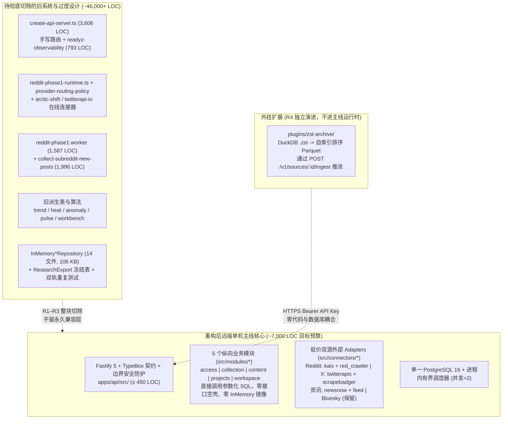
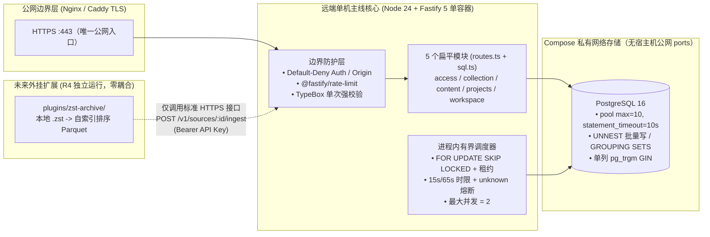

# `reddit-monitoring-mvp` 深度代码审查、终版单服务器产品化架构与外挂插件解耦总规范（Master Spec）

> **文档状态与定位**：本文件是 `main` 分支的**完整深度代码审查与终版单服务器产品化重建总规范（Master Spec）**，融合了基于 `main@7045185`（576 文件 / 74,468 LOC）的量化实码尸检（`a078c9c`）、2026-11-16 真实数据源连通性与定价核验、以及 `df8ab15` / `8f16e05` / `8ba0d65` / `90dbe9a` / `fefdb8c` / `93ca276` 多轮深化定案。后续编码与迁移以此总纲及对齐后的正式专项文档（[产品与架构](../README.md)、[主线架构规范](../architecture.md)、[数据与 API 契约](../contracts.md)、[产品交互规范](../design.md)、[R1–R4 重建计划](../plans/source-expansion.md)、[来源替换规格](./source_replacement_and_twitterapi_io_removal_spec.md)）为准，各规则编号唯一定义且由 `npm run lint` 强制静态校验。

---

## 0. 五大锁定顶层决策（Finalized Product & Architecture Decisions）

1. **主线与离线归档外挂彻底物理隔离（Core vs. Plugin）**：
   - **主线核心（Mainline Core）**：聚焦于**远端单服务器 7×24 安全稳定运行的在线多平台信息监测与讨论证据研究产品**（Fastify 5 + TypeBox + PostgreSQL 16 + 在线 Connectors + React 五页工作台）。主线容器镜像、迁移、备份、打包白名单（`scripts/release-package-lib.mjs`）与日常测试**零 Python / DuckDB / `.zst` 依赖**，彻底删除原规划的 7 张归档表（`dataset`、`import_batch`、`dataset_partition_revision`、`dataset_release`、`dataset_release_partition`、`dataset_content`、`archive_activity_day`）与顶层“数据集”页面。
   - **历史归档外挂（External Plugin `plugins/zst-archive/`）**：保留作为脱离主线的独立外挂客户端在 `R4` 按需迭代。主线只在 `collection` 模块开放标准鉴权推流接口 **`POST /v1/sources/:id/ingest`**（复用 `commitContentBatch` 与 `source_collection_job` 幂等回执），主线无需感知 `.zst`、Parquet、manifest 或全档统计。
2. **彻底退役并实删 `Arctic Shift` 与 `TwitterAPI.io` 在线连接器，升级低价双源矩阵**：
   - **`Arctic Shift` 实测破产证据（2026-11-16）**：大版块 7 天搜帖 `/api/posts/search?subreddit=MachineLearning&query=agent` 在 `1,831ms` 直接返回 **`HTTP 422 Timeout`**；搜评论 `1,633ms` 直接 **`422 Timeout`**（24 小时窗仍耗时 `3,971ms` 仅返 2 条）；中小版块 `LocalLLaMA` 耗时 **`10,225ms`**；评论树接口耗时 `2,874ms` 仅返 4 条并即刻触发 `x-ratelimit-reset: 51` 强限流；Reddit 官网匿名端点实测均返回 **`HTTP 403`**。
   - **`TwitterAPI.io` 成本超限证伪（2026-11-16 核对 `/pricing.json`）**：PAYG 固定 **`$0.15/1k`**（空请求保底扣 15 credits），`$1,499/月` Business 满吃返点地板仍为 **`$0.0789/1k`**，且与 Apify `kaitoeasyapi` 同属一间公司（Prism Digital, LLC）。
   - **最终双平台选型定案**：Reddit 采用 **`kaix/reddit-scraper`（解封后主力，`$0.02/1k`）+ `red_crawler/reddit-search-v2` & `reddit-scrape-v2`（FREE 作者费，Actor 级备源与评论补全）**；X 采用 **`TwitterAPIs`（`$0.0008/call` $\approx \$0.04/1\text{k}$ 主力低价源）+ `ScrapeBadger`（`1 base + 1/item`、原生支持 `GET /v1/twitter/tweets/` 批量 ID 补全、失败零扣费的独立异构备源）**；资讯补充精选 `NewsNow` MIT getter 与受控 RSS/Atom `feed`。`arctic_shift` 与 `twitterapi_io` 在线代码在 R1–R3 解耦实删，历史 DB 内容与观测保留真实 `provider` 软归档。
3. **产品形态升级：逻辑来源分离 + 三阶信号漏斗 + 评论树深度利用**：
   - 领域模型严格分离 **`Platform`**（`source` 表）、**`Provider`**（渠道）、**`CollectionSource`**（`collection_source` 逻辑监测目标，挂载 `primaryProvider` 与可选单跳 `fallbackProvider`），项目与机器 Key 针对逻辑来源一次授权，观测唯一键纳入 `provider`（`(contentId, collectionSourceId, provider, evidenceKey)`）防止主备碰撞。
   - 核心产品闭环升级为：**低价增量发现（Radar）$\to$ 确定性三段词与信号门控（Signal Gate）$\to$ 按需批量水合讨论树（Hydrate）$\to$ 联动锚点证据展示与三视图阅读（Top 高赞 / 命中词父链 / 楼主互动）**；解除 `commitContentBatch` “单任务单一 `contentKind`”锁死，彻底释放 `kaix` 连带层序评论与 `postUrls` 批量水合能力。
4. **砍掉全部 `*Repository` 单实现接口、`14` 个 `InMemory*Repository` 与库内冻结表（方案 B）**：
   - 仅保留一对多外部采集契约 [ContentProvider](../../src/connectors/shared/content-provider.interface.ts)；5 个业务模块内部直接编写接收 `Pool | PoolClient` 的命名参数化 SQL 函数（`routes.ts + sql.ts`），并由 `scripts/check-docs.ts` 对 `src/modules/` 做 TypeScript AST 门禁。
   - 退役 `ResearchExportService` 与 `research_export` / `research_export_member` 冻结表；工作区保留 `content_saved_query` + `content_annotation` + 有界只读 `REPEATABLE READ` 游标流式 CSV/JSON 下载；**全系统重构仅新增 `monitor_project` 与 `monitor_project_source` 两张表**。
5. **Agent-First 开放 HTTP API + 远端单机安全稳定与反 AI 过度设计准则**：
   - 人类 Web 端与外部 AI Agent **100% 共用同一 TypeBox HTTP API 契约、权限与 `compileContentFilter`**（`GET /v1/capabilities` + `GET /v1/openapi.json` + 扩展 `app_session` 的机器 API Key），零数据库旁路、零第二套后台。
   - 拒绝 AI 式的“10,000 行计划外扩散、压行面条代码、UI 协议说明墙、八股文 README 与自欺欺人的 InMemory 假单元测试”；用**极简可读代码 + 远端边界安全熔断 + 真实 PostgreSQL 16 HTTP E2E**保障长期可维护性。

---

## 1. 现状实码量化尸检（Observed Baseline @ `main@7045185`）

通过 `code-map` 与 `arch-audit` 对全仓 **576 个文件（74,468 LOC，3.34 MB 源码）** 进行结构化扫描，重构前代码体积与耦合分布如下：

| 分类 | 文件数 | 行数 (LOC) | 字节数 (Bytes) | 核心诊断与减法处置 |
| :--- | ---: | ---: | ---: | :--- |
| **旧产品链生产代码 (`DELETE_LEGACY_PROD`)** | 91 | 21,335 | 767,318 | `create-api-server.ts`（基线历史路径，现已实删） (3,606 LOC)、`collect-subreddit-new-posts.job.ts`（基线历史路径，现已实删） (1,996 LOC)、`reddit-phase1.worker.ts`（基线历史路径，现已实删） (1,587 LOC)、`readyz-observability.ts`（基线历史路径，现已实删） (793 LOC)、旧 `opossum` 熔断器、`rate-limiter-flexible`、Scrapling 桥、热度/异常/脉冲打分、27 个单实现 Repository 接口（655 LOC）。**R1–R3 全部实删**。 |
| **旧链路与冗余测试 (`DELETE_BLOAT_TEST`)** | 36 | 15,001 | 511,720 | `api-server-trends.test.ts`（基线历史路径，现已实删） (2,124 LOC)、`api-server-readyz.test.ts`（基线历史路径，现已实删） (2,081 LOC)、`collect-subreddit-new-posts-p0.test.ts`（基线历史路径，现已实删） (2,052 LOC) 等。**随旧业务一并删除**。 |
| **旧维护/实验脚本 (`DELETE_LEGACY_SCRIPTS`)** | 18 | 4,628 | 169,425 | `*phase1*`、`shadow-compare`、`controlled-promotion`、`prewarm-keyword-query` 等（含 25 处 `NPlusOneAwaitInLoop`）。**全部删除**。 |
| **前端废弃页面 (`WEB_DELETE_LEGACY`)** | 11 | 2,819 | 121,642 | `MarketBoard`、`TargetDetail` (800 LOC)、`Compare`、`Dashboard`、`Queries`、`Phase1RunCard` 及旧冻结视图。**全部删除**。 |
| **拟保留公共核心 (`KEEP_CORE_PROD`)** | 139 | 14,060 | 652,066 | **存在严重“压行伪装”与双轨冗余**：含 14 个 [基线 in-memory 仓储目录](https://github.com/Euroish/reddit-monitoring-mvp/tree/a078c9c/src/storage/repositories/in-memory) (2,185 LOC / **106 KB**) 及压行文件 `postgres-source-content.repository.ts`（基线历史路径，现已实删） (**305 行却高达 50,868 字节**，单行塞入 8~12 条语句)。**砍掉 In-Memory 双轨、`research_export`、Arctic Shift 与 TwitterAPI.io，重写为排版清晰的直白 SQL 模块**。 |
| **拟保留核心测试 (`KEEP_CORE_TEST`)** | 116 | 9,045 | 594,311 | 含 `tests/helpers/*-cases.ts` (58 KB)，将同一套用例在 JS `Map` 与 PG 上重复跑两遍。**砍掉 In-Memory 双跑，收敛为纯函数单测 + 唯一真实 PG 16 HTTP E2E；公共夹具重构为独立 `StubContentConnector`**。 |



---

## 2. 现有公共代码（`029`–`040`）8 项隐蔽缺陷与 9 项零漂移纠偏

即便仅审视 `029`–`040` 迁移之后的公共内容与研究模块，实码中仍存在以下违背“最低复杂度、最高性能、不过度防御”的隐患，且早先工程草图与真实 Schema/运行时之间存在 9 处规格漂移——R1 必须同步根治。

### 2.1 `[AUD-01]` 双轨 `InMemory*Repository` 是最大的工程税（106 KB 纯冗余）
- **证据**：`source-content.repository.ts`（基线历史路径，现已实删） 用 29,122 字节的压缩 TS 代码在 JS `Map` 中手工模拟 PG 事务、租约、`23505` 冲突、`SKIP LOCKED`、全文检索与 `REPEATABLE READ` 快照（每次调用执行 `structuredClone`）；整个 [基线 in-memory 目录](https://github.com/Euroish/reddit-monitoring-mvp/tree/a078c9c/src/storage/repositories/in-memory) 达 14 文件 / 2,185 LOC / 106 KB。
- **危害**：每增减一个字段或修改过滤规则都得双端重写，且内存模拟永远测不出 PostgreSQL 行锁死锁、索引失效、UTF-8 字符边界或事务隔离缺陷。
- **修正**：**全删 27 个单实现 `Repository` 接口与 14 个 `InMemory*Repository`（只留外部 `ContentProvider`）**。内部直接暴露接收 `Pool | PoolClient` 的命名 SQL 函数；纯规则写单测，数据库行为只测真实 PG 16。

### 2.2 `[AUD-02]` 压行代码（Code Golfing）伪装成“精简代码”
- **证据**：
  - `postgres-source-content.repository.ts`（基线历史路径，现已实删）：305 行塞了 **50,868 字节**（多行超 600 字节）；
  - `content-personal.service.ts`（基线历史路径，现已实删）：22 行塞了 **6,129 字节**（`saveQuery` 单行 820 字符、`saveAnnotation` 单行 890 字符）；
  - `Content.tsx`（基线历史路径，现已实删）：211 行塞了 **39,048 字节**，且前端充斥解释内部契约概念的大段说明框。
- **修正**：减掉真正的 AST 复杂度与多余层，严禁靠删换行压行伪造“精简”；五模块采用清晰可审阅的 `routes.ts + sql.ts`，单条模块注释 `<= 300` 字符（由 `scripts/check-docs.ts` 强制检查）。

### 2.3 `[AUD-03]` 列表分页热路径全表扫描 `public_content_search_document` + `038` 失效触发器
- **证据**：`postgres-source-content.repository.ts`（基线历史路径，现已实删） 在每次 `listContent()` 时先执行全库覆盖统计：
  ```sql
  WITH coverage AS (
    SELECT COUNT(*)::integer AS candidate_count,
           COUNT(doc.content_id)::integer AS indexed, ...
    FROM content c JOIN source p ON p.id=c.source_id
    LEFT JOIN public_content_search_document doc ON doc.content_id=c.id
    WHERE ...
  )
  ```
  且 [038_public_content_search_document.sql](../../src/storage/schema/038_public_content_search_document.sql#L9-L17) 触发器在内容更新时先 `DELETE` 投影，造成无谓 MVCC 死元组膨胀与索引丢失窗口。
- **危害**：`100 万` 内容规模下每次翻 25 条都全表 `LEFT JOIN + COUNT(*)`，直接把 `< 5ms` 的 keyset 分页拖垮至 `> 500ms`。
- **修正**：`commitContentBatch` 同事务保证“有正必有投影”；新增向前迁移完成单列投影回填与完整性验证后移除 `038` 失效触发器；`listContent` 仅做 keyset `limit + 1` 查询，**绝不在热路径跑 `coverage COUNT(*)`**。

### 2.4 `[AUD-04]` 概览 `contentWorkbench` 触发 10+ 次全扫，批注 `listAnnotations` 存在 `1+N`
- **证据**：`content-workbench.service.ts`（基线历史路径，现已实删） 先调 1 次 `contentStats`，再按 `platform` 和 `provider` 循环分别重跑 `contentStats`；`content-personal.service.ts#L21`（基线历史路径，现已实删） 在 `for` 循环中逐条调用 `getContent(annotation.contentId)`。
- **修正**：`projects` 概览使用单条 CTE + `GROUPING SETS` + 独立去重 `providers` 聚合；`workspace` 批注列表直接使用 `JOIN content` 单次查出。

### 2.5 `[AUD-05]` 研究快照冻结 `ResearchExportService.capture` 三重全扫 + 32 MiB 内存驻留
- **证据**：`research-export.service.ts`（基线历史路径，现已实删） 与 `postgres-research-export.repository.ts`（基线历史路径，现已实删） 先全扫两次再拉 2 万行进入 Node `structuredClone` 并分 200 次写回 `research_export_member`，甚至对内部自拼 SQL 跑正则自检。
- **修正（方案 B）**：R3 按原 owner 导出交付历史资产文件后，**实删 `research_export` / `research_export_member` 表、冻结 API 与 UI**；全面改用 `REPEATABLE READ` + server cursor 流式导出 CSV/JSON。

### 2.6 `[AUD-06]` `commitPage()` 页内 400+ 次往返、无稳态时钟、空字段清空正文与 `fetchedAt` 破坏幂等
- **证据**：`postgres-source-content.repository.ts#L102-L127`（基线历史路径，现已实删） 页内 `for` 循环逐条发 4 条 SQL（100 条/页 = 404 次往返）；缺少 `content_evidence_key` 平局决胜；省略标题/正文时 `NULL` 会覆盖已有内容；且现有连接器将 `fetchedAt` 编入 `evidenceKey`，导致同一 Actor Dataset 重读破坏幂等并污染二次发酵判断。
- **修正**：改为 4 组 `UNNEST` 集合写；`content` 表新增独立 `content_evidence_key TEXT NOT NULL`（`C` collation）与 `content_version_fetched_at TIMESTAMPTZ NOT NULL`；规定 `evidenceKey` 严禁包含本次读取 `fetchedAt`；观测唯一键升级为 `(contentId, collectionSourceId, provider, evidenceKey)`。

### 2.7 `[AUD-07]` `listContent()` 偷用 `first_seen_at` 排序 + 12 位 Reddit ID 截断 + `Arctic Shift` 退役
- **证据**：`postgres-source-content.repository.ts#L250-L255`（基线历史路径，现已实删） 用 `COALESCE(c.created_at_source, c.first_seen_at)` 偷替未知发布时间；`arctic-shift-content.connector.ts#L45`（基线历史路径，现已实删） 使用 `{2,12}` 正则破坏 13 位评论刷新。
- **修正**：强制基于物理列 `c.created_at_source DESC NULLS LAST, c.id DESC` 双分支 seek；通用 Reddit ID 全仓锁定 2–32 位 base36 小写；退役 `arctic_shift` 在线代码，保留历史观测可读性。

### 2.8 `[AUD-08]` `kaix` 4 项人为封印与同步 `waitForFinish=60` 丢 Run 风险
- **证据**：[kaix-content.connector.ts#L60-L87](../../src/connectors/reddit/kaix-content.connector.ts#L60-L87) 导入 `ARCTIC_SHIFT_CAPABILITY.metrics`、写死 `includeComments: false`、`maxItems<=100`、`mode="post"` 丢主帖、第 85 行 `literal()` 误杀布尔查询，且同步等待 60s 若上游仍 `RUNNING` 直接抛错丢弃云端正在计费的 `runId`/`datasetId`。
- **修正**：解除全部 4 项封印，实行 `starting -> running -> reading -> committed` 异步 `runId`/`datasetId` 持久化与续读轮询。

### 2.9 必须锁死的 9 项零漂移纠偏规则（修正早期蓝图伪细节）
1. **禁用 `last_seen_at` 作正文版本比较时钟**：必须使用独立 `content_version_fetched_at`（仅胜出接受正文时更新）；严禁落后 `available` 记录借 `COALESCE` 复活已 `deleted/removed` 正文。
2. **禁止 `evidenceKey` 掺入 `fetchedAt`**：同 Actor Dataset 重读维持同一 `evidenceKey` 与已存 `fetchedAt`；观测主键含 `provider` 防主备冲突。
3. **付费异步状态机与 `unknown` 熔断**：发外部创建前存 `starting`，拿到 `runId` 立即写库；普通网络读取 `15s`（X `20s`），Apify 显式等待上限 `65s`；结果未明转 `unknown` 永远阻断自动重放与切备。
4. **物理列名显式对齐**：契约 `publishedAt` 在库中对应物理列 **`content.created_at_source`**，`QRY-05` 双分支 SQL 与索引必须作用在 `created_at_source`。
5. **解除 `item.kind === source.contentKind` 锁死 + 精确外键约束**：允许同批混合写入主帖与评论；`monitor_project_source` 外键指向 `collection_source(id) ON DELETE CASCADE`；`source_collection_job` 在 `purpose='ingest'` 时显式 `DROP NOT NULL` on `from_at / to_at / page_size / max_pages`。
6. **概览 `GROUPING SETS` 使用 `GROUPING(pub_day)` 与 `COUNT(DISTINCT anchor_id)`**：区分总计 `NULL` 与未知发布时间桶 `NULL`；`providers` 独立聚合绝不 `JOIN facets` 放大。
7. **单列全文投影禁用 `strpos()`**：以 `U+001F` 分隔 `normTitle` 与 `normText` 并存 PG `char_length(normTitle)` 至 `title_length`；检索字面转义 `%`/`_`/`\` 后生成参数化 `LIKE` 激活 `pg_trgm` GIN，再 `substring` 精确核对边界。
8. **流式导出长空闲预算与禁代理缓冲**：导出只读事务内设置 `SET LOCAL idle_in_transaction_session_timeout = '35s'`（单 SQL 仍 10s、HTTP 总流 30s），响应头加 **`X-Accel-Buffering: no`** 确保 Nginx 不囤积流，客户断连瞬间中止游标回滚。
9. **容器私有网络无宿主机 `ports` + 15s 优雅退出**：Compose `db` 走内部服务名，严禁映射宿主机公网端口（也不在容器中自连 `127.0.0.1`）；应用收到 `SIGTERM` 执行 **`15s`** 优雅退场预算（高于 10s SQL 熔断）。

---

## 3. 产品升级：双源防停摆矩阵、三阶信号漏斗与 `kaix` 解封

### 3.1 低价异构双源矩阵（最新选型定案，详见[来源替换规格](./source_replacement_and_twitterapi_io_removal_spec.md)）

| 平台 | 主/备角色 | 数据源 | 公开计费与稳定性边界 | 接入契约与防坑约束 |
| :--- | :--- | :--- | :--- | :--- |
| **Reddit** | **主力源** | **`kaix/reddit-scraper`** (build `0.2.25`) | `$0.02 / 1k` 结果 + Apify Compute | 解除 4 项封印；异步 `runId` 恢复；无游标恒标 `coverage = "partial"`；`automaticRequestReplay = false`。 |
| **Reddit** | **Actor 级备源** | **`red_crawler/reddit-search-v2` + `reddit-scrape-v2`** | 作者费 `FREE`，仅耗 Apify Compute | 共用 `APIFY_API_TOKEN`（与 `kaix` 同属 Apify 故障域，非跨云冗余）；补全 `search_type="comments"` 与多社区搜索及有界评论树。 |
| **X** | **主力低价源** | **`TwitterAPIs`** (`api.twitterapis.com`) | `$0.0008 / call`（满 20 条/页 $\approx \$0.04/1\text{k}$），`$10+` 永不过期 | `refreshByIds: false`；以 `!Array.isArray(tweets) \|\| tweets.length === 0 \|\| cursor 重复` 停页（非数组抛出协议错误）；禁接 `$0.004/call` `/tweet/thread`；禁跑稀疏词时间二分树。 |
| **X** | **独立异构备源** | **`ScrapeBadger`** (`scrapebadger.com/v1/twitter`) | `1 base + 1 credit/item`，PAYG 永不过期，**`4xx/5xx` 零扣费** | **`refreshByIds: true`**（原生 `GET /v1/twitter/tweets/` 批量 ID 补全）；时间窗编入 `query`（`since_time:`/`until_time:`）；未首充 `>= 12s`、PAYG `>= 1s`；头 `X-Credits-Used` 记入请求级诊断；失败零扣费仍 `automaticRequestReplay = false`。 |
| **资讯/订阅** | **补充源** | **`NewsNow` 精选 getter + 通用 `feed` (受控 RSSHub)** | `$0`（MIT 裁剪函数 + 白名单 HTTP RSS/Atom） | `canonical URL` 去重、`web.rank` 只作名次、`sha256(boardId+':'+externalId+':'+bucket)`、管理员白名单防 SSRF、`ETag`/`304` 条件请求。 |
| **归档外挂** | **未来扩展 (`R4`)** | **`plugins/zst-archive/`** | 离线独立运行 | 仅经鉴权 `POST /v1/sources/:id/ingest` 推流少量明确选入正文。 |

### 3.2 三阶信号漏斗与 `kaix` 评论树深度利用

```text
【第 1 阶：低成本增量发现（Radar）】
  ├─ 精准品牌/竞品词：kaix (includeComments=true, maxCommentsPerPost=15, commentSort="top")
  │     👉 一次运行同时落库【主帖 + 前 15 条高赞不断链评论树】
  ├─ 宽泛行业大词（控费降噪）：先仅发现根帖 (includeComments=false, maxItems=100~300)
  └─ X 水位线巡检 / NewsNow 榜单 / RSS feed
        │
        ▼ 唯一 commitContentBatch() 落库（同事务混合写入主帖+评论+父链，2,000条/16MiB 上限）
【第 2 阶：确定性噪声门控（Signal Gate — 零 LLM 烧钱，纯 SQL 规则）】
  ├─ 三段式词组：anyTerms (OR) + allTerms (AND) + exclusions (NOT，过滤招聘/抽奖)
  └─ 可解释信号：discussion (Reddit>=10 / X>=5)、pain (痛点词或评论>=分数且score已知)、growing (同渠道同口径二次增量)
        │
        ▼ 筛选 Top 5%~10% 高价值根帖（手选无限制；自动策略默认关闭，每 radar 至多派生 1 笔 hydrate）
【第 3 阶：按需批量水合与评论树证据利用（Hydrate & Three Views）】
  ├─ 批量补全：攒批调 kaix mode="post" postUrls[] (每根 50 评论) 或 X /replies + ScrapeBadger 批量 ID
  ├─ 联动检索（threadAware=true）：评论命中即把【根帖 + 命中评论摘录】映射至可见 anchor 呈现
  └─ 详情侧栏三视图（基于 reply_to + thread_root + depth + isSubmitter）：
        [Top 高赞共识] │ [命中词完整父链上下文] │ [楼主 OP 互动]
```

---

## 4. 开放 HTTP API 与 Agent-First 架构（Human & Machine Parity）

Web 前端与外部 AI Agent **共用唯一 TypeBox HTTP API 契约、权限边界与 `compileContentFilter(scope, filter)`**，零数据库旁路、零平行后台：
- **能力自发现与唯一 Schema**：鉴权访问 `GET /v1/capabilities`（返回 `actor` 角色/scopes/允许来源/到期时间、`providers` 支持操作/参数上限/`automaticRequestReplay`、剩余 `budgets` 与列表/推流/导出硬上限）及同一 Schema 派生的 `GET /v1/openapi.json`（稳定 `operationId`）；
- **机器 API Key（复用 `app_session`）**：扩展 `client_kind`（`'browser' | 'machine'`）、`label`、`scopes`（`read`, `projects:write`, `sources:write`, `collect`, `ingest`, `export`）、`allowed_source_ids UUID[]`（`ingest` 模板强制绑定非空来源），数据库仅存 SHA-256 `token_hash`，明文展示一次，30–90 天过期且撤销立即失效；**严禁机器 Key 访问个人保存查询、批注或账户管理路由**；
- **6 步业务闭环与 4 项防失控护栏**：
  1. `GET /v1/capabilities` $\to$ `POST /v1/projects` $\to$ `POST /v1/sources/:id/collect`（轮询 `/v1/source-jobs/:id`）$\to$ `GET /v1/projects/:id/overview` $\to$ `GET /v1/projects/:id/content` & `/v1/content/:id/thread` $\to$ `GET /v1/content/export`；
  2. 护栏：`GET` 零收费；`automaticRequestReplay = false` 下收费未知进入 `unknown` 返回 `retryable: false, nextAction: "inspect_provider_console"` 阻断循环重试；`allowed_source_ids` 贯穿详情/树/统计防 UUID 枚举（404/403 隔离）；显式声明第三方正文为不可信材料，禁止作为执行指令。

---

## 5. 远端单机安全、反过度设计与测试收敛基线



### 5.1 远端服务器“安全与稳定”六条硬基线（对应[主线架构 `SAFE-01..06`](../architecture.md#6-远端单机公网安全与稳定运行基线)）

| 真实风险面 | 常见 AI 错误做法（假安全/真臃肿） | 我们的单服务器生产级做法（真安全/极简） |
| :--- | :--- | :--- |
| **1. 公网暴露与越权** | 在内部函数写满 `if (typeof x === 'string')`，但 API 漏默认拒绝或无 CSRF 检验 | **Default-Deny Auth Hook**：除 `GET /healthz`、登录 `POST /v1/auth/login`、`GET /v1/auth/session`（只返本人或未登录）与持有效邀请注册 `POST /v1/auth/register` 外一律拒止；Cookie 为 `HttpOnly; Secure; SameSite=Lax` 并校验写操作同源 `Origin`。 |
| **2. 暴力破解与公网数据库** | 手写内存滑动窗口计数或数据库绑定到宿主机公网 | 直接挂载 `@fastify/rate-limit`：登录 `5 次/分钟/IP`、全 API `120 次/分钟/IP`、`413` 限体、只信精确反向代理覆写IP；Compose 下 `db` 走私网服务名，**严禁绑定宿主机公网 `ports`**。 |
| **3. 慢查询拖垮 VPS** | 每次列表跑全表 `COUNT(*)` 且无语句熔断 | `pg.Pool` 锁死 **`max: 10`、`statement_timeout: 10_000ms`、`lock_timeout: 3_000ms`、`idle_in_transaction_session_timeout: 10_000ms`**；导出走事务级 `SET LOCAL idle_in_transaction_session_timeout = '35s'` + `X-Accel-Buffering: no` + 断连立即中止游标。 |
| **4. 上游卡死与计费失控** | 同步死等 60s 失败丢 `runId`，或自动重发未知 POST | 默认读取 `15s`（X `20s`，Apify `65s`）；Worker 最大并发 **`2`**；收费调用实行 **`starting -> running -> reading -> committed`** 状态机，`unknown` 永久停发防重扣。 |
| **5. 重启丢数据** | 无视活跃事务 `kill -9` | 监听 `SIGTERM / SIGINT`：停领任务与新请求 $\to$ 中止在途外部请求与流 $\to$ 等待事务提交或回滚后 `pool.end()`，应用退场预算 **`15s`**（守护宽限 **`30s`**）。 |
| **6. 启动配置地狱** | 30 个必填环境变量缺一报错 | 全空库首次引导仅需 **3 个应用密钥**：`DATABASE_URL`、`SESSION_SECRET`、`ADMIN_BOOTSTRAP_PASSWORD`（引导后移除）；采集 Key 按需配置。 |

### 5.2 反 AI 过度设计四条准则
1. **人类可读代码尺度**：模块默认仅 `routes.ts + sql.ts`（有独立职责经 `scripts/check-docs.ts` 登记后可加 `worker.ts` / `search.ts`），拒绝 50 KB 塞 300 行的代码压缩与无意义 `class` 包装（`npm run lint` 已实施 AST 检查，单注释 `<= 300` 字符）。
2. **最小侵入外挂口**：只保留标准 `POST /v1/sources/:id/ingest`，不预建通用任务/插件框架或 7 张归档表。
3. **测试真实验证**：删除 14 个 `InMemory*` 模拟与 ~90 个冗余 mock 单元测试，收敛为 **纯函数单测 + 一套真实 PG 16 + HTTP E2E + 关键端到端浏览器任务验证**。
4. **文档与界面去 AI 味**：根目录 `README.md` `<= 60` 行；Web 五导航禁止暴露协议代号与说明墙。

---

## 6. 零漂移 SQL 蓝图与模块代码减法预算（5 模块 × 5 页面 × 2 新表）

### 6.1 `GAP-01` 至 `GAP-06` 核心修补索引

| 编号 | 所在规范章节 | 缺陷与修复标准定案 |
| :--- | :--- | :--- |
| **GAP-01** | [contracts.md `DAT-04`](../contracts.md#dat-04接受正文的确定性版本与混合批规则详述) | 新增 `content_evidence_key TEXT NOT NULL`（`C` collation）与 `content_version_fetched_at TIMESTAMPTZ NOT NULL`；元组 `(content_observed_at IS NOT NULL, COALESCE(content_observed_at, content_version_fetched_at), content_evidence_key)` 决胜（绝不用 `last_seen_at`）；`available` 用 `COALESCE` 保已知字段，`deleted/removed` 清正文且落后版本不可复活；同事务仅依据 `RETURNING` 最终规范正文同步 `public_content_search_document`。 |
| **GAP-02** | [contracts.md `QRY-05–06`](../contracts.md#3-过滤三段词信号讨论树与项目比较) | 配合索引 `ON content (created_at_source DESC NULLS LAST, id DESC)` 实现非空与空时间双分支 seek（绝不 `COALESCE(created_at_source, first_seen_at)`）；`threadAware` 按 `matchedAt DESC NULLS LAST, anchorId DESC` seek；范围或 `projectRevision` 变动返 `409 cursor_scope_changed`。 |
| **GAP-03** | [architecture.md `SQL-09–10`](../architecture.md#4-统一查询检索与性能基准) | 单列 `search_text`（`normTitle || U+001F || normText`）+ `GIN gin_trgm_ops` + PG `char_length` 计算 `title_length`；字面转义 `%`/`_`/`\` 后生成参数化 `LIKE` 激活 GIN（禁用 `strpos`），`title`/`text` 域加 `substring` 精确验证确保短语不跨界。 |
| **GAP-04** | [contracts.md `DAT-02/03`](../contracts.md#1-领域模型与内容身份) | `NewsNow` 条目按 `canonical URL` 为 `(platform='web', kind='article', externalId)`；`web.rank` 为名次；证据键为 `sha256(boardId + ":" + externalId + ":" + snapshotBucket)`（UTC 5 分钟桶，重试复用）。 |
| **GAP-05** | [contracts.md `QRY-07`](../contracts.md#3-过滤三段词信号讨论树与项目比较) | 项目对比统一在已存模型与同一 `threadAware` 口径下计算；`engagement` 对比要求两侧收窄至同一平台及兼容 `metricKey`/`provider`/`timeBasis`，否则 `422`。 |
| **GAP-06** | [architecture.md `RUN-01–04`](../architecture.md#5-调度异步收费状态机与单跳备源) | 续页 `next_run_at = now` + `provider.minimum_interval_ms` 统一控频；无任务按 `clamp(nextDue - now, 500ms, 5000ms)` 休眠；Apify 异步 `runId` 持久化恢复，`unknown` 永久阻断重发与切备。 |

### 6.2 零漂移 SQL 架构参考模板

#### (1) `commitContentBatch` 四组集合写与 `DAT-04` 版本决胜（$O(1)$ SQL 往返，混合批共用）
```sql
-- 说明：由应用层在事务外按 (source_id, kind, external_id) 预合并同批输入避免同语句双更新；
-- 短事务固定按 source -> job -> content identity 升序加锁后，执行以下 4 组集合 UNNEST SQL：
-- (第 1 组 SQL: content UNNEST Upsert — 示例展现核心版本与删后防复活语义，参数按真实类型对齐)
WITH input_rows AS (
  SELECT *
  FROM unnest(
    $1::uuid[], $2::uuid[], $3::text[], $4::text[], $5::text[], $6::text[],
    $7::text[], $8::timestamptz[], $9::timestamptz[], $10::jsonb[], $11::jsonb[],
    $12::jsonb[], $13::jsonb[], $14::text[], $15::text[], $16::timestamptz[],
    $17::text[]
  ) AS t(
    id, source_id, kind, external_id, title, body_text, url,
    created_at_source, fetched_at, content_author, content_media,
    content_references, platform_details, language, availability,
    content_observed_at, content_evidence_key
  )
)
INSERT INTO content (
  id, source_id, kind, external_id, title, body_text, url, permalink,
  created_at_source, first_seen_at, last_seen_at,
  content_author, content_media, content_references, platform_details,
  language, availability, content_observed_at, content_version_fetched_at, content_evidence_key
)
SELECT
  id, source_id, kind, external_id,
  CASE WHEN availability IN ('deleted', 'removed') THEN NULL ELSE title END,
  CASE WHEN availability IN ('deleted', 'removed') THEN NULL ELSE body_text END,
  url, url, created_at_source, fetched_at, fetched_at,
  content_author, content_media, content_references, platform_details,
  language, availability, content_observed_at, fetched_at, content_evidence_key
FROM input_rows
ON CONFLICT (source_id, kind, external_id) DO UPDATE SET
  -- 确定性复合元组对比：严禁使用 last_seen_at；落后版本不可通过 COALESCE 复活已删除正文
  title = CASE
    WHEN (EXCLUDED.content_observed_at IS NOT NULL, COALESCE(EXCLUDED.content_observed_at, EXCLUDED.content_version_fetched_at), EXCLUDED.content_evidence_key COLLATE "C")
       > (content.content_observed_at IS NOT NULL, COALESCE(content.content_observed_at, content.content_version_fetched_at), content.content_evidence_key COLLATE "C")
    THEN CASE WHEN EXCLUDED.availability IN ('deleted', 'removed') THEN NULL ELSE COALESCE(EXCLUDED.title, content.title) END
    ELSE content.title
  END,
  body_text = CASE
    WHEN (EXCLUDED.content_observed_at IS NOT NULL, COALESCE(EXCLUDED.content_observed_at, EXCLUDED.content_version_fetched_at), EXCLUDED.content_evidence_key COLLATE "C")
       > (content.content_observed_at IS NOT NULL, COALESCE(content.content_observed_at, content.content_version_fetched_at), content.content_evidence_key COLLATE "C")
    THEN CASE WHEN EXCLUDED.availability IN ('deleted', 'removed') THEN NULL ELSE COALESCE(EXCLUDED.body_text, content.body_text) END
    ELSE content.body_text
  END,
  availability = CASE
    WHEN (EXCLUDED.content_observed_at IS NOT NULL, COALESCE(EXCLUDED.content_observed_at, EXCLUDED.content_version_fetched_at), EXCLUDED.content_evidence_key COLLATE "C")
       > (content.content_observed_at IS NOT NULL, COALESCE(content.content_observed_at, content.content_version_fetched_at), content.content_evidence_key COLLATE "C")
    THEN EXCLUDED.availability ELSE content.availability
  END,
  content_observed_at = CASE
    WHEN (EXCLUDED.content_observed_at IS NOT NULL, COALESCE(EXCLUDED.content_observed_at, EXCLUDED.content_version_fetched_at), EXCLUDED.content_evidence_key COLLATE "C")
       > (content.content_observed_at IS NOT NULL, COALESCE(content.content_observed_at, content.content_version_fetched_at), content.content_evidence_key COLLATE "C")
    THEN EXCLUDED.content_observed_at ELSE content.content_observed_at
  END,
  content_version_fetched_at = CASE
    WHEN (EXCLUDED.content_observed_at IS NOT NULL, COALESCE(EXCLUDED.content_observed_at, EXCLUDED.content_version_fetched_at), EXCLUDED.content_evidence_key COLLATE "C")
       > (content.content_observed_at IS NOT NULL, COALESCE(content.content_observed_at, content.content_version_fetched_at), content.content_evidence_key COLLATE "C")
    THEN EXCLUDED.content_version_fetched_at ELSE content.content_version_fetched_at
  END,
  content_evidence_key = CASE
    WHEN (EXCLUDED.content_observed_at IS NOT NULL, COALESCE(EXCLUDED.content_observed_at, EXCLUDED.content_version_fetched_at), EXCLUDED.content_evidence_key COLLATE "C")
       > (content.content_observed_at IS NOT NULL, COALESCE(content.content_observed_at, content.content_version_fetched_at), content.content_evidence_key COLLATE "C")
    THEN EXCLUDED.content_evidence_key ELSE content.content_evidence_key
  END,
  created_at_source = COALESCE(content.created_at_source, EXCLUDED.created_at_source),
  first_seen_at = LEAST(content.first_seen_at, EXCLUDED.first_seen_at),
  last_seen_at = GREATEST(content.last_seen_at, EXCLUDED.last_seen_at)
RETURNING id, kind, external_id, title, body_text, availability, (xmax = 0) AS inserted;
-- 第 2 组 SQL: 基于 RETURNING 最终正文规范化写入 public_content_search_document (search_text + char_length(normTitle))
-- 第 3 组 SQL: UNNEST Upsert content_discovery (first_fetched_at = LEAST, last_fetched_at = GREATEST)
-- 第 4 组 SQL: UNNEST Insert content_observation ON CONFLICT (content_id, collection_source_id, provider, evidence_key)
```

#### (2) `projects` 单 SQL 锚点 `GROUPING SETS` 概览（替代 10+ 次 `contentStats` 循环扫描）
```sql
WITH matched_nodes AS (
  SELECT c.id AS evidence_id, c.source_id, c.kind AS evidence_kind,
         COALESCE(root_c.id, c.id) AS anchor_id,
         to_char(c.created_at_source AT TIME ZONE 'UTC', 'YYYY-MM-DD') AS pub_day
  FROM content c
  LEFT JOIN LATERAL (
    SELECT r.id FROM content r
    WHERE /* threadAware=true 时查找所属可见根帖，否则退回 c.id 自身 */
    LIMIT 1
  ) root_c ON TRUE
  WHERE /* compileContentFilter(actorAndProjectScope, filter) — 单个 EXISTS(discovery JOIN collection_source) */
),
facets AS (
  SELECT
    GROUPING(pub_day) AS grp_day,
    GROUPING(source_id) AS grp_platform,
    GROUPING(evidence_kind) AS grp_kind,
    pub_day, source_id, evidence_kind,
    COUNT(DISTINCT anchor_id)::bigint AS cnt
  FROM matched_nodes
  GROUP BY GROUPING SETS ((), (pub_day), (source_id), (evidence_kind))
),
providers AS (
  SELECT o.provider, COUNT(DISTINCT m.anchor_id)::bigint AS cnt
  FROM matched_nodes m
  JOIN content_observation o ON o.content_id = m.evidence_id
  JOIN collection_source cs ON cs.id = o.collection_source_id
  WHERE /* 同一 actor ∩ project ∩ 过滤来源范围 */
  GROUP BY o.provider
)
SELECT
  (SELECT jsonb_agg(facets) FROM facets) AS facets,
  (SELECT jsonb_agg(providers) FROM providers) AS providers;
```
- 仅 `grp_day = 0 AND pub_day IS NULL` 为 `unknownTimeCount`；日桶各自对 `anchor_id` 去重，不得将多日累加当作期间总数；`providers` 独立按去重节点聚合不放大计数。

### 6.3 目标目录结构与代码量减法预算（约 **-90%** 源码冗余）

| 模块 / 目录 | 重构前基线 (`main@7045185`) | 重构后目标预估（审查参考，非压行硬指标） | 削减比例 | 关键减法动作 |
| :--- | ---: | ---: | ---: | :--- |
| `apps/api/src/` | 16 文件 / 5,120 LOC (203 KB) | 4 文件 / **~450 LOC** | **-91%** | Fastify 5 + TypeBox 替代 `create-api-server.ts` (3,606 LOC) 与 `readyz-observability.ts` (793 LOC) |
| `src/` (后端核心) | 186 文件 / 27,236 LOC (1.11 MB) | ~24 文件 / **~3,000 LOC** | **-89%** | 切除旧 Phase1/趋势/异常/Scrapling/InMemory(14 文件)/单实现接口(27 文件)/ResearchExport/`arctic_shift`/`twitterapi_io`；收敛为 5 模块 + 新双源 connectors |
| `apps/web/src/` | 49 文件 / 6,508 LOC (376 KB) | ~18 文件 / **~2,000 LOC** | **-69%** | 删除旧页面；拆解压缩 `Content.tsx`；收敛为 5 个一级导航与三视图评论树交互 |
| `scripts/` + `workers/` | 54 文件 / 10,624 LOC (512 KB) | ~6 文件 / **~600 LOC** | **-94%** | 切除旧维护与 Phase1 worker 脚本，仅留迁移、备份恢复、安全退役与 `check-docs.ts` 门禁 |
| `tests/` | 152 文件 / 24,046 LOC (1.10 MB) | ~10 文件 / **~1,200 LOC** | **-95%** | 删除旧业务测试与 InMemory 双跑 helper；保留纯函数单测 + 唯一真实 PG 16 HTTP E2E |
| **全仓主线合计** | **457 源码文件 / ~73,534 LOC** | **~62 文件 / ~7,250 LOC** | **-90%** | **主线极度精干可读、AST 检查守界、远端单机稳态运行** |

---

## 7. 外挂扩展深度研究备案：`plugins/zst-archive/`（R4 独立演进，不阻塞主线）

将历史 `.zst` 归档模块剥离为**外挂扩展**后，主线无需承载任何离线大数据依赖或 7 张发布表；同时外挂本身采用 **“DuckDB 单次转 12 列聚簇排序自索引 Parquet + 按需检索并调 `POST /v1/sources/:id/ingest` 推流”** 方案，彻底解决 `.zst` 无坐标索引痛点。

### 7.1 物理根因：为什么不能直接给原始 `.zst` 建“行号 $\to$ 字节偏移量”索引？
- **2 GiB 连续滑动字典窗口（`windowLogMax = 31`）**：Arctic Shift 月度包（`RS_YYYY-MM.zst`）使用 Zstandard 共享滑动字典流，普通 `.zst` 帧边界与滑动字典状态决定无法可靠假设任意中间字节偏移 `seek()` 解压；
- **`ArthurHeitmann/zst_blocks_format` 的废弃实证**：2024 年 4 月起官方停用切块 SQLite 偏移格式，仅提供原生 `.zst` UTF-8 JSON 流，且同一对象内 `retrieved_on` 与 `_meta.retrieved_2nd_on` 可能来自不同抓取时点，推送时必须保留真实 `timeBasis` 与 `sourceObservedAt`，严禁拿 `retrieved_on` 冒充 `publishedAt`。

### 7.2 外挂研究方案：1 条 DuckDB SQL 转为 **12 列排序自索引 Parquet**（基准性能须经实测验证）

| 维度 | 原始 `.zst` 逐行流式扫 | 自建 `.zst` 块偏移索引 (`zst_blocks`) | **外挂研究方向：12 列排序自索引 Parquet** |
| :--- | :--- | :--- | :--- |
| **存储组织** | 单体压缩流（月度包约 14.8 GB 参考值） | 碎块 + SQLite（体积膨胀且已废弃） | 仅保留 12 核心列，**`ORDER BY subreddit_lower, created_utc`** 聚簇、`ROW_GROUP_SIZE 100000`、`COMPRESSION ZSTD` + 按需核对 Bloom Filter |
| **跳块检索机制** | 无坐标索引，必从头顺序扫描 | 切碎字典破坏压缩率且全文仍慢 | Parquet Footer 自带 RowGroup 字节偏移 + `subreddit_lower`/`created_utc` Min/Max Zonemap 剪枝；全站搜词仅解压 `title`/`selftext` 列（具体体积/耗时以 R4 实际归档样本实测为准，未完成行/字段/拒绝行与备份对账前**绝不删原 `.zst`**） |
| **对远端主线侵入度** | 需上传几十 GB 原档 | 需部署专用解压服务 | **0 侵入！仅把命中筛选后的少量样本经 `POST /v1/sources/:id/ingest` 推流** |

### 7.3 外挂参考转换脚手架说明（R4 启动时在独立环境编写，不写入主线仓库当前代码树）
```python
# R4 plugins/zst-archive/ 独立研究方向示意（不提前落入主线依赖或构建；生产实现须严格参数化路径防注入）：
# COPY (
#   SELECT
#     id, lower(subreddit) AS subreddit_lower, subreddit, author, title, selftext,
#     created_utc::BIGINT AS created_utc,
#     retrieved_on::BIGINT AS retrieved_on,   -- 未知保持 NULL，严禁用 created_utc 冒充或填补！
#     score::INTEGER AS score, num_comments::INTEGER AS num_comments,
#     upvote_ratio::DOUBLE AS upvote_ratio, permalink, url
#   FROM read_json(?, format='newline_delimited', compression='zstd', ...)
#   WHERE id IS NOT NULL AND subreddit IS NOT NULL AND created_utc IS NOT NULL
#   ORDER BY subreddit_lower, created_utc
# ) TO ? (FORMAT PARQUET, COMPRESSION ZSTD, COMPRESSION_LEVEL 6, ROW_GROUP_SIZE 100000);
```
推流端按 `ING-01/02` 将命中行映射为 `NormalizedContentItem[]`（`created_utc -> publishedAt`、`retrieved_on -> observation.sourceObservedAt` 配真实 `timeBasis = 'archive_initial'`、`1–100` 条/批、`<= 1 MiB`、携带 `Idempotency-Key`），按 `MET-03` 标记“导入样本”且不混入默认在线趋势。

---

## 8. 正式文档分工及 `R1 -> R4` 四步垂直交付路线

- **完整 14 份文档唯一分工**：以[产品与架构总入口](../README.md)为核心，配合[主线架构](../architecture.md)、[数据与 API 契约](../contracts.md)、[产品交互](../design.md)、[R1–R4 重建计划](../plans/source-expansion.md)、[来源替换规格](./source_replacement_and_twitterapi_io_removal_spec.md)、[来源研究](./data-sources.md)、[开发说明](../development.md)与[实现状态](../status.md)形成零重叠闭环。
- **`R1`（薄内核重构与数据闭环）**：Fastify 5 五模块 + 安全基线 + `/v1/capabilities` + `/v1/openapi.json`、`041` 迁移与来源安全退役（`from_at/to_at/page_size/max_pages DROP NOT NULL`）、`commitContentBatch` 混合批 4 组 `UNNEST`、`kaix` 4 项解封与异步 `runId` 恢复、`POST /v1/sources/:id/ingest`、NULL 双分支分页、`REPEATABLE READ` + `SET LOCAL 35s` 游标导出与 `x-content-pipeline.test.ts` 迁移 + 薄 Web 闭环。
- **`R2`（项目化三阶漏斗与多源防停摆闭环）**：`042` 建 `monitor_project` / `monitor_project_source`（外键 `collection_source(id) ON DELETE CASCADE`）、三段式词组与信号门控、`GROUPING SETS` + 三视图评论树、`red_crawler` / `TwitterAPIs` / `ScrapeBadger` / `NewsNow` / `feed` 接通并实测建档、干净 5 导航 UI 与 Agent 闭环。
- **`R3`（物理实删、负载与安全证明、Compose 切换）**：按原 `owner` 导出核对旧冻结资产后物理删除仓储双轨/旧 `Phase1`/旧页面与脚本，完成安全与百万级代表负载检验及 Docker Compose 维护窗口上线。
- **`R4`（独立历史归档外挂）**：按需授权启动 `plugins/zst-archive/`。
