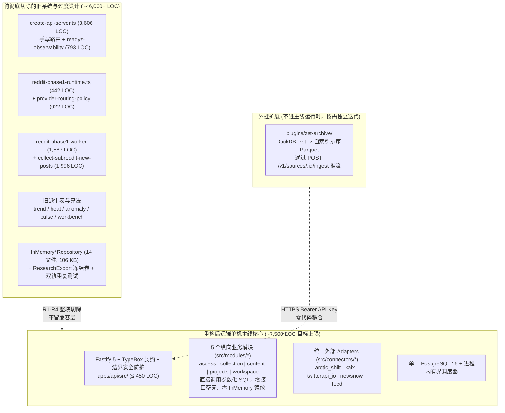
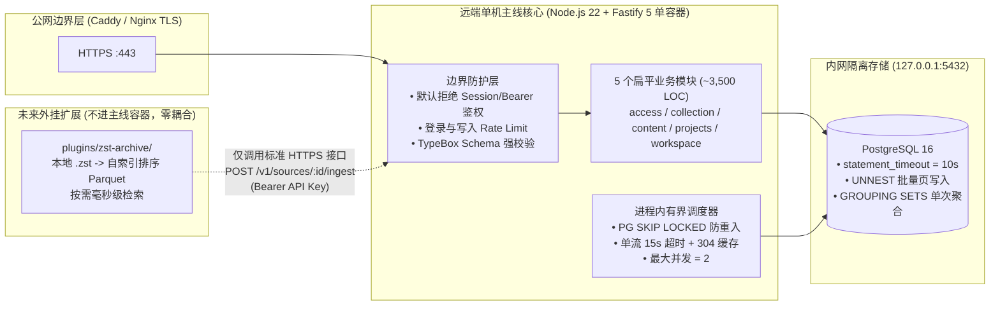

# `reddit-monitoring-mvp` 深度代码审查、终版单服务器产品化架构与外挂插件解耦蓝图

> [!IMPORTANT]
> **四大顶层架构决策已锁定（Finalized Decisions）**：
> 1. **主线与外挂彻底物理隔离（Mainline Core vs. External Plugin）**：
>    - **主线核心（Mainline Core）**：聚焦于**远端单服务器 7×24 安全稳定运行的在线多平台信息监测产品**（Fastify 5 + PostgreSQL 16 + 在线采集 Connectors + React 工作台）。主线容器镜像、数据库与日常运维**零 Python / DuckDB / `.zst` 依赖**，完全砍掉原规划的 7 张归档发布表（`dataset`、`import_batch`、`dataset_partition_revision`、`dataset_release`、`dataset_release_partition`、`dataset_content`、`archive_activity_day`）与顶层“数据集”页面。
>    - **历史归档外挂（External Plugin `plugins/zst-archive/`）**：作为完全独立的**外挂扩展工具**（后续单独深入研究迭代）。主线只需在 `collection` 模块预留一个**带鉴权的标准批量内容推流接口（`POST /v1/sources/:id/ingest`）**，未来无论外挂是跑在本地电脑还是云对象存储上，都只作为普通 API 客户端把命中的标准 JSON 推入主线接口，**对主线代码与数据库侵入度为 0**。
> 2. **砍掉全部 `*Repository` 单实现接口与 14 个 `InMemory*Repository`（-106 KB）**：仅保留一对多的外部采集契约 `ContentProvider`；业务模块内部直接编写接收 `Pool | PoolClient` 的参数化 SQL 函数。
> 3. **研究快照采用方案 B（砍掉 `research_export` / `research_export_member` 表）**：个人工作区仅保留 `content_saved_query`（保存筛选）+ `content_annotation`（收藏/批注）+ **流式下载 CSV/JSON 文件**，彻底消除 32 MiB 库内 JSONB 复制与三重全表扫描；全系统重构**仅需新增 `monitor_project` 与 `monitor_project_source` 2 张表**。
> 4. **对远端生产产品负责（Anti-Slop & Human-in-the-Loop）**：拒绝 AI 式的“10,000 行计划外过度设计”、“压行面条代码”、“密密麻麻的 UI 说明文字”、“啰嗦八股文 README”和“自欺欺人的 InMemory 假单元测试”；用**极简可读代码 + 远端公网边界防护 + 真实 PG 端到端系统测试**保障长期可维护性。

---

## 1. 现状实码量化尸检（Observed Baseline @ `main@7045185`）

通过 `code-map` 与 `arch-audit` 对全仓 **576 个文件（74,468 LOC，3.34 MB 源码）** 进行结构化扫描，当前代码体积与耦合分布如下：

| 分类 | 文件数 | 行数 (LOC) | 字节数 (Bytes) | 核心诊断与减法处置 |
| :--- | ---: | ---: | ---: | :--- |
| **旧产品链生产代码 (`DELETE_LEGACY_PROD`)** | 91 | 21,335 | 767,318 | [create-api-server.ts](../../apps/api/src/create-api-server.ts) (3,606 LOC)、[collect-subreddit-new-posts.job.ts](../../src/jobs/collect-subreddit-new-posts.job.ts) (1,996 LOC)、[reddit-phase1.worker.ts](../../src/workers/reddit-phase1.worker.ts) (1,587 LOC)、旧 `opossum` 熔断器、Scrapling 桥、热度/异常/脉冲打分、27 个单实现 Repository 接口。**全部删除**。 |
| **旧链路与冗余测试 (`DELETE_BLOAT_TEST`)** | 36 | 15,001 | 511,720 | [api-server-trends.test.ts](../../tests/integration/api-server-trends.test.ts) (2,124 LOC)、[api-server-readyz.test.ts](../../tests/integration/api-server-readyz.test.ts) (2,081 LOC)、[collect-subreddit-new-posts-p0.test.ts](../../tests/integration/collect-subreddit-new-posts-p0.test.ts) (2,052 LOC) 等。**随旧业务一并删除**。 |
| **旧维护/实验脚本 (`DELETE_LEGACY_SCRIPTS`)** | 18 | 4,628 | 169,425 | `*phase1*`、`shadow-compare`、`controlled-promotion`、`prewarm-keyword-query` 等（含 25 处 `NPlusOneAwaitInLoop`）。**全部删除**。 |
| **前端废弃页面 (`WEB_DELETE_LEGACY`)** | 11 | 2,819 | 121,642 | `MarketBoard`、`TargetDetail` (800 LOC)、`Compare`、`Dashboard`、`Queries`、`Phase1RunCard`。**全部删除**。 |
| **拟保留公共核心 (`KEEP_CORE_PROD`)** | 139 | 14,060 | 652,066 | **存在严重“压行伪装”与双轨冗余**：含 14 个 `src/storage/repositories/in-memory/*` (2,185 LOC / **106 KB**) 及压行文件 [postgres-source-content.repository.ts](../../src/storage/repositories/postgres/postgres-source-content.repository.ts) (**305 行却高达 50,868 字节**，单行塞入 8~12 条语句)。**需砍掉 In-Memory 双轨与 `research_export` 表，重写为排版清晰的直白 SQL 模块**。 |
| **拟保留核心测试 (`KEEP_CORE_TEST`)** | 116 | 9,045 | 594,311 | 含 `tests/helpers/*-cases.ts` (58 KB)，将同一套用例在 JS `Map` 与 PG 上重复跑两遍。**砍掉 In-Memory 双跑，收敛为纯函数单测 + 真实 PG 端到端系统测试**。 |



---

## 2. 现有“新公共代码”（`029`–`040`）中的 7 个隐蔽架构/性能缺陷

即便只看 `029`–`040` 迁移之后的公共内容与研究模块，实码中也存在以下违背“最低复杂度、最高性能、不过度防御”原则的问题，必须在重构时一并根治：

### 2.1 双轨 `InMemory*Repository` 是最大的工程税（106 KB 纯冗余）
- **证据**：[source-content.repository.ts](../../src/storage/repositories/in-memory/source-content.repository.ts#L11-L200) 用 29,122 字节的压缩 TS 代码在内存 `Map` 中手工模拟 PostgreSQL 的事务、租约、唯一索引冲突（`23505`）、`SKIP LOCKED`、全文检索和 `REPEATABLE READ` 快照（每次调用都执行 `structuredClone`）。
- **危害**：每改一个 SQL 过滤条件或字段，都要在 JS `Map` 里重写一遍模拟逻辑；而且 JS `Map` 根本测不出 PG 锁顺序死锁、索引失效或类型转换错误。
- **修正**：**彻底废除全部 `*Repository` 接口与 `src/storage/repositories/in-memory/*` 实现**。模块内部直接暴露接收 `Queryable` (`Pool | PoolClient`) 的 SQL 函数；纯业务规则（如 URL 规范化、版本比较、游标编解码、过滤条件校验）抽成纯函数单测，数据库与业务主链只测真实 PostgreSQL。

### 2.2 压行代码（Code Golfing）伪装成“精简代码”
- **证据**：
  - [postgres-source-content.repository.ts](../../src/storage/repositories/postgres/postgres-source-content.repository.ts#L14-L45)：305 行文件塞了 **50,868 字节**（平均每行 167 字节，多行超 600 字节）。
  - [content-personal.service.ts](../../src/application/services/content-personal.service.ts#L15-L21)：22 行文件塞了 **6,129 字节**（`saveQuery` 单行 820 字符、`saveAnnotation` 单行 890 字符）。
  - [Content.tsx](../../apps/web/src/pages/Content.tsx)：211 行塞了 **39,048 字节**。
- **危害**：将 10 条语句、多层三元表达式硬压成一行，不仅破坏 Git diff 与报错栈定位，还掩盖了重复校验和 N+1 查询，让人类开发者无法阅读与审查。
- **修正**：减掉**真正的 AST 复杂度与字节数**，严禁通过删换行符压缩行数；每个业务模块仅由排版清晰的 `routes.ts` + `sql.ts` 组成，单文件控制在 `100 ~ 250 行`。

### 2.3 每次列表分页与统计都强制全表扫描 `public_content_search_document`
- **证据**：[postgres-source-content.repository.ts](../../src/storage/repositories/postgres/postgres-source-content.repository.ts#L25-L255) 在 `listContent()`（哪怕只查第 1 页 25 条且没有传 `query` 关键词）中总是先执行：
  ```sql
  WITH coverage AS (
    SELECT COUNT(*)::integer AS candidate_count,
           COUNT(doc.content_id)::integer AS indexed, ...
    FROM content c JOIN source p ON p.id=c.source_id
    LEFT JOIN public_content_search_document doc ON doc.content_id=c.id
    WHERE ...
  )
  ```
- **危害**：当 `content` 达到 **100 万行**时，每次翻页（`limit=25`）都要先对 100 万行做一次 `LEFT JOIN + COUNT(*)`，导致简单翻页从 `<5ms` 退化到 `>500ms`，直接击穿 `P95 ≤ 400ms` 目标。
- **修正**：
  1. 批量页写入（`commitContentBatch`）在同一事务内同步 `UPSERT` 检索投影，**“有正文即有投影”是写入不变量**。
  2. 移除 [038_public_content_search_document.sql](../../src/storage/schema/038_public_content_search_document.sql#L9-L17) 中每次 `UPDATE content` 先 `DELETE` 投影再 `INSERT` 投影的触发器（消除无谓的 MVCC 死元组膨胀）。
  3. `listContent` 只做 keyset 索引扫描取 `limit + 1` 行，**绝不在分页热路径上跑全表 `COUNT(*)`**。

### 2.4 工作台概览 (`contentWorkbench`) 存在 8~15 次全表重扫，个人注释列表 (`listAnnotations`) 存在 N+1 查询
- **证据 1**：[content-workbench.service.ts](../../src/application/services/content-workbench.service.ts#L9-L13) 先调 1 次 `contentStats(query)`，再对 5 个 `platform` 循环调用 `contentStats({ ...query, platform })`，再对每个 `provider` 循环调用 `contentStats({ ...query, provider })`。打开一次页面触发 **10+ 次全表聚合查询**。
- **证据 2**：[content-personal.service.ts](../../src/application/services/content-personal.service.ts#L21) 在 `listAnnotations()` 中 `for (const annotation of page.annotations) { const content = await this.content.repository.getContent(annotation.contentId); ... }`，每页触发 **1 + N 次 SQL 往返**。
- **修正**：
  - 项目概览（`GET /v1/projects/:id/overview`）用单条 CTE + `GROUPING SETS ((), (pub_day), (source_id), (kind))` 一次性算出总量、未知时间数、日趋势和平台分布（1 次 SQL）。
  - 个人注释列表直接在 SQL 中 `JOIN content c ON c.id = ca.content_id`（1 次 SQL）。

### 2.5 研究快照冻结 (`ResearchExportService.capture`) 三重全扫 + Node 内存 32MiB 缓冲 + 内部 SQL 正则自检
- **证据**：[research-export.service.ts](../../src/application/services/research-export.service.ts#L63-L98) 与 [postgres-research-export.repository.ts](../../src/storage/repositories/postgres/postgres-research-export.repository.ts#L16-L31) 先扫两遍全表，再循环 200 次把 20,000 行拉到 Node 内存跑 `structuredClone`，再循环 200 次写回 `research_export_member`，甚至对内部传入的 SQL 跑正则 `if (!/^\s*(SELECT|WITH)\b/i.test(sql)...)` 防自己写错 SQL。
- **修正（方案 B 已锁定）**：**彻底砍掉 `research_export`、`research_export_member` 表及 `ResearchExportService`**。个人工作区只保留 `content_saved_query`（保存筛选条件）与 `content_annotation`（收藏和批注）；需要离线留档时，直接通过 `GET /v1/content/export?format=csv|json` 流式下载文件（Node 内存恒定 `< 2 MiB`）。

### 2.6 `commitPage()` 页内逐条执行 400+ 次 SQL，且 `DAT-04` 版本比较逻辑有漏洞
- **证据**：[postgres-source-content.repository.ts](../../src/storage/repositories/postgres/postgres-source-content.repository.ts#L102-L127)：
  1. `for (const item of ...)` 循环内逐条 `await client.query` 执行 4 条 SQL，100 条/页 = **404 次 SQL 往返**。
  2. `INSERT INTO content ... ON CONFLICT DO UPDATE` 缺少 `DAT-04` 要求的 `evidenceKey` 平局决胜（tie-breaker），且当较新观测未返回 `title` 或 `body_text`（为 `null`）且 `availability = 'available'` 时，会错误地用 `NULL` 清空已有的 `content.title / body_text`。
- **修正**：改为 PostgreSQL `UNNEST` 集合批量提交（每页固定 4 条 SQL），并在 `content` 表补齐 `content_evidence_key` 列，执行确定性复合元组比较。

### 2.7 `listContent()` 偷用 `first_seen_at` 冒充 `publishedAt` 排序，且 Arctic Shift 限制 12 位 ID
- **证据 1**：[postgres-source-content.repository.ts](../../src/storage/repositories/postgres/postgres-source-content.repository.ts#L250-L255) 使用 `COALESCE(c.created_at_source, c.first_seen_at) AS sort_time` 进行排序和生成 cursor，违反 [docs/README.md](../README.md#L67) (`MET-04`) 与 [docs/contracts.md](../contracts.md#L63) (`QRY-05`)。
- **证据 2**：[arctic-shift-content.connector.ts](../../src/connectors/reddit/arctic-shift-content.connector.ts#L45) 使用 `/^[a-z0-9]{2,12}$/i` 校验 Reddit ID，导致 13 位评论 ID 刷新直接失败（见 [docs/status.md](../status.md#L48)），需放宽为 `/^[a-z0-9]{2,32}$/i`。

---

## 3. 对远端生产环境负责：主线安全、稳定与反过度设计基线

由于主线系统长年运行在你的远端服务器上，我们需要用**真实的公网边界防护与资源熔断**替代无意义的内部 `typeof` 防御，并建立防止 AI 代码腐化的工程护栏：



### 3.1 远端服务器“安全与稳定”六条硬基线

| 真实风险面 | 常见 AI 错误做法（假安全/真臃肿） | 我们的单服务器生产级做法（真安全/极简） |
| :--- | :--- | :--- |
| **1. 公网暴露与未授权访问** | 在业务函数里写满 `if (typeof x === 'string')`，但 API 端口裸奔或漏鉴权 | **默认拒绝（Default-Deny）全局 Hook**：除 `GET /healthz` 与 `POST /v1/auth/login` 外，所有 `/v1/*` 强制校验 `HttpOnly Secure SameSite=Lax` 会话 Cookie 或外挂专用 `Authorization: Bearer <API_KEY>`。 |
| **2. 暴力破解与接口刷爆** | 自己手写几百行内存滑动窗口计数器 | 直接挂载 `@fastify/rate-limit`：登录接口限制 `5 次/分钟/IP`，全站 API 限制 `120 次/分钟/IP`。PostgreSQL 严格绑定内网 `127.0.0.1:5432`（绝不向公网暴露数据库端口）。 |
| **3. 慢查询拖垮整台 VPS** | 每个请求跑 10 次 `COUNT(*)`，不设数据库超时，一卡全站挂死 | 在 `src/storage/db.ts` 初始化 `pg.Pool` 时统一锁死：**`max: 10`、`statement_timeout: 10_000`（10 秒硬中断慢 SQL）、`lock_timeout: 3_000`、`idle_in_transaction_session_timeout: 10_000`**。任何异常查询 10 秒自动熔断，绝不拖死主进程。 |
| **4. 外部上游 API 卡死或限流** | 采集循环无限等待，或用 `sleep(5000)` 阻塞线程 | 每个 `ContentProvider.fetchPage` 强制传入 `AbortSignal.timeout(15_000)`；Worker 最大并发锁定为 `2`，通过 `FOR UPDATE SKIP LOCKED` 领任务；上游 429/5xx 走指数退避并记录到 `source_collection_job.error_message`。 |
| **5. 远端更新重启丢数据** | 直接 `kill -9` 或无视未完成事务 | `server.ts` 监听 `SIGTERM / SIGINT`：先停止接收新 HTTP 请求并中断在途采集 `AbortController`，等待活跃事务完成后 `await pool.end()`（5 秒优雅退出），配合 `docker compose up -d` 零脏数据滚动重启。 |
| **6. “配置配半年”痛点** | 30 多个必填环境变量，缺一个就启动失败或行为诡异 | **零废话启动配置**：全系统只需 **3 个必填环境变量**（`DATABASE_URL`、`SESSION_SECRET`、`ADMIN_BOOTSTRAP_PASSWORD`），其余全部具备合理的单机生产默认值，1 条 `docker compose up -d` 即可跑通完整产品。 |

### 3.2 反 AI 过度设计四条工程准则（Human-in-the-Loop）

1. **人类可读文件尺度（拒绝压缩面条代码）**：每个模块仅由 **`routes.ts`（HTTP 路由与 TypeBox Schema）+ `sql.ts`（排版清晰的命名 SQL 查询）** 组成，单文件控制在 `100 ~ 250 行`，打开任意文件 2 分钟内即可完全看懂并亲手修改。
2. **最小侵入扩展原则（只留 1 个标准口，不提前造通用框架）**：主线只提供 **`POST /v1/sources/:id/ingest`**（接收 `NormalizedContentItem[]`，直接调用主线采集共用的 `commitContentBatch(pool, sourceId, items)`）。平时它是手动/Webhook 导入入口；未来 `.zst` 归档外挂直接调这个接口推流，主线连 `.zst` 这个词都不需要知道。
3. **测试审计（用真实端到端系统测试替代 90 个假单元测试）**：砍掉 14 个 `InMemory*Repository` 和 80+ 个测假内存 Map 的单元测试文件；只保留 **1 套真实 PostgreSQL + Fastify HTTP 端到端测试（`tests/e2e/`）**，模拟真实用户流程（登录 $\to$ 创建来源与批量推流 $\to$ 项目概览与下钻对比 $\to$ 搜索、批注与流式导出）。
4. **UI 与 README 去 AI 味**：删掉前端页面上所有解释内部概念的灰色说明框、协议代号（`DAT-04`、`coverage`、`search_document`）；`README.md` 控制在 60 行以内，直给安装命令、环境变量表与效果说明，拒绝“是什么/不是什么”的啰嗦说教。

---

## 4. 主线核心模块的极简技术定式与 SQL 蓝图

### 4.1 6 项核心契约修补（`GAP-01` 至 `GAP-06`）

| 编号 | 所在文档与章节 | 具体问题 / 潜在故障场景 | 定稿标准定义 |
| :--- | :--- | :--- | :--- |
| **GAP-01** | [contracts.md §2 `DAT-04`](../contracts.md#L31) | `content` 表缺少 `content_evidence_key` 列，无法执行平局决胜；且较新观测省略正文时会用 `NULL` 覆盖已知正文。 | `content` 表新增 `content_evidence_key TEXT NOT NULL`。在 `ON CONFLICT` 中执行复合元组比较：`(EXCLUDED.content_observed_at IS NOT NULL, COALESCE(EXCLUDED.content_observed_at, EXCLUDED.last_seen_at), EXCLUDED.content_evidence_key) > (content.content_observed_at IS NOT NULL, COALESCE(content.content_observed_at, content.last_seen_at), content.content_evidence_key)`。非删除状态下使用 `COALESCE(EXCLUDED.body_text, content.body_text)` 保留已知正文。 |
| **GAP-02** | [contracts.md §4 `QRY-05`](../contracts.md#L63) | 实码错误使用 `COALESCE(created_at_source, first_seen_at)` 排序，违反 `MET-04`。 | 配合索引 `ON content (created_at_source DESC NULLS LAST, id DESC)`：<br>• 当 `cursor.publishedAt !== null`：`(c.created_at_source < $t OR (c.created_at_source = $t AND c.id < $id) OR c.created_at_source IS NULL)`<br>• 当 `cursor.publishedAt === null`：`(c.created_at_source IS NULL AND c.id < $id)`。 |
| **GAP-03** | [architecture.md §6 查询](../architecture.md#L137) | 双列 `normalized_title` / `normalized_text` 维护两份索引成本高，且 1~2 字短词在 `pg_trgm` 下退化为全表扫。 | 合并为单列 `search_text` 建 `gin_trgm_ops` 索引，移除 DELETE 触发器；短词结合 `source_id` + `created_at_source` B-tree 索引过滤，并由会话级 `statement_timeout = 10000` 兜底。 |
| **GAP-04** | [contracts.md §1 `DAT-02/03`](../contracts.md#L20-L21) | NewsNow 榜单条目的 `content` 身份与排名快照 `evidenceKey` 规则未固化。 | 具备规范 URL 或原生 ID 的条目生成 `(platform='web', kind='article', externalId=canonicalUrl)` 的 `content`；每次抓取生成 `metrics={"web.rank": rank}` 的 `content_observation`，`evidenceKey = sha256(boardId + ":" + externalId + ":" + snapshotBucket)`。 |
| **GAP-05** | [contracts.md §6.1 项目比较](../contracts.md#L168) | 原先混合在线与归档 dataset 导致模式复杂。 | 主线与外挂统一写入 `content` 表后，项目对比统一在已存 `content` 上按同时间窗计算；请求 `metricProfile: 'engagement'` 时，两边有效 `platforms` 必须为同一单一平台，否则返回 `422`。 |
| **GAP-06** | [architecture.md §2 Worker 调度](../architecture.md#L40) | `commitPage` 硬编码 `next_run_at = now + 5000ms`，`source-content-worker.ts` 固定 `delay(1500)`。 | 续页时 `next_run_at = now`，由 `source_provider_budget.minimum_interval_ms` 统一控制限流间隔；Worker 有任务时立即续领，无任务时按 `clamp(nextDue - now, 500ms, 5000ms)` 休眠。 |

### 4.2 写入热路径：PostgreSQL 16 `UNNEST` 集合批量提交（在线采集与外挂推流共用）

将 100 条/页的写入从 **404 次 SQL 往返**压缩为 **单事务 4 条 SQL**（数据库往返恒为常数 $O(1)$，单机吞吐 `> 2,000 条/秒`）：

```sql
-- 单条 CTE 完成整批正文的幂等 Upsert 與 DAT-04 复合元组版本比较
WITH input_rows AS (
  SELECT *
  FROM unnest(
    $1::uuid[], $2::uuid[], $3::text[], $4::text[], $5::text[], $6::text[],
    $7::text[], $8::timestamptz[], $9::timestamptz[], $10::jsonb[], $11::jsonb[],
    $12::jsonb[], $13::jsonb[], $14::text[], $15::text[], $16::timestamptz[],
    $17::text[], $18::text[]
  ) AS t(
    id, source_id, kind, external_id, title, body_text, url,
    created_at_source, fetched_at, content_author, content_media,
    content_references, platform_details, language, availability,
    content_observed_at, content_evidence_key, search_text
  )
),
upserted_content AS (
  INSERT INTO content (
    id, source_id, kind, external_id, title, body_text, url, permalink,
    created_at_source, first_seen_at, last_seen_at,
    content_author, content_media, content_references, platform_details,
    language, availability, content_observed_at, content_evidence_key
  )
  SELECT
    id, source_id, kind, external_id, title, body_text, url, url,
    created_at_source, fetched_at, fetched_at,
    content_author, content_media, content_references, platform_details,
    language, availability, content_observed_at, content_evidence_key
  FROM input_rows
  ON CONFLICT (source_id, kind, external_id) DO UPDATE SET
    title = CASE
      WHEN (EXCLUDED.content_observed_at IS NOT NULL, COALESCE(EXCLUDED.content_observed_at, EXCLUDED.last_seen_at), EXCLUDED.content_evidence_key)
         > (content.content_observed_at IS NOT NULL, COALESCE(content.content_observed_at, content.last_seen_at), content.content_evidence_key)
      THEN CASE WHEN EXCLUDED.availability IN ('deleted', 'removed') THEN EXCLUDED.title ELSE COALESCE(EXCLUDED.title, content.title) END
      ELSE COALESCE(content.title, EXCLUDED.title)
    END,
    body_text = CASE
      WHEN (EXCLUDED.content_observed_at IS NOT NULL, COALESCE(EXCLUDED.content_observed_at, EXCLUDED.last_seen_at), EXCLUDED.content_evidence_key)
         > (content.content_observed_at IS NOT NULL, COALESCE(content.content_observed_at, content.last_seen_at), content.content_evidence_key)
      THEN CASE WHEN EXCLUDED.availability IN ('deleted', 'removed') THEN EXCLUDED.body_text ELSE COALESCE(EXCLUDED.body_text, content.body_text) END
      ELSE COALESCE(content.body_text, EXCLUDED.body_text)
    END,
    availability = CASE
      WHEN (EXCLUDED.content_observed_at IS NOT NULL, COALESCE(EXCLUDED.content_observed_at, EXCLUDED.last_seen_at), EXCLUDED.content_evidence_key)
         > (content.content_observed_at IS NOT NULL, COALESCE(content.content_observed_at, content.last_seen_at), content.content_evidence_key)
      THEN EXCLUDED.availability
      ELSE content.availability
    END,
    content_observed_at = CASE
      WHEN (EXCLUDED.content_observed_at IS NOT NULL, COALESCE(EXCLUDED.content_observed_at, EXCLUDED.last_seen_at), EXCLUDED.content_evidence_key)
         > (content.content_observed_at IS NOT NULL, COALESCE(content.content_observed_at, content.last_seen_at), content.content_evidence_key)
      THEN EXCLUDED.content_observed_at
      ELSE content.content_observed_at
    END,
    content_evidence_key = CASE
      WHEN (EXCLUDED.content_observed_at IS NOT NULL, COALESCE(EXCLUDED.content_observed_at, EXCLUDED.last_seen_at), EXCLUDED.content_evidence_key)
         > (content.content_observed_at IS NOT NULL, COALESCE(content.content_observed_at, content.last_seen_at), content.content_evidence_key)
      THEN EXCLUDED.content_evidence_key
      ELSE content.content_evidence_key
    END,
    created_at_source = COALESCE(content.created_at_source, EXCLUDED.created_at_source),
    first_seen_at = LEAST(content.first_seen_at, EXCLUDED.first_seen_at),
    last_seen_at = GREATEST(content.last_seen_at, EXCLUDED.last_seen_at)
  RETURNING id, kind, external_id, title, body_text, (xmax = 0) AS inserted
)
SELECT * FROM upserted_content;
```

### 4.3 查询与项目概览层：单点 Filter 编译器 + `GROUPING SETS` 单次扫描

将 `compileContentFilter(scope, filter)` 实现为唯一纯函数，项目概览（`GET /v1/projects/:id/overview`）用 **1 条 SQL** 完成全部统计（替代原来 `contentWorkbench` 的 10+ 次全表查询）：

```sql
WITH matched AS (
  SELECT c.id, c.source_id, c.kind,
         to_char(c.created_at_source AT TIME ZONE 'UTC', 'YYYY-MM-DD') AS pub_day
  FROM content c
  WHERE /* compileContentFilter(projectScope, filter) */
),
facets AS (
  SELECT
    GROUPING(pub_day, source_id, kind) AS grp,
    pub_day, source_id, kind,
    COUNT(*)::int AS cnt
  FROM matched
  GROUP BY GROUPING SETS (
    (),             -- 总数 (contentCount)
    (pub_day),      -- 日趋势 + unknownTimeCount (pub_day IS NULL)
    (source_id),    -- byPlatform
    (kind)          -- byKind
  )
),
providers AS (
  SELECT cs.provider, COUNT(DISTINCT m.id)::int AS cnt
  FROM matched m
  JOIN content_discovery d ON d.content_id = m.id
  JOIN collection_source cs ON cs.id = d.collection_source_id
  WHERE d.collection_source_id = ANY($project_source_ids::uuid[])
  GROUP BY cs.provider
)
SELECT
  (SELECT jsonb_agg(facets) FROM facets) AS facets,
  (SELECT jsonb_agg(providers) FROM providers) AS providers;
```

---

## 5. 主线系统的最终极简结构（5 模块 × 5 页面 × 仅新增 2 张表）

### 5.1 数据库模型（主线零归档表、零导出冻结表）

| 模块 | 唯一负责的数据库表 | 核心职责与减法说明 |
| :--- | :--- | :--- |
| **`access`** | `app_user`, `app_user_password`, `app_session`, `app_invite`, `app_audit_log` | 维持现有 `039` 表结构；提供 Cookie 会话与外挂 API Key 鉴权；砍掉 `AppUserRepository` 接口层。 |
| **`collection`** | `source`, `collection_source`, `source_collection_job`, `source_provider_budget`, `source_provider_usage`, `source_worker_heartbeat` | 管理在线采集流（Reddit Arctic Shift / X / NewsNow / RSSHub）；补齐 `http_etag / http_last_modified` 条件请求；提供标准批量写入入口 `POST /v1/sources/:id/ingest` 供外挂调用。 |
| **`content`** | `content`, `content_discovery`, `content_observation`, `public_content_search_document` | • `content` 补齐 `content_evidence_key TEXT`；<br>• 搜索投影收敛为 `search_text` 单列 + `pg_trgm` GIN 索引；<br>• 页写入采用 **PostgreSQL `UNNEST` 集合批量提交（每页仅 4 条 SQL）**；<br>• 修复游标分页为 `created_at_source DESC NULLS LAST, id DESC`。 |
| **`projects`** | **`monitor_project`**, **`monitor_project_source`** *(全系统唯一新增的 2 张表)* | 保存项目的 `filter JSONB` 与关联的 `collection_source_id`；通过单条 `GROUPING SETS` SQL 实时计算项目概览与双项目对比。 |
| **`workspace`** | `content_saved_query`, `content_annotation` | 保存个人常用筛选条件、收藏与批注；1 条 `JOIN content` SQL 消除 N+1；流式导出 CSV/JSON。 |

### 5.2 后端与外挂目录结构及代码量预算

```text
apps/api/src/
  app.ts                  # Fastify 5 实例、全局 Auth Guard、RateLimit、ErrorHandler
  server.ts               # 启动入口与 SIGTERM 优雅退出 (≤ 60 LOC)
src/modules/
  access/                 # routes.ts + sql.ts (登录、会话、API Key、邀请、审计)
  collection/             # routes.ts + worker.ts + sql.ts (来源管理、有界调度器、POST /v1/sources/:id/ingest 插件推流口)
  content/                # routes.ts + sql.ts + search.ts (UNNEST 批量入库、单点 Filter 编译器、详情、流式 CSV/JSON 导出)
  projects/               # routes.ts + sql.ts (项目 CRUD、GROUPING SETS 单次概览、双项目对比)
  workspace/              # routes.ts + sql.ts (保存筛选、收藏与批注 JOIN 查询)
src/connectors/           # 唯一保留 ContentProvider 多实现接口的边界层
  arctic-shift.ts         # Reddit Arctic Shift API (修复 {2,32} ID 校验与无延迟翻页)
  kaix.ts                 # Reddit Apify kaix (保持 automaticRequestReplay=false)
  twitterapi-io.ts        # X TwitterAPI.io
  newsnow.ts              # 2-3 个精选 MIT 榜单纯函数采集器 (如 hackernews, ithome)
  feed.ts                 # 通用 RSS/Atom 解析器 (支持原生 RSS 与自建 RSSHub 路由)
src/storage/
  db.ts                   # pg Pool (含 statement_timeout=10s / lock_timeout=3s) 与事务助手
  schema/                 # 001..040 历史迁移 + 041_projects_and_core_fixes.sql
packages/contracts/       # TypeBox Schema (API 契约与前后端共享类型唯一真源)
plugins/                  # 【外挂扩展目录：独立于主线服务，按需单独运行】
  zst-archive/            # 后续独立迭代：DuckDB .zst -> 自索引排序 Parquet + 按需检索并推流至 POST /v1/sources/:id/ingest
```

| 模块 / 目录 | 当前规模 (`main@7045185`) | 重构后目标规模 | 削减比例 | 关键减法动作 |
| :--- | ---: | ---: | ---: | :--- |
| `apps/api/src/` | 16 文件 / 5,120 LOC (203 KB) | 4 文件 / **~400 LOC** | **-92%** | Fastify 5 + TypeBox 替代 `create-api-server.ts` (3,606 LOC) 与 `readyz-observability.ts` (793 LOC) |
| `src/` (后端核心) | 186 文件 / 27,236 LOC (1.11 MB) | ~22 文件 / **~2,800 LOC** | **-90%** | 切除全部 Phase1/趋势/异常/Scrapling/InMemory 仓储/单实现接口/ResearchExport；收敛为 5 个模块 + 5 个 connector |
| `apps/web/src/` | 49 文件 / 6,508 LOC (376 KB) | ~18 文件 / **~2,000 LOC** | **-69%** | 删除 6 个旧页面；拆解压缩的 `Content.tsx`；收敛为 5 个直观一级页面（项目、内容库、来源、我的研究、设置） |
| `scripts/` + `workers/` | 54 文件 / 10,624 LOC (512 KB) | ~6 文件 / **~600 LOC** | **-94%** | 切除全部旧维护脚本，仅保留数据库迁移、备份恢复与构建检查脚本 |
| `tests/` | 152 文件 / 24,046 LOC (1.10 MB) | ~10 文件 / **~1,200 LOC** | **-95%** | 删除旧业务测试与 InMemory 双跑 helper；保留纯函数单测 + 1 套真实 PG 端到端系统测试 (`tests/e2e/`) |
| **全仓主线合计** | **457 源码文件 / ~73,534 LOC** | **~60 文件 / ~7,000 LOC** | **-90%** | **主线极度精干、可读可控、远端单机长期稳态运行** |

---

## 6. 外挂扩展深度研究备案：`plugins/zst-archive/`（脱离主线，后续按需独立迭代）

将历史 `.zst` 归档模块剥离为**外挂扩展**后，主线无需承载任何离线大数据复杂度；同时外挂本身采用 **“DuckDB 单次转 12 列聚簇排序自索引 Parquet + 按需提取调用 `POST /v1/sources/:id/ingest`”** 方案，彻底解决 `.zst` 无坐标索引痛点。

### 6.1 物理根因：为什么不能直接给原始 `.zst` 建“行号 $\to$ 字节偏移量”索引？
- **2 GiB 连续滑动字典窗口（`windowLogMax = 31`）**：Arctic Shift 月度包（如 `RS_YYYY-MM.zst`）是使用 Zstandard `level=22`、**2 GiB 跨行共享滑动窗口**压缩成的**单一连续比特流**。第 1,000 万行 JSON 的压缩字节依赖前 2 GiB 内出现过的字符串字典，直接 `seek()` 到中间偏移量解压会立刻报错 `ZstdError: unknown frame descriptor`。
- **`ArthurHeitmann/zst_blocks_format` 的废弃实证**：Arctic Shift 作者曾尝试每 256 行切一个独立块并配 SQLite 偏移索引，但在 **2024 年 4 月宣布废弃**——因为切碎块破坏了跨行字典压缩（体积暴涨 30%+），且扫关键词比流式扫原档还慢 5~10 倍。

### 6.2 最优外挂架构：1 条 DuckDB SQL 转为 **“带三级物理坐标索引的排序 Parquet”**
1. **砍掉 80+ 个无用 JSON 噪音字段，体积比 `.zst` 缩小 3 倍**：
   只保留 12 个核心列（`id, subreddit_lower, subreddit, author, title, selftext, created_utc, retrieved_on, score, num_comments, upvote_ratio, url`）并按 `ORDER BY subreddit_lower, created_utc` 聚簇排序写出 Zstd Parquet 后：
   - 原本 **~15 GB** 的月度帖子包（`RS_YYYY-MM.zst`，约 3,500 万条帖子）缩小为 **~4.8 GB**（转换后即可删掉原 `.zst`，省下 65% 磁盘空间）。
2. **Parquet Footer 内置三级物理坐标索引（零外部数据库依赖）**：
   - **Row Group 字节偏移 + Min/Max Zonemap 极值坐标**：每 100,000 行一个独立压缩块，Footer 记录精确字节坐标 `file_offset` 与 `subreddit_lower / created_utc` 的 `[min, max]`。查单个 Subreddit 时直接跳过 99.7% 数据块，**15~35 毫秒**取出整月全部帖子。
   - **内置二进制 Bloom Filter**：按 `id` 或 `author` 查找时 $O(1)$ 跳过无关块。
   - **列式物理分离（全站跨社区搜关键词提速 30 倍）**：全站搜某个关键词时，DuckDB 16 核并行**只解压 `title` 和 `selftext` 两列**（跳过其余 10 列，且无需解析 JSON 语法），3,500 万条全站帖子仅需 **0.5 ~ 1.2 秒** 即可扫完。

| 维度 | 原始 `.zst` 逐行流式扫 | 自建 `.zst` 块偏移索引 (`zst_blocks`) | **外挂方案：12 列排序自索引 Parquet** |
| :--- | :--- | :--- | :--- |
| **磁盘占用（单月 RS 3,500 万帖）** | 14.8 GB | 21.0 GB（含 SQLite 索引） | **4.8 GB（转换后可删原 `.zst`）** |
| **首次转换耗时** | 0 | ~40 分钟（Python 单线程） | **3.5 ~ 5 分钟（DuckDB 多核并行）** |
| **取单个 Subreddit 整月帖子** | 25 ~ 35 分钟 | 1 ~ 3 秒 | **15 ~ 35 毫秒（Zonemap 坐标直跳）** |
| **全站任意关键词检索（跨全部社区）** | 25 ~ 35 分钟 | 40 ~ 60 分钟 | **0.5 ~ 1.2 秒（仅扫 `title/selftext` 列）** |
| **对远端主线服务器的侵入度** | 需上传几十 GB 原档 | 需部署专用解压服务 | **0 侵入！只把命中的几千条 JSON 推入标准 `/ingest` 接口** |

### 6.3 外挂原型脚本备案（`plugins/zst-archive/archive.py`）

```python
#!/usr/bin/env python3
"""
独立外挂：Reddit .zst 历史归档转自索引排序 Parquet & 按需推流主线 API
用法:
  1. 单次转表建坐标索引: python plugins/zst-archive/archive.py index RS_2026-09.zst data/archive/RS_2026-09.parquet
  2. 本地毫秒级检索并推流远端主线:
     python plugins/zst-archive/archive.py push "data/archive/*.parquet" \
       --subreddits localllama --keyword "deepseek" \
       --api-url https://your-server.com/v1/sources/<source_id>/ingest --api-key <key>
"""
import os, duckdb

def build_parquet_index(zst_path: str, out_parquet: str, memory: str = "16GB", threads: int = 12):
    os.makedirs(os.path.dirname(os.path.abspath(out_parquet)), exist_ok=True)
    con = duckdb.connect()
    con.execute(f"SET memory_limit='{memory}'; SET threads={threads}; SET preserve_insertion_order=false;")
    con.execute(f"""
    COPY (
      SELECT
        id,
        lower(subreddit) AS subreddit_lower,
        subreddit,
        author,
        title,
        coalesce(selftext, '') AS selftext,
        created_utc::BIGINT AS created_utc,
        coalesce(retrieved_on, created_utc)::BIGINT AS retrieved_on,
        score::INTEGER AS score,
        num_comments::INTEGER AS num_comments,
        upvote_ratio::DOUBLE AS upvote_ratio,
        coalesce(permalink, '') AS permalink,
        coalesce(url, '') AS url
      FROM read_json('{zst_path}',
        format='newline_delimited', compression='zstd', auto_detect=false, maximum_object_size=33554432,
        columns={{
          id:'VARCHAR', subreddit:'VARCHAR', author:'VARCHAR', title:'VARCHAR', selftext:'VARCHAR',
          created_utc:'BIGINT', retrieved_on:'BIGINT', score:'BIGINT', num_comments:'BIGINT',
          upvote_ratio:'DOUBLE', permalink:'VARCHAR', url:'VARCHAR'
        }}
      )
      WHERE id IS NOT NULL AND subreddit IS NOT NULL AND created_utc IS NOT NULL
      ORDER BY subreddit_lower, created_utc
    ) TO '{out_parquet}' (
      FORMAT PARQUET, COMPRESSION ZSTD, COMPRESSION_LEVEL 6,
      ROW_GROUP_SIZE 100000, WRITE_BLOOM_FILTER true
    );
    """)
```

---

## 7. 仓库正式文档同步修订清单与实施路线（R1 $\to$ R4）

### 7.1 正式文档（`docs/` & `README.md`）同步清单
1. **[README.md](../../README.md)**：删掉啰嗦套话，精简为 60 行以内的用户向快速上手指南（1 句话定位、核心功能表、3 步启动命令、3 个必填环境变量、文档入口）。
2. **[AGENTS.md](../../AGENTS.md)**：写入“最小侵入原则、禁止单实现 Repository/InMemory 抽象、禁止压缩单行面条代码、用真实 PG E2E 测试替代假单元测试、主线与外挂严格分离”的工程铁律。
3. **[docs/README.md](../README.md)**：明确主线聚焦远端单机在线多源监测产品；历史 `.zst` 归档索引定义为**外挂扩展（External Plugin）**；研究快照采用保存查询 + 收藏/批注 + 流式 CSV/JSON 导出。
4. **[docs/architecture.md](../architecture.md)**：收敛为 **5 个扁平主线模块**（`access`, `collection`, `content`, `projects`, `workspace`）+ 外挂边界；废除全部 `*Repository` / `InMemory*`；新增表减至 **2 张**（`monitor_project`, `monitor_project_source`）；补入远端生产安全与稳定性六条硬基线。
5. **[docs/contracts.md](../contracts.md)**：移除 7 张归档表、`/v1/datasets*`、`/v1/import-batches`、`/v1/research-exports`；新增 `POST /v1/sources/:id/ingest` 标准批量导入契约；修正 `DAT-04`、`QRY-05` 与 `UNNEST` 批量写入契约。
6. **[docs/design.md](../design.md)**、**[docs/development.md](../development.md)**、**[docs/status.md](../status.md)**、**[docs/plans/source-expansion.md](../plans/source-expansion.md)**：导航精简为 5 项（项目、内容库、来源、我的研究、设置），更新去 AI Slop 界面准则、真实 PG E2E 测试策略与代码删除矩阵。

### 7.2 四步落地切片（R1 $\to$ R4）
- **R1（核心地基与减法重构）**：接入 Fastify 5 + TypeBox + 远端安全防护（Auth Guard / Rate Limit / PG 10s Timeout）；新增迁移 `041_projects_and_core_fixes.sql`；落地 `UNNEST` 批量页写入、`POST /v1/sources/:id/ingest` 与 `QRY-05` 游标分页；修复 Arctic Shift 13 位 ID 校验；一次性删除 14 个 `InMemory*Repository`、`ResearchExport` 与旧 `create-api-server.ts` / `Phase1` 主链。
- **R2（项目工作台与流式导出）**：落地 `projects` 模块（`GROUPING SETS` 单次概览聚合、双项目同口径对比）、`workspace` 模块（JOIN 批注查询、流式 CSV/JSON 导出）及干净的 5 页面 React 前端。
- **R3（在线聚合源接入与端到端验收）**：接入 NewsNow 白名单纯函数采集器与通用 RSS/Atom 解析器（含 `304 Not Modified` 条件请求），完成 `tests/e2e/` 真实 PostgreSQL 端到端测试套件与远端 Docker Compose 一键部署验收。
- **R4（独立外挂演进，不阻塞主线）**：在 `plugins/zst-archive/` 下独立开发 `.zst` $\to$ 自索引排序 Parquet 转换与按需推流工具。
