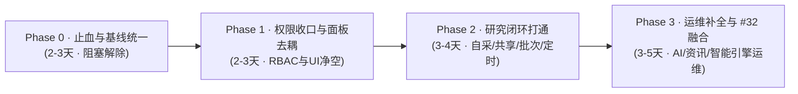

# SIFTLINE 业务梳理对照审计与系统解耦解决方案报告

> **审计说明与核实基线（2026-11-23）**
> - **业务对照标准**：基于本地原始梳理稿 `output/业务梳理.txt` 及完善后的 [SIFTLINE_全面业务梳理报告_2026-11-23.md](SIFTLINE_全面业务梳理报告_2026-11-23.md)；逐条修复进度见 [SIFTLINE_修复进度完成表_2026-11-23.md](SIFTLINE_修复进度完成表_2026-11-23.md)。
> - **代码核实基线**：
>   1. **远程最新主干**：`origin/main@3fece79`（已合入 `#31` 七域无环架构与 `#30` 研究工作台重构；数据库迁移至 `060_batch_visibility_and_field_policy.sql`）。
>   2. **PR #32 最新分支**：`origin/feat/backend-v2-feed-intelligence@a42594d`（基于 `#31@4b05369` 切出，尚未变基至 `#30`；含 `feed` / `intelligence` 新域及迁移 `059..062`）。
>   3. **本地工作区提示**：当前本地 `main` 停留在 `d4991c0`（#26），落后 `origin/main` 5 个提交；本报告所有代码行号与事实均严格核验自 `origin/main@3fece79` 与 `PR #32@a42594d` 真实源码。
> - **审计目标**：把当前系统的**跨分支阻塞、业务死锁、逻辑耦合、面板错误、权限组漏洞（RBAC/IDOR）、假开关、运维盲区**彻底审透，并逐一给出**低复杂度、符合 9 域无环 DAG 与单机 PG16（4 GB）约束的详细解决方案**。

---

## 0. 审计总览与问题分级矩阵（共 22 项核心缺陷）

### 0.1 宏观结论一句话总结

当前仓库正处于 **“两个优秀但互不兼容的半成品正面相撞”** 的临界点：
1. **`origin/main`（#30）** 把前端和后端围绕 **“研究项目（`monitor_project`）+ 批次资产（`collection_batch`）+ 预检计划”** 重构了一半，却因为过度保守的“必须管理员预先建源”和“只读共享项目无法补充采集/复用”制造了**多处业务死锁**，且残留了多处**普通用户面板泄漏**和**假开关（如 `exportEnabled` 未校验）**。
2. **`PR #32`（`a42594d`）** 补齐了极具价值的 **连接器扩展筛选字段、4 池防茧房信息流、Semrush 级关键词/KOL/Subreddit 智能监测与 GEO 外链榜**，却因为绕开 `#30` 另起炉灶，导致**迁移号 `059/060` 撞车**、**`intel_monitor` 存在严重跨用户越权（IDOR）与 Free 用户绕过套餐白嫖全站定时采集的高危漏洞**、**删除监测器后底层源永不停机的隐形烧钱死锁**，且**前端 0 页面接入、运维后台 0 管理入口**。

### 0.2 全量缺陷速查表（`AUD-01` ~ `AUD-22`）

| 编号 | 级别 | 所属领域 | 问题一句话定性 | 涉及分支 |
| :--- | :---: | :--- | :--- | :--- |
| **AUD-01** | **P0** | 跨分支集成 | 迁移号 `059/060` 硬冲突、`server.ts` Worker 回调签名冲突、`collection.ts` 契约互删字段 | `main` × `#32` |
| **AUD-02** | **P0** | 权限/安全 | `#32` `intel_monitor` 严重跨用户越权（IDOR）：任意普通用户可查看/篡改/删除他人和管理员的监测器 | `#32` |
| **AUD-03** | **P0** | 权限/安全 | `#32` `createMonitor -> ensureManagedSource` 越权穿透：Free 用户跳过全部套餐限制、无限建源、强制开定时白嫖全站预算、复活管理员暂停源 | `#32` |
| **AUD-04** | **P0** | 业务死锁/成本 | `#32` `deleteMonitor` / 禁用监测器后底层 `collection_source` 永不关闭，造成后台僵尸源无限烧钱死锁 | `#32` |
| **AUD-05** | **P0** | 资讯运维 | `#32` 迁移 `059` SQL 一刀切归档现存新闻/媒体源且无 `feed_lane` / `quality_grade` 运维台，合入即致资讯流大面积失联 | `#32` × `main` |
| **AUD-06** | **P1** | 架构耦合 | 研究工作区双轨撕裂：`main` 的 `Project + Batch` 与 `#32` 的 `IntelMonitor + ManagedSource` 互不相通 | `main` × `#32` |
| **AUD-07** | **P1** | 业务死锁 | 普通用户自主采集死锁：`main` 强制命中管理员预建源（`needs_admin_source`），无法自选社区/账号/词，且连接器筛选字段在 `main` 严重阉割 | `main` |
| **AUD-08** | **P1** | 业务死锁 | 共享项目（`source_filter`）无法补充自采集；且普通用户在共享项目批次页看不到「复用」按钮，无法把共享数据直接挪入自己项目 | `main` |
| **AUD-09** | **P1** | 逻辑错误 | 管理员在研究工作区建项目自动变全平台共享（`owner_user_id = ANY(staffIds)` -> `is_shared=true`），无私有空间且运维台缺共享项目入口 | `main` |
| **AUD-10** | **P1** | 核心缺口 | 研究工作区完全缺失「单次采集 vs 持续自动化采集」切换、用户组权限控制及全部项目卡片状态标签 | `main` × `#32` |
| **AUD-11** | **P1** | 数据资产管理 | 预设共享数据与自采集数据未分区；缺「一键移动」；私有垃圾批次无「彻底丢弃」语义（`removed` 仅解绑不隐藏，下次仍反复出现） | `main` |
| **AUD-12** | **P1** | 故障报错 | API 密钥未配置/失效时，前端静默隐藏源导致空列表，且吞掉后端精确 `blockers` / `409` / `422` 错误，管理员无法直接看到密钥故障根因 | `main` |
| **AUD-13** | **P1** | 权限/假开关 | `exportEnabled` 是彻底未生效的假开关；单用户覆盖漏掉 5 个新增策略字段；缺持续采集与 Monitor 策略位 | `main` × `#32` |
| **AUD-14** | **P1** | 预算冲突 | 宏观渠道预算双轨打架：DB `source_provider_budget` vs `#32` 硬编码 `DAILY_SOCIAL_ITEM_CEILING = 20_000` 及 `059` SQL 强改预算值 | `main` × `#32` |
| **AUD-15** | **P2** | 权限/域分裂 | `owner`/`admin` 权责与 MFA 门控不统一；成员套餐变更在 `/settings`，配额策略在 `/sources`，跨域割裂 | `main` |
| **AUD-16** | **P2** | 面板错误/泄漏 | 普通用户存在 5 处通往「运维管理 `/sources`」的泄漏入口与面板错乱（左下角治理、顶栏新建、`Ctrl+K`、通知红点、`/sources` 面包屑错乱） | `main` |
| **AUD-17** | **P2** | 面板泄漏 | `SettingsPage` 对普通用户暴露「成员与权限」「机器 API 密钥」「健康探针」「OpenAPI 摘要」及过时文案 `free (reserved)` | `main` |
| **AUD-18** | **P2** | 死链遗留 | `Ctrl+K` 遗留死链 `/projects?section=radar`（#30 已移除该视图，`activeSection` 成为死代码） | `main` |
| **AUD-19** | **P2** | AI 运维缺口 | `/admin/queue` 已发布事件 Tab 仅能「撤回」，无编辑 UI（后端已有 PATCH）、无新建/删除、无搜索分页且硬截断 60 条（线上 90+ 条后 30 条不可管） | `main` |
| **AUD-20** | **P2** | AI 运维缺口 | AI 来源接口无密钥在线管理（AA/LLM/OpenRouter 仍只能改 env 重启）、无注册表启停/周期编辑接口、厂商采集/发布未解耦且开关无错误反馈 | `main` |
| **AUD-21** | **P2** | 资讯运维缺口 | 资讯源运维查看最近入库会跳出运维域到 `/content`，且缺少 `#32` `feed_lane` / `quality_grade` / 增强引擎管理界面 | `main` × `#32` |
| **AUD-22** | **P2** | 前后端断层 | `#32` 15 条新路径 / 19 个新操作前端 0 接入，且完全缺失托管源、P80 自动补采、Rollup 回算的新后端管理空间 | `#32` |

---

## 1. P0 级：跨分支冲撞、合并阻塞与高危权限穿透漏洞

### AUD-01：迁移编号硬冲突、`server.ts` 回调碰撞与契约字段互相覆盖

- **代码证据**：
  - `origin/main` 已落盘：`src/storage/schema/059_project_batches_and_ownership.sql`、`src/storage/schema/060_batch_visibility_and_field_policy.sql`。
  - `PR #32` 同号落盘：`src/storage/schema/059_content_enrichment_and_source_lanes.sql`、`060_feed_personalization_and_seen.sql`、`061_social_intelligence_monitors_and_rollups.sql`、`062_feed_positive_event_idempotency.sql`。
  - `apps/api/src/server.ts`：`origin/main` 将 `startWorker` 第 4 参用作事务内 `attachBatchToProjectInTx`；`PR #32` 将同一第 4 参用作事务后 `onSourceContentChanged(sourceId, { changed, hydration })`。
  - `packages/contracts/src/collection.ts`：`git diff` 显示 `PR #32` 缺失 `origin/main` 新增的 `usageDomain`、`maxProjects`、`maxLookbackDays`、`allowProviderChoice`、`exportEnabled`、`Collect.projectId`、`ResearchPlanPreviewInput`、`BatchVisibilityInput`。
- **业务影响**：PR #32 无法直接合入 `main`；强行解决冲突若稍有不慎，会导致迁移器拒启、批次自动挂项目失效或 PR #30 策略字段丢失。
- **详细解决方案**：
  1. **严格保留 `main` 的 `059`、`060` 不可变哈希**，将 PR #32 的 4 份迁移顺延重编为 **`061`–`064`**（或将 `060`+`062` 合并为干净的 `062`，总计 `061`–`063`），并在隔离 PG16 上执行 `001 → 060 → 063` 连续前向与回滚校验。
  2. **将 `startWorker` 位置回调重构为具名生命周期钩子对象**：
     ```ts
     export interface WorkerHooks {
       onBatchCommittedInTx?: (client: PoolClient, info: { batchId: string; projectId: string; userId: string | null }) => Promise<void>;
       onSourceContentCommitted?: (info: { sourceId: string; changed: boolean; hydration: boolean }) => Promise<void>;
     }
     ```
     事务内仅执行 `onBatchCommittedInTx`（保证批次与项目强一致）；事务提交后异步执行 `onSourceContentCommitted`（Rollup 刷新与自动补采故障不回滚已入库数据，也不触发付费重试）。
  3. **合并 `collection.ts` 契约并统一 `usage_domain` 与 `feed_lane`**：不再维护两套互不关联的分类列——保留 `usage_domain`（`research | feed`）作为大域归属，或直接用 `feed_lane` 推导并加数据库 CHECK 约束防止矛盾（如 `feed_lane = 'monitor_only'` 必属 `usage_domain = 'research'`）。

---

### AUD-02：PR #32 `intel_monitor` 严重跨用户越权漏洞（IDOR）

- **代码证据**（`PR #32: src/modules/intelligence/sql.ts`）：
  - `listMonitors`（L43–57）：`SELECT m.* FROM intel_monitor m WHERE ($1::text IS NULL OR m.kind=$1)`，后续只校验 `actor.allowedSourceIds`（而所有浏览器用户的 `allowedSourceIds` 都是 `null`！），**完全没有 `WHERE m.owner_user_id = $userId`**！
  - `loadMonitor`（L82–101）、`updateMonitor`（L154–159）、`deleteMonitor`（L186–191）：全部只调 `assertActorAllowed(actor, sourceIds)`，**没有任何 `owner_user_id` 归属校验或 `viewer` 权限判断**！
- **业务影响**：任意一个刚注册的 Free 普通用户，调 `GET /v1/intelligence/monitors` 即可看到全站所有用户和管理员的商业监测器，甚至调 `PATCH` / `DELETE` 直接修改或删掉别人的监测器！
- **详细解决方案**：
  1. 参照 `src/modules/projects/sql.ts` 的 `owner_user_id` + 显式 `visibility`（`private | shared`）机制，对 `intel_monitor` 增加 `visibility TEXT NOT NULL DEFAULT 'private' CHECK (visibility IN ('private', 'shared'))` 列。
  2. **读权限隔离**：`viewer` 仅可读取 `owner_user_id = actor.userId OR visibility = 'shared'`；`owner`/`admin` 可读取全站并在运维台干预。
  3. **写/删权限隔离**：抽离 `assertMonitorWritable(client, actor, monitorId)`——`viewer` 仅可修改/删除 `owner_user_id = actor.userId AND visibility = 'private'` 的监测器；`shared` 监测器仅允许 `owner`/`admin` 修改；普通用户试图改/删他人或共享监测器一律返回 `403`。

---

### AUD-03：PR #32 `createMonitor -> ensureManagedSource` 权限大穿透（Free 白嫖定时爬取 + 复活管理员停用源）

- **代码证据**（`PR #32`）：
  - `src/modules/intelligence/routes.ts:80-82`：`POST /v1/intelligence/monitors` 开放给 `viewer_write`。
  - `src/modules/intelligence/sql.ts:125-144`：`createMonitor` **完全不查 `plan_collection_policy`**——不检 `manual_collect_enabled`、不检 `max_projects`、不检 `allowed_providers`、不检 `dailyItemBudget` 上限！
  - `src/modules/intelligence/provisioning.ts:142-144`：`buildSchedule` 硬编码 **`enabled: true`**！而 `src/modules/collection/worker.ts` 对 `purpose='scheduled'` 的定时任务**不走 `admitViewerCollection` 个人配额扣减**，直接消耗全站 `source_provider_budget`！
  - `src/modules/collection/managed.ts:352-363`：`ensureManagedSource` 发现同 target 的既有 `collection_source` 处于 `paused` 或 `archived` 时，直接 **`UPDATE collection_source SET state='active', schedule=...`**！
- **业务影响**：
  1. 任何被管理员关掉手动采集或限额为 0 的 Free 用户，只要建几个关键词 Monitor，就能绕过全部配额，用定时任务持续免费狂刷全站付费 Apify/TwitterAPIs 额度；
  2. 管理员在运维台手动暂停或归档的违规/高耗源，普通用户建一个同目标 Monitor 就能将其瞬间复活并开启定时爬取！
- **详细解决方案**：
  1. **严禁普通用户复活管理员已暂停/归档的源**：在 `collection_source` 增加 `managed_by TEXT NOT NULL DEFAULT 'admin' CHECK (managed_by IN ('admin', 'system_monitor'))` 及 `admin_locked BOOLEAN NOT NULL DEFAULT FALSE`。`ensureManagedSource` 遇到 `state !== 'active'` 且 `managed_by = 'admin'` 或 `admin_locked = true` 的源时，**严禁自动激活**，直接报错 `403/409`（提示该目标已被管理员暂停）。
  2. **强制接入 `plan_collection_policy` 准入闸门**：
     - 创建/修改 Monitor 前，对 `viewer` 必检 `maxProjects`（与项目统一计数或独立 `maxMonitors`）、`allowedProviders`、`allowAutoSchedule`（新增字段）、`minScheduleIntervalHours`、`dailyItemBudget <= effective.dailyResources`。
     - 若用户组无权开启持续自动采集（`allowAutoSchedule = false`），或用户显式选择“单次采集”，`buildSchedule` 必须生成 **`schedule: { enabled: false }`**！
  3. **用户级定时任务必须记账扣个人额度**：对归属 `viewer` 的持续自动监测任务，调度器在派发 `source_collection_job` 时必须带上 `requested_by_user_id = monitor.owner_user_id`、`requested_by_client_kind = 'browser'` 并走个人配额核验（扣减失败则自动暂停该用户的 Monitor 并写入告警，绝不偷用全平台公共预算）。

---

### AUD-04：PR #32 删除或禁用监测器后底层 `collection_source` 永不关闭（僵尸源隐形烧钱死锁）

- **代码证据**（`PR #32: src/modules/intelligence/sql.ts`）：
  - `deleteMonitor`（L184–197）：仅调用 `cancelUnstartedMonitorHydrations(client, id)` 后直接 `DELETE FROM intel_monitor WHERE id=$1`（级联删掉 `intel_monitor_source`）。**没有检查并停用底层已无人引用的 `collection_source`！**
  - `updateMonitor`（L168–179）：用户将 `enabled` 改为 `false`，或从 `config.keywords` 中移除了某些关键词时，同样只删 `intel_monitor_source` 映射，**原 `collection_source` 依然保持 `state='active'` 且 `schedule.enabled=true`**！
- **业务影响**：用户在界面上明明把监测项目关了甚至删了，后台 Worker 依然每 6 小时继续对这些孤儿源调用付费 API，直到烧光渠道月预算！
- **详细解决方案**：
  1. 在 `src/modules/collection/managed.ts` 增加 `reconcileManagedSources(client, affectedSourceIds)`：
     - 事务内检查 `affectedSourceIds` 中 `managed_by = 'system_monitor'` 的源；
     - 若该源不再被任何 `enabled = true` 的 `intel_monitor`（且要求持续采集）引用，则立即将其 `schedule = jsonb_set(schedule, '{enabled}', 'false')`、`next_due_at = NULL`，并取消其所有未开始的 `purpose='scheduled'` 排队任务；
     - 若完全无任何 Monitor 引用，则将其 `state = 'paused'`（保留历史已入库内容的只读归档与外键完整，不物理删表）。
  2. 在 `updateMonitor`（修改目标/关闭 `enabled`）与 `deleteMonitor` 事务内强制调用 `reconcileManagedSources`。
  3. 同时在运维台 `[5] 智能监测引擎运维` 提供孤儿托管源巡检列表与一键回收按钮。

---

### AUD-05：PR #32 迁移 `059` 一刀切归档现存资讯源，且缺少 `feed_lane` / `quality_grade` 运维台

- **代码证据**：
  - `PR #32: src/storage/schema/059_content_enrichment_and_source_lanes.sql`（L108–124）：直接在 Schema 迁移里执行 `UPDATE collection_source SET feed_lane = 'news', state = 'archived', schedule.enabled = false WHERE ... source_group IN ('public-affairs','lifestyle','tech-media','design-visual','science') OR label ~* '(v2ex|bilibili|zhihu|ithome|ifanr|cnbeta|...)'`。
  - `origin/main: apps/web/src/components/SourceEditor.tsx` & `SourcesPage.tsx`：完全不认识 `feed_lane` 和 `quality_grade` 字段，也没有泳道筛选器。
- **业务影响**：一旦按现状合并运行迁移，生产上 95 个活跃资讯源中的绝大多数会被直接写死为 `archived` 并停采；而管理员在资讯运维台里既看不到泳道分类，也无法一键调整泳道或恢复误归档的频道！
- **详细解决方案**：
  1. **Schema 迁移只做结构加列与安全分类标注，绝不做不可逆的生产数据强归档**：迁移中仅给传统新闻/媒体源打标 `feed_lane = 'news'`（让新 `/v1/feed/stream` 默认按 `feed_lane IN ('discussion', 'release')` 过滤，从而不污染高讨论信息流），**不要在迁移 SQL 里强行将它们全部改为 `state = 'archived'`**；是否停采交由管理员在运维台按需批量操作，确保既有 `/` 公开首页与 `/app/feed` 零断流。
  2. 在「运维管理 → `[2]` 资讯信息流运维」与 `SourceEditor` 中完整补齐 **`feed_lane`（`discussion` / `release` / `monitor_only` / `news`）** 与 **`quality_grade`（`S/A/B/C`）** 的筛选、展示、单项与批量编辑能力。

---

## 2. P1 级：核心业务死锁、模型耦合与逻辑矛盾

### AUD-06：研究工作区双轨模型撕裂（`Project + Batch` vs `IntelMonitor + ManagedSource`）

- **代码证据**：
  - `origin/main` 围绕 `monitor_project`（`dataset_mode`: `'source_filter' | 'batch'`）+ `collection_batch` + `monitor_project_batch` 建好了前端页面（`ProjectsPage`、`ProjectCollectView`、`ProjectWorkspaceViews`）。
  - `PR #32` 在 `docs/plans/backend-v2-blueprint.md` 中将 `projects` 降级为 `"Legacy Compatibility Layer"`，新建了平行的 `intel_monitor` + `intel_monitor_source` + `intel_monitor_target` + `intel_rollup_bucket`（共 4 张新表 + 13 个新接口），与 `collection_batch` 毫无关联。
- **业务影响**：如果两套模型并存不融合，用户打开研究工作区会困惑：“为什么我有‘研究项目’又有‘监测器’？在监测器里采的数据怎么不能挪到我的研究项目里？管理员的预设共享项目又是哪一种？”
- **详细解决方案（统一低复杂度融合模型）**：
  - **对用户统一心智为唯一概念 —— 「研究项目（Research Project）」**，按业务形态支持两种数据组织模式与扩展视图：
    1. **自由专题研究（Batch 驱动）**：支持单次/持续采集批次自由挂载、预设共享数据引入、跨项目复用/移动/禁用/丢弃（完全满足《业务梳理》`(1)`–`(5)`）。
    2. **专项智能监测模板（复用 `#32` `intel_monitor` 引擎作为项目可选的“智能追踪器”能力）**：用户在项目内可绑定 1 个或多个结构化监测规则（关键词 SoV / KOL 列表 / Subreddit 集群），其每次采集同样落盘为 `collection_batch` 并自动挂载到本项目，同时触发 `intel_rollup_bucket` 预聚合，让项目总览直接点亮 `#32` 的 **SoV、意图分布、GEO 外链榜、KOL 画像、Subreddit 热力图**！
  - **关键好处**：彻底消除“两套研究入口”，批次资产流转（挪用、启禁、丢弃）与 `#32` 的高阶监测分析合二为一，后端仅需在 `monitor_project` 或关联表上建立 `project_id <-> monitor_id` 轻量绑定即可，无需推倒重来。

---

### AUD-07：普通用户自主采集死锁（`needs_admin_source` 拦截 + `main` 连接器筛选字段阉割）

- **代码证据**：
  - `origin/main: src/modules/collection/plans.ts:455-496`：`POST /v1/research/collection-plans/preview` 只能在已有 `collection_source`（`usage_domain='research'`）里查找；只要用户输入的社区/账号/关键词没被管理员提前建过源，即返回 `resolutionStatus: "needs_admin_source"`, `executable: false`, `restrictions: ["target_unavailable"]`。
  - `origin/main: apps/web/src/components/CollectionIntakeSteps.tsx:108-138`：采集范围只有 `days`、`limit`、`includeComments`、`maxCommentsPerPost`，完全无法设置排序（`top`/`hot`/`new`）、最低赞/评门槛、排除转发、语言筛选；且 `origin/main` 的 `kaix`、`red_crawler`、`twitterapis`、`scrapebadger` 硬编码只抓最新帖（`new` / `Latest`）。
- **业务影响**：直接打破《业务梳理》`(1)` —— 普通用户新建一个自己关心的研究主题，连最基本的“输入 `r/cursor` 或关键词 `Cursor vs Windsurf` 抓高赞帖”都做不到，必须每次找管理员去运维台手动建源，流程彻底卡死！
- **详细解决方案**：
  1. **引入受控按需建源（Controlled Self-Serve Provisioning）**：
     - 将 PR #32 的 `ensureManagedSource` 安全加固后（见 AUD-03：检查 `plan_collection_policy`、遵守平台禁止列表、绝不复活管理员暂停源、默认 `schedule.enabled = false`、`managed_by = 'system_monitor'`），直接接入研究工作区的采集确认流程！
     - 在 `POST /v1/research/collection-plans/preview` 中：若目标尚未注册但符合格式规范、对应平台渠道密钥与预算就绪、且用户套餐允许自选目标，则返回 `resolutionStatus: "on_demand_ready"`, `executable: true`，给出准确估算；用户确认提交时，由新接口 `POST /v1/research/collect`（或扩展 `/v1/projects/:id/collect`）在事务内原子完成 `ensureManagedSource(schedule: enabled=false)` + 扣个人额度 + 入队 `source_collection_job` + 关联 `projectId`！
  2. **合入 PR #32 的连接器扩展筛选字段到采集面板**：
     - 在 `IntakeScopeStep` 与 `Collect` / `ResearchPlanPreviewInput` 契约中透出并支持后端 API 已具备的自由度：
       - **排序方式**：`top` / `hot` / `new`；
       - **互动门槛**：`minLikes`（最低点赞/分数）、`minComments`（最低评论数）；
       - **X 专属**：`excludeReposts`（排除纯转发）、`language`（语言）；
       - **评论深度**：`includeComments`、`maxCommentsPerPost`。
     - 各字段的可用性与上限均由 `fieldPolicy`（从用户组策略动态计算）驱动，管理员自动满血全开。

---

### AUD-08：共享预设项目（`source_filter`）无法补充采集，且普通用户无法将共享数据直接挪入自己项目

- **代码证据**：
  - `origin/main: apps/web/src/components/ProjectCollectView.tsx:1333-1334`：`const canModify = writable && batchProject;`。对于管理员预设的 `source_filter` 共享项目，普通用户 `can_edit = false`，点「数据接入」被直接拦截（L1461–1468）；甚至连管理员自己面对 `source_filter` 项目也无法通过「数据接入」追加单次采集！
  - `origin/main: apps/web/src/components/ProjectWorkspaceViews.tsx:1812, 1842`：`ProjectBatchesView` 整个「操作（Actions）」列（包含「复用 Reuse」到其他项目的下拉框和按钮）被包裹在 `{project.can_edit && (...)}` 中！导致普通用户进入共享项目的「数据批次」页面时，**根本看不到任何「复用到我的项目」按钮**！
  - `origin/main: src/modules/projects/sql.ts:605-611`：`source_filter` 项目的数据不走 `monitor_project_batch`，只靠 `monitor_project_source` 动态查询，导致共享项目与自建项目之间**没有统一的数据引用/挪用协议**。
- **业务影响**：直接阻塞《业务梳理》`(2)`（基于预设共享项目补充自采集）与 `(3)`（把预设主题数据直接挪到自己项目里）。
- **详细解决方案**：
  1. **让「复用 / 引入到我的项目」对只读共享项目完全可用**：
     - 在 `ProjectBatchesView` 中，将「复用到我的项目」从 `project.can_edit` 守卫中拆分出来：只要当前用户拥有至少 1 个 `can_edit === true` 的目标项目（`otherWritableProjects.length > 0`），即使当前正在查看的共享项目是只读的，依然展示「引入到我的项目」按钮（同时继续隐藏禁用/移除按钮，确保共享项目本身不被篡改）。
  2. **在共享项目顶部与「数据接入」页增加「基于此共享主题扩展我的研究（Fork / Supplement）」一键动作**：
     - 新增后端接口 `POST /v1/projects/:id/fork`（`viewer_write`）：以选中的共享项目为基础，在事务内为用户创建一个新的私有项目（`dataset_mode = 'batch'`，记录 `parent_shared_project_id`），并自动把该共享项目当前关联的共享批次（或将其 `source_ids` 下所有可见共享批次，或作为共享数据引用源）一键挂入新项目，随后自动跳转到新项目的「数据接入」页让用户直接按自己的采集字段补充采集！
  3. **统一共享项目的数据载体**：将管理员在运维台新建的共享项目同样产出并绑定 `visibility = 'shared'` 的 `collection_batch`（定时采集每次入库也自动记为该共享项目的共享批次），彻底消除 `source_filter` 与 `batch` 两套割裂的底座（旧 `source_filter` 仅做向后兼容只读支持，并提供一键转批次视图）。

---

### AUD-09：管理员在研究工作区建项目自动变全平台共享（归属逻辑错乱）

- **代码证据**：
  - `origin/main: src/modules/projects/sql.ts:445`：
    ```sql
    (p.owner_user_id IS NULL OR p.owner_user_id = ANY($5::uuid[])) AS is_shared
    ```
    其中 `$5` 是 `listStaffOwnerIds(pool)`（所有 `owner` 和 `admin` 的用户 ID 列表）！
  - `origin/main: src/modules/projects/sql.ts:465-470`：`viewer` 查询列表条件包含 `OR p.owner_user_id = ANY($5::uuid[])`！
  - `origin/main: src/modules/collection/batches.ts:658-662`：管理员发起采集生成的 `collection_batch` 同样默认强制 `visibility = 'shared'`！
- **业务影响**：
  1. 管理员自己在研究工作区建的任何测试项目、个人专题或草稿，**瞬间全员可见**，污染全体用户的「共享研究项目」列表；
  2. 运维台 `[1] 研究采集源运维` 中却完全没有「全平台共享项目管理」入口，职责颠倒。
- **详细解决方案**：
  1. **给 `monitor_project` 增加显式列 `visibility TEXT NOT NULL DEFAULT 'private' CHECK (visibility IN ('private', 'shared'))`**（新迁移顺延编号），历史 `owner_user_id IS NULL` 或既有运维共享项目回填为 `'shared'`，其余均为 `'private'`。
  2. 修改 `src/modules/projects/sql.ts`：用 `p.visibility = 'shared'` 彻底取代 `p.owner_user_id = ANY($5::uuid[])`！
     - 管理员在**研究工作区**新建项目默认 `visibility = 'private'`，其产生的批次默认 `visibility = 'private'`，享受与普通用户完全一致的私有研究体验；
     - 管理员在**运维管理 → `[1]` 共享研究项目管理**中创建（或在项目设置中显式切换为 `shared`）的项目，才标记为 `visibility = 'shared'`，其产生的批次自动标为 `visibility = 'shared'`，面向全平台用户展示。

---

### AUD-10：研究工作区完全缺失「单次采集 vs 持续自动化采集」控制与项目状态标签

- **代码证据**：
  - `origin/main: apps/web/src/components/CollectionIntakeSteps.tsx` & `ProjectWorkspaceViews.tsx`：研究工作区只能走单次手动采集；`ProjectListView`（L1584–1635）和 `ProjectSwitcher` 仅显示 `N 批次 / N 来源 / 共享 / 只读`，**没有任何「单次采集 / 持续自动采集」状态标签**。
  - `origin/main: src/storage/schema/059` & `060`：`plan_collection_policy` 中没有 `allow_auto_schedule`、`max_scheduled_tasks`、`min_schedule_interval_hours` 等控制字段。
  - `PR #32`：相反地把所有 `intel_monitor` 写死为 `schedule.enabled = true` 持续采集，不支持纯单次采集，也不受用户组控制。
- **业务影响**：直接违反《业务梳理》`（5）` 与 `[1]（2）` —— 既无法在采集面板按权限组切换“持续动态采集 / 单次采集”，全用户组在项目选择面板也看不到每个共享项目究竟在实时自动更新还是静态一次性快照。
- **详细解决方案**：
  1. **数据库与策略扩展**（在顺延迁移中完成）：
     - `plan_collection_policy` 新增：`allow_auto_schedule BOOLEAN NOT NULL DEFAULT FALSE`（Free 默认 `false`，Pro 默认 `true`）、`max_scheduled_tasks INTEGER NOT NULL DEFAULT 0`（Pro 默认 `5`）、`min_schedule_interval_hours INTEGER NOT NULL DEFAULT 24`（Pro 默认 `6`）。
     - `monitor_project` 新增聚合/显式元数据（或在 `GET /v1/projects` 实时 JOIN 关联调度源/监测器计算）：`collection_mode: 'one_time' | 'scheduled' | 'mixed'`、`schedule_interval_hours: number | null`、`last_collected_at: string | null`、`next_due_at: string | null`。
  2. **前端两处落地**：
     - **全部项目列表（`ProjectListView`）与 `ProjectSwitcher`**：为每个项目（尤其是共享项目）醒目渲染状态徽标——例如绿色动态呼吸灯徽标 **`持续自动采集 · 每 6h`** 或灰色静态徽标 **`单次快照采集`** + 最近更新时间；
     - **研究工作区「数据接入 / 采集任务」面板**：增加采集模式单选「单次采集 / 持续自动化采集（选周期）」——Free 用户若策略未开放，显示锁形图标与权限说明；Pro/管理员开启后，在项目的「采集任务」面板支持一键暂停/恢复/修改周期，且与后台 Worker 调度联动。

---

### AUD-11：批次数据资产管理缺失分区展示、一键移动与私有批次彻底丢弃

- **代码证据**：
  - `origin/main: apps/web/src/components/ProjectWorkspaceViews.tsx:1803-1948`：`ProjectBatchesView` 将共享批次与私有批次混在同一张表格里，仅靠一列小标签 `Private/Shared` 区分；
  - 操作只有 `Enable/Disable`、`Remove`（`status='removed'`）和 `Reuse`（复制到目标项目），没有「移动（Move）」；
  - `origin/main: src/modules/collection/batches.ts:694-754`：没有 `DELETE /v1/batches/:id` 或 `discarded_at` 软删字段，导致 `status='removed'` 仅从 `monitor_project_batch` 解绑，该垃圾私有批次仍永久躺在 `collection_batch` 表里，下次点「使用已有数据」时继续出现！
- **业务影响**：违反《业务梳理》`(3)`（预设主题数据与自采集数据分开放、可挪出/挪到其他项目）与 `(4)`（支持彻底丢弃自己采集的错误数据，但不能丢弃预设共享数据）。
- **详细解决方案**：
  1. **批次表增加私有软丢弃字段**：`collection_batch` 新增 `discarded_at TIMESTAMPTZ NULL`。
  2. **新增两个轻量接口**：
     - **`POST /v1/projects/:id/batches/:batchId/move`**（`viewer_write`）：原子事务内执行“挂入目标项目（校验目标可写）+ 从源项目设为 `removed`”，实现一键“挪走”；
     - **`DELETE /v1/batches/:id`**（`viewer_write`，软丢弃）：严格校验 `visibility = 'private'` 且 `created_by_user_id = actor.userId`（或管理员操作）；**若 `visibility = 'shared'`，对普通用户强硬返回 `403`（禁止丢弃平台预设共享数据）**！软丢弃后将 `discarded_at = NOW()` 并把关联的 `monitor_project_batch` 置为 `removed`，以后在所有查询与「使用已有数据」中过滤 `discarded_at IS NULL`。
  3. **前端 `ProjectBatchesView` 改造**：拆分为两个清晰分区卡片——**「区块 1：预设共享主题数据（只读受保护，可启禁/移出/引入其他项目，不可丢弃）」** 与 **「区块 2：我的自采集数据（可启禁/移出/复用/一键移动/彻底丢弃）」**。

---

### AUD-12：API 密钥未配置/失效时前端静默隐藏源、错误被吞没（违背分级精准报错原则）

- **代码证据**：
  - `origin/main: apps/web/src/components/ProjectCollectView.tsx:1344-1349`：`eligible` 列表把 `!service.enabled`（密钥未配或联网关了）的源直接过滤掉，结果密钥没配时列表变空，只显示“当前账号暂无可用的采集对象”！
  - `origin/main: apps/web/src/components/CollectionIntakeSteps.tsx:185, 203`：后端 `plans.ts:304` 明明返回了具体 `blockers: ["Provider kaix is disabled or missing credentials/networking"]`，但前端只按 `restrictions` 枚举渲染了固定模糊文案 `"采集服务尚未就绪。请换个对象，或联系管理员。"`，**彻底扔掉了 `result.blockers` 里的精准根因**！
  - `origin/main: apps/web/src/lib/researchIntake.ts:21`：`useIntakeError` 把提交时的所有 `409/422` 后端错误统一覆盖为 `"采集配置或服务预算可能已变化"`，管理员自己也看不到是 API 密钥错了！
- **业务影响**：直接违反《业务梳理》`[1]（1）` —— “若密钥配置没生效，任何用户组在研究工作区都无法开展采集工作（此时任何用户组都应该看到报错，但是管理员账户下可以看到精确的报错原因是 API 密钥问题）”。
- **详细解决方案**：
  1. **后端 `plans.ts` 与 `quotas/summary` 细化不可用原因码（区分三类根因）**：
     - 将笼统的 `provider_unavailable` 拆分为 3 个精确 `restrictionCode`：
       - `network_disabled`（服务端 `SOURCE_NETWORK_ENABLED=false`）；
       - `credential_missing`（该渠道 API Key 未配置）；
       - `credential_invalid`（最近一次探测/运行因 401/403 鉴权失败）。
     - **接口返回按角色分级**：
       - 对 `viewer`：只返回脱敏后的统一错误码与业务提示（如 `channel_unavailable`：“当前平台该渠道采集服务未就绪，暂时无法采集，请联系管理员处理”）；
       - 对 `owner / admin`：额外返回 `adminDiagnostic: { code, provider, envVar, detail, fixPath: '/sources?tab=providers' }`（如“Apify API Token 未配置（环境变量 `APIFY_API_TOKEN` 与加密密库均为空），请前往第三方采集密钥页配置”）。
  2. **前端 `ProjectCollectView` & `CollectionIntakeSteps` 改造**：
     - **绝不静默过滤因密钥失效而不可用的平台/源**！当某个平台或全部研究渠道因密钥未配置而不可用时，直接在「数据接入」页顶部渲染醒目的阻断告警横幅（Alert），置灰提交按钮；
     - 普通用户看到明确的“采集服务当前不可用”阻断报错；管理员看到精确的 API 密钥故障根因卡片 + **「前往配置密钥 →」**直达按钮；
     - `useIntakeError` 对管理员保留后端 `error.message` 原文透出，不再一刀切吞掉 `409/422` 详情。

---

## 3. P1 / P2 级：权限组漏洞、假开关与预算体系矛盾

### AUD-13：`exportEnabled` 假开关 + 单用户覆盖漏字段 + 策略维度不全

- **代码证据**：
  - `origin/main: src/storage/schema/059_project_batches_and_ownership.sql:23` 与 `QuotasManagementView.tsx:1376-1379` 都定义了 `export_enabled`（`允许 CSV/JSON 数据导出`），但 `origin/main: src/modules/content/export.ts:44-100` **完全没有读取 `plan_collection_policy` 或校验 `exportEnabled`**！任何 Free 用户都可以直接调 `GET /v1/content/export` 导出 50,000 行数据！
  - `origin/main: src/modules/collection/policy.ts:520-527`：`QuotaOverride`（单用户覆盖）仅含 6 个字段（`manualCollectEnabled`/`allowedProviders`/`allowedSourceIds`/`dailyRequests`/`dailyResources`/`maxBatchLimit`），**漏掉了 `maxCommentsPerPost`、`maxProjects`、`maxLookbackDays`、`allowProviderChoice`、`exportEnabled`**，导致管理员无法针对某个 VIP 测试用户单独放宽项目数或回溯天数！
- **详细解决方案**：
  1. **立刻让 `exportEnabled` 真实生效**：在 `apps/api/src/app.ts` 注入只读策略回调 `assertExportAllowed(pool, actor)` 给 `contentRoutes -> exportRoutes`（保持 `content` 不反向依赖 `collection` 的 DAG 门禁）；对 `viewer` 读取有效策略（含个人覆盖），若 `!effective.exportEnabled` 则返回 `403 ("Data export is disabled for your plan")`；前端 `ContentExplorerPage` 同步按 `effectivePolicy.exportEnabled` 控制导出按钮状态并提示升级。
  2. **补齐 `QuotaOverride` 与 `UserQuotaOverrideInput` 全字段**：将 `maxCommentsPerPost`、`maxProjects`、`maxLookbackDays`、`allowProviderChoice`、`exportEnabled` 以及新增的 `allowAutoSchedule`、`maxScheduledTasks`、`minScheduleIntervalHours` 全部纳入 `resolveEffectivePolicy` 与运维台单用户覆盖表单。

---

### AUD-14：宏观预算双轨冲突（DB 渠道预算 vs `#32` 硬编码 20,000 常量）

- **代码证据**：
  - `origin/main: src/modules/collection/routes.ts:195-244`：宏观预算保存在 `source_provider_budget` 表，由管理员在线编辑。
  - `PR #32: src/modules/collection/automatic-hydration.ts:277`：硬编码常量 **`export const DAILY_SOCIAL_ITEM_CEILING = 20_000;`**，被 `estimateMonitorCollection`、`triggerMonitorCollect`、`enqueueAutomaticCommunityHydration`、`cancelHydrationOutsideBudget` 四处直接引用。
  - `PR #32: 059_content_enrichment_and_source_lanes.sql:127-134`：迁移 SQL 直接改写 `source_provider_budget` 把 4 个付费渠道的 `daily_resources` 强制抬高到 `>= 10,000`！
- **业务影响**：管理员在运维台调大预算到 50,000 会被硬编码 20,000 暗中截断；管理员想把生产预算压低到 1,000 控成本，跑一次迁移又会被 SQL 暗中拉回 10,000！
- **详细解决方案**：
  1. **删除 `059` 迁移里强行修改生产 `source_provider_budget` 的 `UPDATE` 语句**（预算值属于运行时运营配置，不应由 Schema 迁移覆写生产配置）。
  2. **将全站社媒直调日总上限配置化**：新增轻量 `system_runtime_config` 键值行（或扩展全局预算设置接口 `PUT /v1/sources/budgets/global`），把 `daily_social_item_ceiling`（默认 `20000`）与 `auto_hydration_enabled` 纳入运维台 `[3] 宏观渠道预算` 卡片在线可配，并作为平台级总封顶与分渠道预算同屏展示。

---

### AUD-15：`owner` / `admin` 权责与 MFA 门控不统一，成员管理与配额管理跨域分裂

- **代码证据**：
  - `origin/main: src/modules/collection/routes.ts:198`：`PUT /v1/sources/budgets/:provider` 声明 `access: "admin"`（**无需 MFA**），而 `PUT /v1/quotas/users/:id` 与 `PUT /v1/sources/credentials/:provider` 声明 `access: "admin_mfa"`（需 MFA）。
  - `origin/main: src/modules/collection/policy.ts:716, 794`：`GET /v1/quotas/summary` 对 `admin/owner` 也返回 `effectivePolicy`（其底层读的是 `app_user.plan_tier`，通常为 `'free'`），造成语义混乱。
  - 成员角色/套餐修改在 `/settings?tab=members`，而个人配额覆盖在 `/sources?tab=budgets`——管理员刚把某用户升成 `pro`，还要切去另一个顶级域才能看他的配额！
- **详细解决方案**：
  1. **统一高危运维写操作的 MFA 安全等级**：`PUT /v1/sources/budgets/:provider` 与全局预算修改统一提升为 `admin_mfa`，与凭证/配额覆盖保持一致；明确文档与界面区分 `Owner`（可改全局 Free/Pro 套餐默认模板、升降 Admin）与 `Admin`（可管宏观预算、单用户覆盖、来源、共享项目、AI 审核）。
  2. **`GET /v1/quotas/summary` 对 `owner/admin` 返回显式 `bypassPlanLimits: true` 标记**，杜绝前端把管理员当 `free` 限制。
  3. **将「成员角色/套餐与邀请管理」收口或双向联动到「运维管理 → `[3]` 用户组与成员治理」**：管理员在一张用户表里同时完成“改套餐 Free/Pro”、“改角色/启禁”和“调整个人配额覆盖”。

---

## 4. P2 级：面板错误、导航泄漏与 AI / 资讯 / `#32` 运维缺口

### AUD-16：普通用户存在 5 处通往「运维管理 `/sources`」的面板泄漏与路由错乱

- **代码证据（全部来自 `origin/main` 实码）**：
  1. **`WorkbenchShell.tsx:1339-1341`**：左下角个人配额卡片渲染了 `<button onClick={() => navigateAndClose('/sources?tab=budgets')}>治理</button>`，**未判断 `canWrite`**！普通用户一点就跳进 `/sources?tab=budgets`。
  2. **`WorkbenchShell.tsx:1501-1505`**：顶栏 `+ 新建` 下拉菜单对所有登录用户渲染了 `<button onClick={() => navigateAndClose('/sources?new=1')}>采集来源</button>`，**未判断 `canWrite`**，普通用户点击直接撞权限拒绝页！
  3. **`WorkbenchShell.tsx:848`**：`Ctrl+K` 命令面板对所有用户包含 `{ label: '来源与采集任务', run: () => navigateAndClose('/sources') }`，**未判断 `canWrite`**！
  4. **`WorkbenchShell.tsx:682, 705-713, 1535-1542`**：普通用户登录也会拉取全量 `useSourcesQuery`，顶栏通知铃铛会向普通用户弹出运维级告警 `blockedSources`（`"存在未决付费阶段任务，已暂停自动采集"`）！
  5. **`App.tsx:561` + `WorkbenchShell.tsx:730-732` + `SourcesPage.tsx:79, 441-447`**：`SourcesPage` 故意放行 `viewer` 访问 `/sources?tab=budgets` 和 `/sources?tab=jobs`，但页面顶部面包屑硬写着 **`运维管理 / 我的采集配额`**（点面包屑“运维管理”立刻报错无权限！），与此同时左侧主图标栏却高亮着「研究工作区」，次级导航也是研究工作区菜单——**严重精神分裂的面板错误**！
- **详细解决方案（彻底物理隔离普通用户与运维空间）**：
  1. **把 `/sources` 与 `/admin/*` 收口为 100% 纯管理员路由**：在 `App.tsx` 路由守卫中，凡 `!canWrite` 访问 `/sources` 或 `/admin/*` 直接重定向至 `/projects` 或渲染统一的 403 引导页，**不再把 `/sources` 半开给 `viewer`**！
  2. **把普通用户的“我的配额”迁入 `/settings?tab=quota`（账户与设置），把普通用户的“我的采集任务”收口在 `/projects?view=jobs`（研究工作区）**：
     - 侧边栏左下角配额卡对普通用户按钮文案改为「查看额度」，跳转 `/settings?tab=quota`；对管理员保留「治理」，跳转 `/sources?tab=budgets`。
  3. **清理全部 3 处导航/告警泄漏**：
     - 顶栏 `+ 新建` 下拉菜单的「采集来源」加 `{canWrite && ...}` 守卫；
     - `Ctrl+K` 命令面板的 `/sources` 加 `...(canWrite ? [...] : [])` 守卫；
     - 通知铃铛的 `blockedSources` / `zeroQuotaProviders` 运维告警仅对 `canWrite` 渲染（普通用户通知铃铛改为展示**本人采集任务完成/失败通知**与**本人额度即将耗尽提醒**）。

---

### AUD-17：`SettingsPage` 对普通用户暴露管理菜单、调试探针与过时文案

- **代码证据**：
  - `origin/main: apps/web/src/pages/WorkbenchShell.tsx:1287-1305`：左侧「账户与设置」次级菜单无条件向 `viewer` 显示「成员与权限」与「机器 API 密钥」；
  - `origin/main: apps/web/src/pages/SettingsPage.tsx:1227-1228`：无条件向 `viewer` 发起 `useMachineKeysQuery(true)` 和 `useSourcesQuery(true)`；
  - `SettingsPage.tsx:1330-1342, 1393-1402`：向普通用户暴露「健康探针 `/healthz /readyz`」和「OpenAPI 摘要」等系统运维调试按钮；
  - `SettingsPage.tsx:1381`：把套餐层级硬编码写死成 **`${actor.planTier ?? 'free'} (reserved)`**，而套餐策略明明已在生产生效！
- **详细解决方案**：
  1. `WorkbenchShell` 的 `settings` 次级菜单中，「成员与权限」「机器 API 密钥」严格用 `canWrite` 门控隐藏；`SettingsPage` 对应 Tab 加 `canManage` 守卫并按需发请求（`useMachineKeysQuery(canManage && tab === 'keys')`、`useSourcesQuery(canManage && tab === 'keys')`）。
  2. 健康探针与 OpenAPI 摘要按钮仅对管理员显示；移除 `(reserved)` 过时标注，改为展示真实生效套餐与「我的额度」子页签。

---

### AUD-18：`Ctrl+K` 命令面板遗留死链 `/projects?section=radar`

- **代码证据**：
  - `origin/main: apps/web/src/pages/WorkbenchShell.tsx:846`：`{ label: '趋势雷达多维图谱', run: () => navigateAndClose('/projects?section=radar') }`。
  - `origin/main: apps/web/src/pages/ProjectsPage.tsx:100`：仅声明了 `const activeSection = searchParams.get('section') || '';`，全文已无任何消费点（#30 重构移除了旧 `radar` 分区）。
- **详细解决方案**：移除无效死链与无用变量 `activeSection`，将 `Ctrl+K` 快捷项对齐为真实的 `/projects?view=overview`、`/projects?view=collect`、`/projects?view=batches`、`/projects?view=jobs`。

---

### AUD-19：AI 发布情报运维（`/admin/queue`）已发布事件管理严重残缺

- **代码证据**：
  - `origin/main: apps/web/src/pages/AiReviewQueuePage.tsx:303`：`useAiEventsQuery({ limit: 60 }, ...)` 硬写 `limit: 60` 且无分页/搜索/厂商筛选，而生产库冷启动已有 **90+ 条已发布事件**，意味着后 30+ 条历史事件在管理后台**永远看不见、管不了**！
  - `AiReviewQueuePage.tsx:944-982`：`tab === 'published'` 仅有列表与一个「撤回 Unpublish」按钮——后端明明已经实现了 `PATCH /v1/admin/ai/events/:id`（`src/modules/ai/ai-routes.ts:154-184`），前端却**没有编辑弹窗**，也**没有直接新建事件入口**、**没有重新发布/删除操作**！
- **详细解决方案**：
  1. **补全已发布事件全量 CRUD 接口**：
     - 扩展 `GET /v1/admin/ai/events`（或复用带 `visibility=all` 的管理查询）支持 `search`、`vendor`、`eventStatus`、`visibility`、`limit`、`offset` 与 `total` 总数，覆盖全部历史记录（包含已撤回事件，支持重新发布）；
     - 新增 `POST /v1/admin/ai/events`（`admin_mfa`）：允许管理员直接录入带官方主证据链接的重大发布事件；
     - 复用已有 `PATCH /v1/admin/ai/events/:id` 对接前端编辑抽屉；新增软删除/归档端点（或明确 `visibility='deleted'` + 审计日志）。
  2. **升级 `AiReviewQueuePage` 的「已发布事件」面板**：补齐搜索框、厂商/状态/可见性筛选器、分页条、「+ 手工录入事件」弹窗、行内「编辑 / 撤回 / 重新发布 / 删除」完整操作闭环。

---

### AUD-20：AI 来源 API 接口运维缺失密钥管理、周期编辑与厂商采集开关

- **代码证据**：
  - `origin/main: src/modules/ai/ai-routes.ts`：存在 `GET /v1/admin/ai/sources` 和 `POST /v1/admin/ai/sources/:code/sync`，但**根本没有 `PATCH /v1/admin/ai/sources/:code` 接口**，管理员无法在线启停某个注册表源或调整 `sync_interval_seconds`（采集周期），也无法手动清除熔断器 `circuit_open_until`！
  - `Artificial Analysis`（`ARTIFICIAL_ANALYSIS_API_KEY`）、`OpenRouter`、`AI_LLM_API_KEY` 等 AI 专用凭证未接入 AES-256-GCM 密库，只能靠改服务器 env 重启容器。
  - `AiReviewQueuePage.tsx:659`：厂商自动发布开关 `onClick={() => mutations.setVendorAutoPublish.mutate(...)}` 没有 `disabled={isPending}` 防连点，也没有错误提示回调；且只能控“自动发布”，无法单独控某厂商的“自动采集开关”。
  - `AiSourceOperations.tsx:1068, 1075`：使用原生 `<a href="/sources?new=1">` 和 `<a href={'/sources?sourceId=' + source.id}>`，点击触发浏览器整页重载且丢失 `domain=feed`。
- **详细解决方案**：
  1. **扩展密库覆盖 AI 来源凭证**：复用 `source_provider_credential`（AES-256-GCM）纳入 `artificial_analysis`、`ai_llm`、`openrouter` 三个可选凭证槽位，支持在线加密保存、轮换、撤销与连通性探测（`POST /v1/admin/ai/credentials/:provider/test`）。
  2. **新增 `PATCH /v1/admin/ai/sources/:code`（`admin_mfa`）**：支持在线修改 `enabled`（启停开关）、`cadenceSeconds`（采集周期 `sync_interval_seconds`）、`resetCircuit: true`（手动解除熔断）。
  3. **拆解厂商双开关并补齐交互稳健性**：在 `ai_vendor`（或关联配置）明确区分「自动采集开关（联动其绑定的官方 Web 源 `schedule.enabled`）」与「自动发布开关」，前端按钮补齐 `isPending` 禁用与错误提示；将原生 `<a>` 全部替换为 `onNavigate('/sources?tab=sources&domain=feed&...')`。

---

### AUD-21：资讯信息流运维缺少“最近入库内容内嵌预览”与 `#32` 泳道/质量治理界面

- **代码证据**：
  - `origin/main: apps/web/src/pages/SourcesPage.tsx:892`：在资讯信息流源详情中点击「查看已入库内容」，直接 `<a href={'/content?sourceId=' + selectedSource.id}>` 跳出运维域进入研究工作区的内容检索页！
  - 前端完全没有对 `#32` 新增的 `feed_lane`、`quality_grade`、清洗归档恢复、内容增强/意图覆盖率的管理面板。
- **详细解决方案**：
  1. 在 `FeedSourceDetail` 中新增**「最近入库内容（近 10 条）」折叠/页签预览区**（直接复用只读查询展示标题、发布时间、入库时间、意图标签与原文链接），不跳出运维域即可完成日常巡检。
  2. 在 `SourcesPage`（`domain=feed`）与 `SourceEditor` 中增加 **`feed_lane` 泳道选择器**、**`quality_grade`（S/A/B/C）评级选择器**、**按泳道筛选**与**批量修改泳道/启停**操作，彻底接管 `#32` 的信源分级体系。

---

### AUD-22：PR #32 后端新能力与前端完全断层，且缺失第 `[5]` 块后端管理空间

- **代码证据**：
  - `PR #32` 新增 15 条 API 路径 / 19 个操作（`/v1/feed/*` 6 操作 + `/v1/intelligence/*` 13 操作），但冻结了 `apps/web/**`，前端 0 处调用。
  - `PR #32` 未提供任何面向管理员的运维接口来查看全站所有用户的 `intel_monitor`、托管源引用计数、P80 自动评论补采总控开关与 Rollup 手动重算。
- **详细解决方案**：
  1. **前端分期对接（与产品主轴一致，先通流程后做深度分析）**：
     - 信息流侧：在 `/app/feed` 接入 `/v1/feed/stream`、`/v1/feed/hot`、`/v1/feed/events` 与个人偏好抽屉 `/v1/feed/preferences`；
     - 研究工作区侧：在项目内无缝接入 `#32` 的扩展采集参数、单请求 `overview`（SoV / 意图 / GEO 外链榜）、`authors`（KOL 画像）与 `communities`（Subreddit 象限与热力图）。
  2. **补齐运维管理空间 `[5]`（新增 4 个轻量运维接口，均 `admin` / `admin_mfa`）**：
     - `GET /v1/admin/intelligence/monitors` & `PATCH /v1/admin/intelligence/monitors/:id/pause`（全站监测器巡检与紧急暂停）；
     - `GET /v1/admin/collection/managed-sources` & `POST /v1/admin/collection/managed-sources/reconcile`（托管源引用计数与孤儿一键回收）；
     - `GET/PUT /v1/admin/collection/runtime-settings`（全站社媒日上限池、P80 自动补采全局开关）；
     - `POST /v1/admin/intelligence/rollups/refresh`（指定来源/监测器 Rollup 手动回算与状态查看）。

---

## 5. 系统级解耦与分阶段落地路线图（低复杂度、严守不变量）

> 严格遵循 `AGENTS.md` 原则：**单主干 `main` 短分支交付、迁移前向顺延不可改写历史、严守 9 域无环 DAG 与单写表归属、零 Python/Redis/ORM、4 GB 单机 PG16 预算**。



### Phase 0：跨分支止血与安全合并 PR #32（解除 P0 阻塞）
- **涵盖编号**：`AUD-01`、`AUD-02`、`AUD-03`、`AUD-04`、`AUD-05`、`AUD-14`
- **关键动作**：
  1. 将 PR #32 变基至最新 `origin/main@3fece79`，迁移重编为 **`061`–`063`**，删除 `059` SQL 中强制归档生产资讯源与强改渠道预算的破坏性 `UPDATE`；
  2. 重构 `startWorker` 回调为具名 `WorkerHooks`，合并 `packages/contracts/src/collection.ts` 双方全部字段；
  3. 立即修复 `#32` 三大高危漏洞：`intel_monitor` 补齐 `owner_user_id` + `visibility` 隔离、`createMonitor -> ensureManagedSource` 接入 `plan_collection_policy` 且禁止复活管理员源与强开定时、`deleteMonitor`/`updateMonitor` 接入 `reconcileManagedSources` 彻底消灭僵尸源；
  4. 将 `DAILY_SOCIAL_ITEM_CEILING` 配置化，与 `source_provider_budget` 统一。
- **验收标准**：`001..063` 在隔离 PG16 通过全量迁移与回滚测试；新增权限单测验证“Free 用户不能读写他人 Monitor、不能绕过配额开定时、删 Monitor 后底层托管源自动停机”。

### Phase 1：普通用户与运维面板彻底物理隔离 + 假开关清零
- **涵盖编号**：`AUD-13`、`AUD-15`、`AUD-16`、`AUD-17`、`AUD-18`
- **关键动作**：
  1. `App.tsx` / `WorkbenchShell.tsx` / `SourcesPage.tsx` / `SettingsPage.tsx` 彻底封堵普通用户 5 处运维泄漏（左下角治理、顶栏新建来源、`Ctrl+K`、通知铃铛、`/sources` 半开放路由）；移除死链 `/projects?section=radar` 与过时文案 `free (reserved)`；
  2. 为普通用户在 `/settings?tab=quota` 落地专属「我的套餐与采集额度」面板，在 `/projects?view=jobs` 收口本人任务视图；
  3. 在 `src/modules/content/export.ts` 接入 `exportEnabled` 强校验，补齐 `UserQuotaOverrideInput` 漏掉的 5 个字段，统一 `PUT /v1/sources/budgets/:provider` 为 `admin_mfa`。
- **验收标准**：使用 Free / Pro 账号全站点击遍历，**零可见运维入口、零跳入 `/sources`、零越权导出**。

### Phase 2：打通研究工作区核心业务闭环（对应《业务梳理》`(1)`–`(5)` & `[1]`）
- **涵盖编号**：`AUD-06`、`AUD-07`、`AUD-08`、`AUD-09`、`AUD-10`、`AUD-11`、`AUD-12`
- **关键动作**：
  1. `monitor_project` 新增显式 `visibility`（`private | shared`），解决管理员建项目自动变共享的错误；在运维台 `[1]` 新增「全平台共享研究项目」管理面板；
  2. 开放受控按需建源 + 合入 `#32` 连接器扩展筛选字段（排序/赞评门槛/排除转发/语言），打破 `needs_admin_source` 死锁；
  3. 落地共享项目一键「基于此主题补充采集（Fork）」与只读批次页「引入到我的项目」；
  4. 批次管理页拆分为「预设共享数据 / 我的自采集数据」双分区，新增「一键移动」与私有批次「彻底丢弃」（共享数据强禁丢弃）；
  5. 落地「单次采集 vs 持续自动化采集」切换、用户组 `allow_auto_schedule` 权限控与全站项目卡片采集模式标签；
  6. 落地 API 密钥失效/未配置时的“不静默隐藏 + 普通用户受控报错 + 管理员精确透出根因与直达修复”。
- **验收标准**：严格按《业务梳理.txt》的普通用户 (1)–(5) 与管理员视角逐条走完端到端浏览器验收，无任何死锁或卡点。

### Phase 3：运维管理空间全面补齐与 `#32` 新维度前端融合
- **涵盖编号**：`AUD-19`、`AUD-20`、`AUD-21`、`AUD-22`
- **关键动作**：
  1. **AI 运维（`[4]`）补齐**：已发布事件全量 CRUD + 搜索分页、AI 专用密钥入 AES-256-GCM 密库与探测、注册表源启停与周期编辑接口、厂商采集/发布双开关；
  2. **资讯运维（`[2]`）升级**：内嵌最近入库预览、接入 `feed_lane` 四泳道与 `quality_grade` 质量分级管理；
  3. **成员与配额运维（`[3]`）合一**：在运维台统一展示成员角色/套餐与单用户配额覆盖；
  4. **`#32` 新增运维空间（`[5]`）与前端融合**：上线托管源/孤儿回收、P80 自动补采总控与 Rollup 监控面板；前端 `/app/feed` 接入 4 池防茧房流与偏好面板，研究项目总览接入 SoV / 意图 / GEO 外链榜 / KOL 画像 / Subreddit 象限热力图。
- **验收标准**：运维管理五大空间全部闭环，前后端零断层，全量 `check:docs`、`check:openapi`、`lint:arch`、`test:postgres` 绿灯通过。
