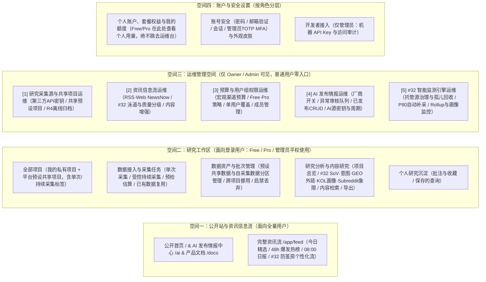
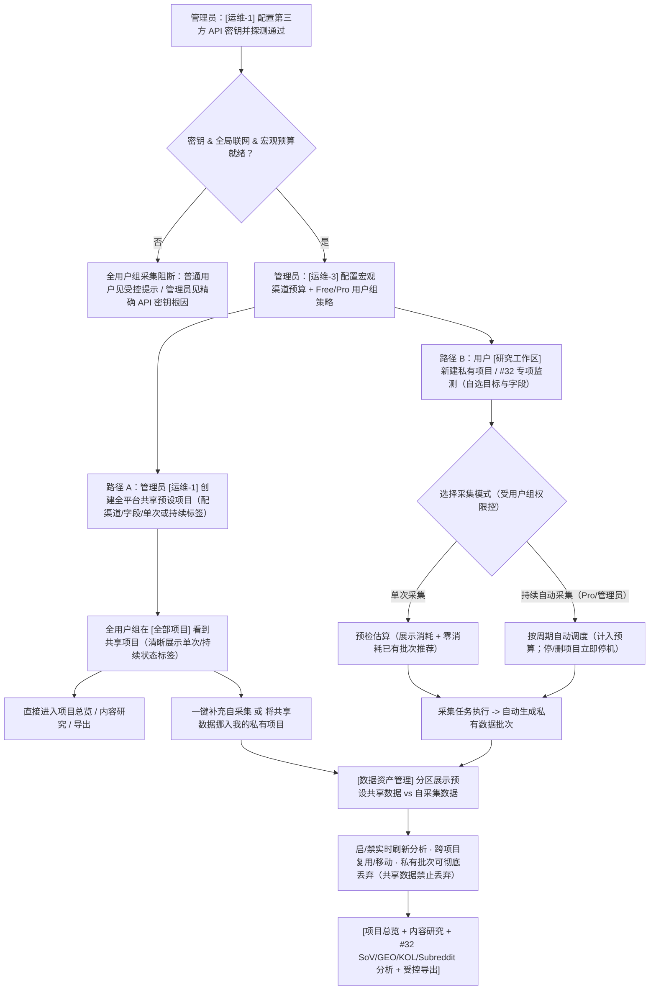

# SIFTLINE 全系统业务梳理报告（用户视角 × 管理者视角）

> **文档基线与编制说明**
> - **原始输入**：基于本地原始梳理稿 `output/业务梳理.txt` 的用户与管理者业务视角框架进行完整结构化升级。
> - **代码对照基线**：
>   - 仓库远程最新主干：`origin/main@3fece79`（已含 PR #30 研究工作台重构与 PR #31 七域无环架构，数据库迁移至 `060_batch_visibility_and_field_policy.sql`）。
>   - 待融合新能力分支：`PR #32`（`origin/feat/backend-v2-feed-intelligence@a42594d`，引入 `feed` 个性化信息流域、`intelligence` 社媒/GEO 智能监测域、连接器富化字段、托管采集源与 P80 自动评论补采）。
> - **表述口径**：本报告严格站在**账户用户与系统管理者的直观业务体验与操作闭环**角度编写，重点聚焦**把全站业务流程走通、把阻塞点打散、厘清权限边界与模块解耦**；深度内容分析算法（如 LLM 摘要、复杂情感归因等）留作后续迭代扩展。
> - **配套文档**：本文定义“应该如何顺畅运作”（目标业务蓝图）；所有当前代码中的阻塞、死锁、越权、耦合与逐项改造方案见配套报告 [SIFTLINE_业务梳理对照审计与解决方案报告_2026-11-23.md](SIFTLINE_业务梳理对照审计与解决方案报告_2026-11-23.md)，逐条修复进度见 [SIFTLINE_修复进度完成表_2026-11-23.md](SIFTLINE_修复进度完成表_2026-11-23.md)。

---

## 0. 全站空间拓扑与角色权限总览

### 0.1 四大独立业务空间（彻底解耦，禁止跨域跳转与面板混用）

### 0.2 角色权限与可见空间矩阵

| 角色 / 用户组 | 公开站与资讯流 | 研究工作区 | 运维管理空间 | 账户与安全设置 | 核心约束口径 |
| :--- | :--- | :--- | :--- | :--- | :--- |
| **匿名访客** | 完整阅读（匿名采用 `#32` 非个性化高价值混排：热榜+探索+上升） | 不可访问（引导登录） | **不可见、不可达** | 无 | 只读公开数据；不可触发任何外部采集或反馈写入 |
| **普通用户 · Free** | 完整阅读 + 个人反馈（有用/收藏/屏蔽）+ 推荐偏好控制 | 完整研究闭环（受 Free 策略约束：项目数、单次/持续采集权限、渠道、回溯天数、条数、导出等） | **彻底不存在此面板**（侧栏、顶栏、快捷命令、通知铃铛、路由全屏蔽） | 账户/个人配额/安全/偏好/皮肤（隐藏成员管理与机器 Key） | 只能编辑/删除自己创建的私有项目与私有批次；**不能修改或丢弃平台预设共享项目及共享数据** |
| **普通用户 · Pro** | 同 Free | 同 Free，享有更高配额与高级字段自由度（如持续自动化采集、更长回溯窗口、评论采集、渠道选择、高级监测维度、导出等） | **彻底不存在此面板** | 同 Free | 同 Free；所有额度可被管理员按单用户覆盖微调 |
| **管理员 · Admin** | 同普通用户 | **与普通用户操作路径完全一致**，但默认拥有**最高采集权限与全字段自由度**，不受 Free/Pro 额度与字段限制（仅受平台宏观渠道预算约束）；新建项目默认私有 | **完全可见**（全部 5 大运维子空间；敏感写操作需 TOTP MFA 步进验证） | 完整账户设置 + MFA + 成员邀请/viewer 管理 + 机器 Key + 审计 | 在研究工作区报错时可看到**精确运维根因**（如具体哪个渠道 API Key 失效/未配置）；日常运维全权处理 |
| **所有者 · Owner** | 同 Admin | 同 Admin | 同 Admin，额外独占**最高治理权**（修改全局 Free/Pro 套餐默认策略、管理 Admin 角色账号） | 同 Admin | 平台最高权限，负责用户组默认权限模板与管理员任免 |
| **外部机器 / Sidecar（Machine Key）** | 按 `read` scope | 仅限绑定了 `allowedSourceIds` 的接口 | 严禁访问 `/auth`、`/admin`、`/quotas`、`/credentials`、`/workspace` | 无 | R4 归档与重型外挂仅持 `ingest` scope + 指定来源 ID 调用推流接口 |

---

## 1. 业务域一：研究工作区（普通用户 Free/Pro 与管理员）

> **核心设计原则**：研究工作区是“按研究主题组织数据与分析”的主阵地。用户在研究工作区只关心**“我要研究什么 → 拿数据（自采或用共享）→ 管数据（启禁/挪动/清理）→ 看分析与导证据”**，绝不应被迫理解底层连接器、数据库表或运维概念。

### 1.1 普通用户（Free / Pro）五大核心业务流程

#### 流程（1）：自主选择主题研究新建 → 自选采集范围与字段 → 分析与导出
1. **极简创建项目（零历史污染）**：
   - 用户点击「新建项目」，只需输入项目名称、研究说明，并选择研究形态：
     - **通用主题研究项目**（兼容现有 `batch` 模式，可自由挂载多次不同来源的采集批次与共享数据）；
     - **【#32 补充维度】结构化专项监测**：
       - *关键词 / 竞品声量监测（Keyword Monitor）*：输入主关键词与竞品关键词，跨 Reddit / X 追踪声量份额（SoV）；
       - *KOL / 账号矩阵监测（Author List）*：批量输入 Reddit / X 账号，系统自动按批次（如 X 每 15 人一包）高效追踪；
       - *Subreddit 社区集群监测（Community Bundle）*：批量追踪多个目标社区板块并对比活跃度与讨论深度。
   - 新建项目初始数据量严格为 **0**，不自动混入任何无关历史数据，创建后直接进入「数据接入」引导页。
2. **自主选择采集范围与采集字段（取决于后端 API 自由度与套餐权限组）**：
   - **目标自由选择**：用户既可以从平台已有推荐源中选择，也可以**直接输入自己想研究的新社区（如 `r/cursor`）、新账号（如 `@openai`）或新关键词**，无需每次找管理员去运维后台预先建源（系统在后台自动按需安全签发受控临时/托管采集目标，受用户组权限与平台合规白名单/黑名单约束）。
   - **可自定义采集字段矩阵（对照 `main` + `#32` 后端真实 API 自由度）**：
     - *平台与渠道*：Reddit（`kaix` / `red_crawler`）、X（`twitterapis` / `scrapebadger`）、Bluesky（`bluesky_appview`）；Pro/管理员可按权限选主备渠道。
     - *时间范围*：近 24 小时 / 7 天 / 30 天 / 自定义回溯窗口（上限受 Free/Pro `maxLookbackDays` 控制）。
     - *采集条数与评论深度*：主帖上限（受 `maxBatchLimit` 控制）、是否同时采集评论及每帖评论上限（受 `maxCommentsPerPost` 控制）。
     - *【#32 连接器新增筛选字段】*：排序方式（`top` 高赞 / `hot` 热门 / `new` 最新，打破旧版仅抓最新噪音帖的局限）、最低点赞/得分门槛（`minLikes`）、最低评论数门槛（`minComments`）、是否排除纯转发（`excludeReposts`）、内容语言（`language`）。
   - **预检与消耗确认（Pre-flight）**：
     - 提交前系统统一展示：本次预计消耗请求数与额度单位、当前套餐剩余额度、是否已有可直接零消耗复用的授权历史批次。
     - **失败阻断规则**：若平台该渠道 API 密钥未配置或失效，系统直接拦截并向普通用户给出清晰的统一受控报错（如“该平台采集服务当前不可用，请联系管理员检查配置”），绝不静默留白或误导为“暂无可用目标”。
3. **采集落库 → 项目总览、内容研究与导出**：
   - 任务提交后可在项目内「采集任务」实时跟踪状态（排队中 / 采集中 / 重试中 / 已完成 / 失败），完成后自动挂载为本项目已启用的数据批次并刷新计数。
   - **项目总览与内容研究**：
     - 查看项目核心 KPI、时间 × 平台趋势、痛点与高信号讨论排行；
     - **【#32 补充分析面板】**：声量份额（SoV）与周期环比（Delta）、6 类用户意图分布（讨论/提问/对比/痛点/发布/资讯）、**GEO 高频外链域名榜**（含高赞评论中的引用链接）、高频词、**KOL 排行榜与单人画像**（粉丝数、历史互动率 ER、代表作）、**Subreddit 多板块象限对比与 7×24 活跃热力图 / Flair 分布**；
     - 下钻「内容研究」进行三段词（任意命中/全部命中/排除词）检索、多维分面过滤、查看三视图评论树（热评 `top` / 命中 `matches` / 楼主 `op`）、添加个人批注与收藏、保存常用查询；
     - **导出数据**：按 CSV / JSON 导出当前筛选命中的证据集合（严格受管理员在用户组策略中配置的 `exportEnabled` 开关控制）。

#### 流程（2）：选择预设共享主题研究使用（直接分析 + 支持补充自采集）
1. **清晰区分与预览**：用户打开「全部项目」，页面分区展示「我的研究项目」与「平台预设共享项目」。
2. **直观状态标签**：每个共享项目卡片清晰标明：
   - 采集状态标签：**「持续自动更新中（每 X 小时）」** 或 **「单次快照采集」**；
   - 覆盖平台、已入库样本量、最近成功更新时间。
3. **两种零阻力使用方式**：
   - **方式 A（直接开箱分析）**：点击进入共享项目，直接查看该项目已采集的全部共享数据，在「项目总览」「内容研究」里下钻、检索、收藏、批注、导出（若套餐允许导出）。
   - **方式 B（基于共享项目补充采集）**：若用户觉得共享数据不够全，想按自己的采集字段（新关键词、更深评论、补充某个社区/账号）叠加数据，支持在共享项目内一键点击**「基于此项目补充采集 / 复制到我的研究」**：
     - 系统自动基于该共享项目创建一个关联了其共享数据集的个人扩展工作区（或绑定用户的私有补充层），用户追加采集的新批次**仅归该用户自己可见**，既保留了共享底数，又不污染其他用户看到的平台共享项目！

#### 流程（3）：已有研究项目的数据资产管理（跨项目灵活流转）
1. **数据资产分区视图**：在任意项目的「数据管理（数据批次）」面板中，明确分成两个清晰区块（而非混在一张表里）：
   - **区块 A：预设共享主题数据**（来自平台共享项目或管理员发布的共享批次，带 `共享` 标识）；
   - **区块 B：我的自采集数据**（由本人发起采集产生的私有批次，带 `自采` 标识）。
2. **跨项目全向数据调度（零重复 API 消耗）**：
   - **项目一 → 项目二（复用 / 同步挂载）**：可将项目一中自采集的某个批次，直接同步复用到项目二中，两边共享引用，零额外 API 费用；
   - **项目一 → 项目二（移动）**：支持一键将某批次从项目一“挪到”项目二（自动完成“挂入项目二 + 从项目一移出”的原子操作）；
   - **预设共享数据 → 我的项目**：用户无论在「共享项目的数据视图」还是在「自己项目的数据接入 → 引入已有共享数据」，都可以把某个预设共享主题的全部或指定共享批次**一键挪入/引入**自己的研究项目；
   - **移出当前研究主题**：可把任意数据批次（无论是自采的还是引入的预设共享数据）从自己当前的项目里移出，使其不再参与本项目的统计与分析。

#### 流程（4）：已有研究项目的数据启用 / 禁用 / 移出 / 彻底丢弃（严格保护共享资产）
1. **本项目内启用 / 禁用（实时生效）**：
   - 在自己的项目中，可随时对任意已挂载的数据批次（包括引入的共享数据和自己的自采集数据）切换**「启用 / 禁用」**，项目总览图表、趋势、内容检索结果实时重算（禁用的批次保留在清单中，随时可一键重新启用）。
2. **从本项目移出 vs 彻底丢弃（权限红线分明）**：
   - **我的自采集数据**：支持三种操作——① 在本项目中禁用/启用；② 从本项目移出（保留在个人批次库，可被其他项目继续用）；③ **彻底丢弃（软删/归档隐藏）**——对于采错词、采偏了的垃圾私有批次，允许本人彻底丢弃，丢弃后从本人所有项目与“可用已有数据”列表中消失。
   - **预设共享项目数据**：普通用户在自己项目中仅允许**禁用 / 启用 / 从本项目移出**，**绝不允许丢弃或删除平台预设共享数据本身**（底层共享批次与其他用户的视图完全不受影响）。

#### 流程（5）：采集任务模式控制（单次采集 vs 持续自动化采集）
1. **双采集模式选择**：在研究工作区的「数据接入 / 采集任务」面板中，用户配置任务时可选择：
   - **单次采集（One-time）**：按指定时间窗口与条数立即抓取一次，形成独立批次；
   - **持续自动化采集（Scheduled / Auto）**：按设定的更新周期（如每 6h / 12h / 24h）自动增量抓取并持续沉淀到本项目中（含 `#32` 社区高讨论帖 P80 自动补采评论能力，受独立开关与额度约束）。
2. **受管理员用户组权限精准控制**：
   - 若管理员在运维台对 `Free` 用户组关闭了“允许持续自动化采集”，则 Free 用户界面上该选项呈锁定/升级提示状态，后端强制拦截，仅允许单次采集；
   - 对 `Pro` 用户组可开放持续采集，并可精细约束**最多同时运行的持续任务数**、**最短调度周期**与**每日自动采集资源上限**；
   - **强制扣减与停止机制**：用户发起的持续采集必须计入该用户的个人/项目每日预算配额；用户暂停或删除项目/监测器时，底层自动调度任务**必须同步立刻停机**，杜绝后台隐形烧钱。

### 1.2 管理员用户在研究工作区的定位与差异

- **流程（1）–（5）与普通用户完全同构**：管理员在研究工作区中拥有完全一致的界面心智与操作路径，方便管理员以真实用户视角做专题研究与验收集成。
- **三项关键差异**：
  1. **默认最高权限**：不受 Free/Pro 套餐的采集次数、条数上限、回溯天数、项目数、字段选择、持续采集开关和导出开关限制（仅受平台级宏观渠道预算保护）；
  2. **精确排障透视**：当采集因平台 API 密钥未配置、密钥失效、联网总开关关闭或渠道余额不足失败时，管理员在研究工作区报错面板中直接看到**精确根因**（如 `APIFY_API_TOKEN 未配置 / 401 鉴权失败 / SOURCE_NETWORK_ENABLED=false`）及一键跳转运维台修复的入口；
  3. **私有 vs 共享显式分离**：管理员在研究工作区自己新建的项目默认仍为**个人私有项目**（不自动暴露给普通用户）；只有当管理员在「运维管理 → 共享研究项目」创建、或显式点击「发布为平台共享项目」时，才会向全体普通用户开放。

---

## 2. 业务域二：高质量资讯信息流与 AI 情报消费（补充 PR #32 新维度）

> **说明**：原《业务梳理.txt》重点聚焦研究工作区与运维管理，而仓库 `main` 与 `PR #32` 已构建了面向全体读者的**高质量资讯分发与 AI 发布情报**产品线，本节补全其面向普通用户与访客的业务闭环。

### 2.1 资讯信息流阅读与个性化体验（`/app/feed` 与公开首页 `/`）
1. **双模式阅读入口**：
   - **编辑式情报首页（`/`）**：紧凑全局检索、自动焦点信号、48h 热榜、频道精选、AI 实时动态预览、08:00 每日简报；
   - **【#32 升级】高质量防信息茧房瀑布流（`/app/feed`）**：
     - 摒弃传统新闻媒体纯文字堆砌，按卡片视觉形态（大图媒体、社交引述、热议长帖、链接预览、紧凑信号）呈现，并直接外显**结构化摘要（`cleanExcerpt`）、意图标签（讨论/提问/对比/痛点/发布/资讯）、高赞神评预览（`topComments`）、热度分与推荐理由（`reason`）**；
     - **四池防茧房混排**：登录用户默认融合 `preferred`（兴趣偏好）+ `rising`（快速上升）+ `explore`（高质冷门探索）+ `serendipity`（跨界随机惊喜），自动 14 天已读去重；匿名访客采用非个性化高价值混排（`hot` + `explore` + `rising`）；
     - **48h 爆发热榜**：按互动爆发速度排序，附带 6 小时趋势微图（Sparkline）。
2. **显式/隐式反馈与算法可控权**：
   - **轻交互反馈**：卡片支持「有用」「收藏」「不感兴趣」「屏蔽该来源」「屏蔽该主题/作者」，系统实时调整用户兴趣权重（14 天半衰期衰减，避免永远锁死在旧兴趣）；
   - **个人推荐偏好面板**：用户可自主调节**探索比例（0%–50%）**、管理关注主题、编辑屏蔽来源/关键词/作者列表、选择是否混入传统新闻泳道（`includeNewsLane`），以及**一键重置推荐画像**。

### 2.2 AI 发布情报中心（`/ai`）
- 面向全体用户（含访客）公开可读，仅展示经官方一手来源核验的 AI 厂商动态：
  - 浅色时间矩阵（按厂商 × 日期呈现模型发布、更新、API 开放、降价、弃用与退市）；
  - 模型详情抽屉（版本谱系、开源协议、上下文/定价参数、官方主证据链接）；
  - 外部评测榜单（受商业分发授权开关控制）与官方一手更新流。

---

## 3. 业务域三：运维管理空间（仅管理员可见）

> **铁律**：普通用户（Free / Pro）**不存在此空间**——左侧主导航、顶栏快捷新建、`Ctrl+K` 命令面板、通知铃铛、路由访问均彻底屏蔽；管理员通过顶部/左侧专属「运维管理」图标进入，统一收敛以下 **5 大运维子空间**（原 TXT 四大模块 + `#32` 新增第五模块）。

### `[1]` 研究采集源与全平台共享项目运维

1. **全平台研究采集渠道 API 密钥管控（全局总闸）**：
   - 集中管理全平台研究采集第三方服务商密钥（AES-256-GCM 静态加密，支持在线保存、轮换、撤销、本地校验、付费确认后的真实连通性探测）：
     - `Apify`（驱动 Reddit 主源 `kaix` 与备源 `red_crawler`，或只读显示外部 Relay 代理状态）；
     - `TwitterAPIs`（驱动 X 主源）；
     - `ScrapeBadger`（驱动 X 备源与批量推文刷新）；
     - 同时显式展示全局联网开关状态（`SOURCE_NETWORK_ENABLED`）。
   - **强阻断与分层报错联动规则**：
     - 任一渠道密钥未配置、被撤销或探测失效（或全局联网关闭）时，**任何用户组（含管理员）在研究工作区均无法针对该渠道发起有效采集**；
     - 普通用户看到清晰受控的业务阻断提示（不暴露密钥与内部细节）；
     - 管理员账户在研究工作区看到**精确故障原因**（如 `TwitterAPIs API Key 未配置` / `Apify Token 鉴权 401` / `服务端 SOURCE_NETWORK_ENABLED=false`），并提供直达本页修复的快捷入口。
2. **全平台共享研究项目（预设主题）管理**：
   - 管理员在运维台直接**新增、编辑、启停、下架全平台共享的预设研究项目**（即普通用户在研究工作区「全部项目 → 共享研究项目」中看到的项目）；
   - 支持配置该共享项目绑定的数据源渠道（Reddit/X/Bluesky）、采集字段（关键词/社区/账号、排序方式、赞评门槛、评论深度、语言）、内容筛选规则（三段词/信号类型/平台/内容形态）；
   - **采集更新模式配置与全局状态透传**：管理员可为每个共享项目设置**「持续自动化采集（及更新频率）」**或**「单次采集」**，该状态以统一标签实时透传展示在全用户组的研究工作区项目列表与切换器上；
   - 支持一键将某次高质量采集批次标记为「全平台共享批次」，供普通用户零成本引入自己的私有项目。
3. **底层研究源目录与 R4 离线归档外挂**：
   - 管理平台底层研究采集源（启停、归档、处理 `unknown` 付费未决阻断的核对与解锁、查看最近任务）；
   - 管理员专用 **R4 离线归档外挂工具（`plugins/zst-archive/`）** 命令生成与推流源管理（严格遵守主线隔离，仅通过受限 Machine Key 推流）。

### `[2]` 资讯信息流运维（兼容 `main` 与 `#32` 泳道升级）

1. **资讯来源与频道管理**：
   - 统一管理 RSS / Atom、网页列表、NewsNow 榜单频道及外部推流资讯源，支持订阅前实时抓包预览与 OPML / JSON 批量导入；
   - 配置采集规则：单次抓取条数上限（`maxItems`）、超时时间（`timeoutMs`）、URL 跟踪参数剥离（`stripTrackingParams`）、标题排除正则（`excludeTitlePatterns`）、自动更新频率与启停状态。
2. **最近入库内容与保活诊断（运维内闭环）**：
   - 在资讯运维面板内直接查看各频道**最近入库内容样本、48h 入库量、HTTP 304/失败率、连续报错与健康状态**，无需跳出运维域。
3. **【#32 新增】信息流泳道（Lane）与信源质量治理**：
   - 可视化配置每个来源的 **`feed_lane`（泳道归类）**：
     - `discussion`（高讨论社区主泳道）；
     - `release`（官方发布/更新泳道）；
     - `monitor_only`（仅研究监测使用，不进入公共信息流）；
     - `news`（传统新闻媒体泳道，默认折叠，用户可在偏好中手动开启）。
   - 配置来源 **`quality_grade`（质量等级 `S / A / B / C`）** 与来源分级（`T1 / T1_5 / T2`），直接影响四池排序权重；
   - **信源清洗与恢复控制台**：对批量归档的低质/营销源提供可视化清单、一键恢复与批量泳道调整（避免数据库迁移静默“隐藏”线上信源）；
   - **内容增强与意图引擎观测**：查看 `clean_excerpt`（纯净摘要）与 `intent_tag`（6 类意图分类）的覆盖率、规则版本（`heuristic_v1` → 未来 LLM 升级钩子）及异常内容重算入口。

### `[3]` 宏观预算、用户组权限与成员治理运维

1. **宏观系统渠道预算（平台级唯一真源）**：
   - 生效范围覆盖全平台（包含所有用户的手动采集、持续自动采集、系统定时抓取、P80 自动补采）；
   - 在线配置每个第三方数据源 / API 渠道（`kaix`、`red_crawler`、`twitterapis`、`scrapebadger`、`feed`、`newsnow`、`bluesky_appview`）的：启用开关、日/月请求上限、日/月资源条数上限、最小请求间隔（ms）；
   - **统一全站社媒日上限池**：将 `#32` 的 20,000 条/日跨渠道社媒直调总额度收归数据库可配置参数，与单渠道预算联动展示（今日已用 / 本月已用 / 剩余百分比 / 触顶告警），彻底消除硬编码常量与后台配置打架。
2. **用户组权限与预算模板管理（Free / Pro 策略矩阵）**：
   - 由 `Owner`（或授权的超级管理员）统一配置 `Free`、`Pro` 两个用户组的默认策略，所有开关必须在后端真实强校验生效：
     - *采集准入*：是否允许手动采集（`manualCollectEnabled`）、允许使用的渠道清单（`allowedProviders`）、允许访问的来源范围（`allowedSourceIds`）；
     - *采集配额*：每日请求上限、每日资源条数上限、单次采集最大条数（`maxBatchLimit`）、每帖最大评论数（`maxCommentsPerPost`）；
     - *字段与时间自由度*：最大历史回溯天数（`maxLookbackDays`）、是否允许自主选择主/备渠道（`allowProviderChoice`）、是否允许自定义目标（无需管理员预建源）；
     - *持续自动化采集权限（新增）*：是否允许开启持续自动化采集（`allowAutoSchedule`）、单用户最多同时运行的持续任务数（`maxScheduledMonitors`）、允许的最短自动更新周期（小时）、持续任务日资源上限；
     - *研究资产与导出权限*：私有项目/监测器数量上限（`maxProjects`）、**是否允许 CSV/JSON 导出（`exportEnabled`，强校验生效）**。
3. **成员管理与单用户覆盖联动（收口在同一运维视角）**：
   - 将成员列表（角色分配 `viewer/admin`、套餐升级 `free/pro`、账号启用/禁用、邀请码签发）与**单用户配额覆盖（全字段覆盖，含回溯天数、项目数、持续采集、导出权限）**打通展示，管理员给某用户开通 Pro 或单独放宽额度时，一页完成，不再在「设置」与「运维」之间反复跳转。

### `[4]` AI 发布情报运维（首页 AI 资讯与 `/ai` 中心）

1. **厂商级自动采集与自动发布双开关**：
   - 区分并独立控制每个 AI 厂商的**「自动采集开关」**（是否拉取该厂商官方源）与**「自动发布灰度开关」**（命中官方规则后是否免审直发 `/ai`，关闭则进入影子评估/人工队列）；操作带防抖、乐观锁与错误反馈。
2. **异常与候选信息队列审核**：
   - 按状态（待审核 `pending` / 缺官方证据 `needs_info` / 已通过 / 已驳回 / 已搁置）与厂商筛选；
   - 支持保存编辑草稿、补充官方主证据链接与日期精度、发布到 `/ai`、驳回、搁置、批量忽略；
   - 查看近 7 天自动化统计摘要、自动发布/回滚审计记录与未处理运维告警。
3. **已发布事件全量 CRUD 管理（增 / 删 / 改 / 查）**：
   - 支持**搜索、按厂商/状态/类型筛选与真分页**（覆盖全部历史冷启动与新增事件，打破原 60 条硬截断）；
   - **增**：支持管理员直接手工补录一条带官方主证据的重大 AI 发布事件（无需强行绕道等待爬虫进候选队列）；
   - **改**：在线编辑已发布事件的标题、中英文摘要、发布状态（`released` / `announced_future` / `deprecated` / `retired`）、日期精度与可见性（对接后端 `PATCH /v1/admin/ai/events/:id`）；
   - **删 / 撤回 / 重新发布**：支持撤回下线（`unpublish`）、一键回滚自动发布（`rollback`）、重新发布以及归档删除错误记录。
4. **AI 来源 API 接口全面管理整治**：
   - **AI 专用密钥在线加密管理**：纳管 `Artificial Analysis`、`OpenRouter`、内部 `AI_LLM_API_KEY` 等凭证（走同一套 AES-256-GCM 密库热生效与连通性探测），不再要求运维登服务器改环境变量重启容器；
   - **注册表与官方源周期与启停控制**：在线编辑 `ai_registry_source`（如 OpenRouter、LiteLLM、HuggingFace、Artificial Analysis）的**启用/停用开关、采集周期（秒）**、手动重置熔断器（`circuit_open_until`）、触发**试跑（Dry Run）与立即同步（Sync Now）**；
   - **官方 Web 源与厂商绑定**：绑定官方博客/文档/Changelog Web 源到对应 AI 厂商，并支持一键触发官方发现与全局 AI 调度器状态观测。

### `[5]`【PR #32 新增补充】智能监测引擎与托管采集源运维空间

> **为什么必须新增这一运维子空间？** PR #32 引入了面向用户的 `intel_monitor` 自动建源、P80 自动评论补采、6h/1d 预聚合（Rollup）和作者画像表。如果不为其配备专属的后端管理空间，系统将在上线后迅速陷入“孤儿源无限后台烧钱、自动补采失控、聚合数据过期无法排查”的运维盲区。

1. **全站智能监测器（`intel_monitor`）总览与干预**：
   - 管理员可查看全平台所有用户的关键词 / KOL / Subreddit 监测器清单（归属用户、状态、更新周期、每日条数预算、绑定底层源数量、最近成功时间）；
   - 支持管理员一键**强制暂停 / 调整周期 / 降额 / 终止**异常消耗资源的监测器。
2. **托管采集源（Managed Sources）生命周期与孤儿清理**：
   - 清晰标识哪些 `collection_source` 是“管理员手动维护的常驻源”，哪些是“由用户监测器自动派生（`managed`）的源”，并展示其当前被多少个活跃监测器引用（引用计数）；
   - **自动停机与回收机制**：当所有引用某托管源的监测器被禁用或删除时，系统自动将其 `schedule.enabled` 置为 `false` 并暂停/归档，运维台同时提供“孤儿托管源巡检与一键清理”入口。
3. **自动评论补采（P80 Automatic Hydration）治理**：
   - 提供全局总开关（可一键紧急熔断自动评论补采而不影响主帖采集）、P80 阈值与单帖评论上限配置视图、今日已触发自动补采次数与资源消耗明细。
4. **预聚合（Rollup）与作者画像健康监控**：
   - 展示 `intel_rollup_bucket`（6h/1d 聚合表）和 `content_author_profile`（KOL 画像表）的最近更新时间、覆盖率与失败日志；
   - 提供**手动触发指定监测器或来源 Rollup 重算**与 **Feed 过期日志清理（`pruneFeedArtifacts`）**状态监控。
5. **全站采集任务总监控（Global Jobs）**：
   - 集中监控全站排队、执行中、重试中、失败及 `unknown` 付费未决阻断任务，支持查看脱敏错误详情、手动取消、重试、续跑与付费核实解锁。

---

## 4. 业务域四：账户与安全设置（按角色严格分层）

| 子面板 | 普通用户（Free / Pro） | 管理员（Admin / Owner） |
| :--- | :--- | :--- |
| **当前账户与套餐权益** | 查看邮箱、角色、当前生效套餐（Free / Pro，移除过时的 `reserved` 误导标注）、**我的今日采集配额用量与各渠道可用状态**（从运维台彻底迁回此处） | 查看管理员身份、最高权限说明与当前会话信息 |
| **安全与会话** | 修改密码、邮箱验证、查看/踢出其他浏览器会话 | 同普通用户 + **管理员 TOTP MFA 绑定/恢复码/步进验证** |
| **推荐与阅读偏好（#32 补充）** | 调节信息流探索比例、关注主题、屏蔽列表、传统新闻泳道开关、重置画像 | 同普通用户 |
| **外观与品牌** | 17 套主题皮肤与品牌图标偏好、中英文切换 | 同普通用户 |
| **成员、邀请与机器密钥** | **完全隐藏（无菜单、无接口请求）** | 团队邀请码签发（与运维台成员治理联动）、机器 API Key（`read/export/ingest/collect` 等 scope 与 `allowedSourceIds` 严格隔离）、访问安全审计日志、系统健康探针 |

---

## 5. 端到端核心业务链路闭环图（疏通后目标态）

