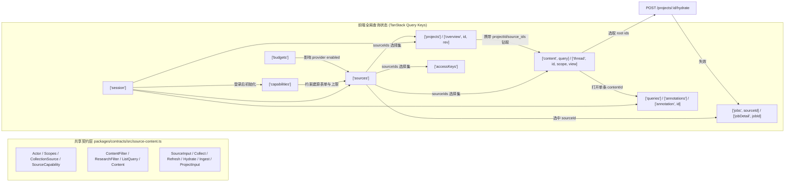

# Reddit Monitoring MVP · 前后端接口与功能对接手册

> **适用代码基线**：分支 `prod`（提交 `dd2feb2`）  
> **文档边界声明**：本文档严格依据服务端实盘源码（`apps/api/src/`、`src/modules/`、`src/connectors/`、`packages/contracts/`）及当前前端（`apps/web/src/`）整理。文中仅定义**功能架构、路由/面板层级树、组件与数据源依赖关系、HTTP/TypeBox 契约、状态与错误处理逻辑及可视化图表选型口径**，**不预设任何前端视觉样式、排版美学、配色、动效或具体界面表现形式**。

---

## 一、系统运行时接入基线与全局契约

### 1.1 通信网关与路径前缀映射

服务端应用（`apps/api/src/server.ts` + `apps/api/src/app.ts`）监听路由根路径（`/healthz`、`/readyz`、`/v1/*`）。前端请求统一遵循以下反向代理路径规则：

| 运行环境 | 代理实现 | 前端请求路径 | 后端实际接收路径 | 关键代理配置 |
| :--- | :--- | :--- | :--- | :--- |
| **本地开发** | `apps/web/vite.config.ts` | `/api/v1/*` | `/v1/*` | `rewrite: (p) => p.replace(/^\/api/, '')`，转发至 `VITE_API_PROXY_TARGET`（默认 `http://localhost:3000`） |
| **Docker / 生产** | `deploy/Caddyfile` | `/api/v1/*` | `/v1/*` | `handle_path /api/*` 剥离 `/api` 前缀并设 `flush_interval -1`（支持导出流无缓冲直传） |
| **健康探针** | `deploy/Caddyfile` | `/healthz`、`/readyz` | `/healthz`、`/readyz` | Caddy 直接透传至后端 `app:3000` |

> 前端业务请求基路径统一为 `/api/v1`（见 `apps/web/src/api.ts`），且必须携带 `credentials: "same-origin"`。

### 1.2 全局鉴权、CSRF、限流与 RBAC 规则（`apps/api/src/app.ts`）

1. **Default-Deny 鉴权例外**：仅 `GET/HEAD /healthz`、`GET/HEAD /readyz`、`GET/HEAD /v1/auth/session`、`POST /v1/auth/login`、`POST /v1/auth/register` 允许未登录访问；其余所有 `/v1/*` 接口未携带有效凭据统一返回 `401`。
2. **双凭据形态**：
   - **浏览器会话（`clientKind: "browser"`）**：由 `POST /v1/auth/login` 下发 `HttpOnly; SameSite=Lax; Path=/` Cookie `app_session=<43位token>.<hmac>`（生产 HTTPS 下附加 `; Secure`），有效期 7 天。
   - **机器 API Key（`clientKind: "machine"`）**：请求头 `Authorization: Bearer <43位base64url>`；**前端严禁使用或存储 Machine Key**，仅在设置面板供管理员创建与吊销。
3. **同源写保护（CSRF）**：所有非 `GET / HEAD / OPTIONS` 的浏览器 Cookie 请求，服务端校验 `request.headers.origin === APP_ORIGIN`，不匹配返回 `403 Same-origin request required`。
4. **全局与登录限流**：
   - 全局默认每 IP 每分钟 `120` 次（`/healthz` 免计）；
   - `POST /v1/auth/login` 严格限制每 IP 每分钟 **`5` 次**；
   - `GET /v1/content/export` 整个应用进程同一时刻仅允许 **`1` 个活跃导出流**，并发占用返回 `429` + 响应头 `Retry-After: 5`。
5. **角色权限矩阵（Browser Session）**：
   - **`owner`**：全部读写与管理能力，可邀请 `admin` 与 `viewer`。
   - **`admin`**：除“邀请 `admin`”外与 `owner` 等价（可建源、配预算、启停采集、建/改/删项目、签发与管理自己创建的机器 Key、邀请 `viewer`）。
   - **`viewer`**：所有 `/v1/sources`、`/v1/projects`、`/v1/content` 与 `/v1/source-jobs` 仅限只读（`GET / HEAD`）；**仅允许对 `/v1/workspace/*`（个人保存查询/批注）与 `/v1/auth/logout` 发起写操作**，其他任何非读请求返回 `403`。

### 1.3 统一错误信封与关键状态码处置（前端必接）

后端所有非 2xx 响应均返回统一 JSON 结构（流式导出开始写包头后若中途报错则直接异常断流）：

```ts
interface ApiErrorResponse {
  error: {
    code: string;       // 例如 "cursor_scope_changed" | "temporarily_unavailable" | "http_409" | "http_422"
    message: string;    // 人类可读错误说明（500 时固定脱敏为 "Internal server error"）
    requestId: string;  // 服务端请求追踪 ID
    retryable: boolean; // true 时（如 503）可提示用户重试
  };
}
```

| HTTP 状态码 / `error.code` | 触发场景 | 前端应执行的程序行为 |
| :--- | :--- | :--- |
| **`401`** | 会话过期、未登录或被停用 | 清除/失效 `["session"]` 查询缓存，引导进入登录态 |
| **`403`** | `viewer` 越权写入 / 非同源写请求 / 权限不足 | 按 `user.role` 隐藏或禁用管理写操作；提示权限受限 |
| **`409` (`cursor_scope_changed`)** | 翻页 `cursor` 对应的过滤条件或 `project.revision` 已变化 | **必须丢弃当前 `cursor`**，重置查询至第一页重新拉取 |
| **`409`（乐观锁/状态冲突）** | `projects` / `sources` / `budgets` / `annotation` 的 `revision` 过期；或来源存在 `starting`/`unknown` 未确认付费调用；或 `Idempotency-Key` 同键异体 | 乐观锁冲突：失效对应 query 缓存重新加载最新 `revision`；收费未确认：要求用户显式勾选/确认 `acknowledgePotentialCharge: true` 后再调用解锁或重试接口 |
| **`413`** | 推流单批超过 `1 MiB` 或单条 `title > 4 KiB` / `text > 64 KiB` | 提示超出推流负载上限，要求拆分批次 |
| **`422`** | TypeBox 参数校验失败、检索词不足 3 个连续字母/数字、`from >= to`、跨平台刷新或无可用渠道 | 展示 `error.message` 校验原因，阻止提交 |
| **`429`** | 请求频率超限或导出并发槽位被占用 | 若响应含 `Retry-After`，提示稍后重试 |
| **`503` (`temporarily_unavailable`)** | PostgreSQL 查询超时（10s）、锁等待（3s）或连接异常 | 标记 `retryable: true`，保留筛选上下文以便重试 |

---

## 二、前端层级面板树与组件依赖架构

### 2.1 目标功能树与路由层级（覆盖后端全能力）

> 注：相比当前仓库里仅包含最小表单的 `apps/web/src/pages/` 原型，下表完整映射了 **`prod@dd2feb2` 后端已开放的全部能力面板**，标注为“新增补全”的部分在后端已有现成路由与 SQL 支持。

```text
AppShell（会话门禁：GET /v1/auth/session）
├── [未登录态] AuthGate
│   ├── LoginPanel            ── POST /v1/auth/login
│   └── InviteRegisterPanel   ── POST /v1/auth/register              [后端已实现，原前端未接]
│
└── [已登录态] AuthenticatedWorkbench（顶层加载 Actor、Capabilities 能力快照、全局错误边界与退出）
    ├── 路由 "/" (或 "/projects") : ProjectsWorkspacePanel（监测项目面板）
    │   ├── ProjectListSelector          ── GET /v1/projects
    │   ├── ProjectMutationPanel         ── POST /v1/projects · PATCH /v1/projects/:id · DELETE /v1/projects/:id
    │   ├── ProjectOverviewFacetsPanel   ── GET /v1/projects/:id/overview
    │   │   ├── [指标总览] contentCount / matchedContentCount / threadAware / includePushInTrends
    │   │   ├── [图1] 时间序列趋势图（facets 过滤 day_group=0）
    │   │   ├── [图2] 平台/内容类型分布图（facets 过滤 platform_group=0 / kind_group=0）
    │   │   └── [来源归因列表] providers[]
    │   └── ProjectDrilldownLink         ── 跳转 "/content?projectId=<id>"
    │
    ├── 路由 "/content" : ContentExplorerPanel（内容检索、研判与导出面板）
    │   ├── FilterBuilderBar             ── 构造 ContentFilter & URLSearchParams（支持三段词、信号、时间窗、来源、searchScope）
    │   ├── SavedQueryShortcutAction     ── POST /v1/workspace/queries
    │   ├── StreamingExportPanel         ── GET /v1/content/export (JSON/CSV + maxRows + cursor 分段续传)
    │   ├── BatchHydrationActionBar      ── POST /v1/projects/:id/hydrate（仅 projectId 上下文下选 1..30 根 Reddit 帖）
    │   ├── ContentStreamList            ── GET /v1/content 或 GET /v1/projects/:id/content（cursor 游标翻页）
    │   └── ContentDetailPanel           ── GET /v1/content/:id（或列表项传入 + 同步详情/观测/批注）
    │       ├── ObservationHistoryPanel  ── 渲染 observations[] 与多快照指标对比图（[图3]）
    │       ├── AnnotationEditorPanel    ── GET/PUT /v1/workspace/annotations/:id（乐观锁 revision）
    │       └── ThreadTreePanel          ── GET /v1/content/:id/thread?view=top|matches|op（[图4] 评论树视图）
    │
    ├── 路由 "/sources" : SourceAndCollectionPanel（来源、任务、预算与推流管理面板）
    │   ├── SourceCreatePanel            ── POST /v1/sources（结合 capabilities 动态约束 target.type / contentKind / fallbackProvider）
    │   ├── SourceListPanel              ── GET /v1/sources（含 sources[] 与 capabilities[]）
    │   ├── SourceDetailControlPanel     ── 选中单个 sourceId
    │   │   ├── SourceLifecycleControls  ── PATCH /v1/sources/:id（state 暂停/启用、fallbackProvider、revision）
    │   │   ├── SourceUnblockControl     ── POST /v1/sources/:id/unblock（acknowledgePotentialCharge） [后端已实现，原前端未接]
    │   │   ├── PullCollectDispatchPanel ── POST /v1/sources/:id/collect（Idempotency-Key、页上限按 provider 动态限制）
    │   │   ├── BatchRefreshIdsPanel     ── POST /v1/sources/:id/refresh（支持 refreshByIds 的渠道 1..20 条刷新） [后端已实现，原前端未接]
    │   │   ├── PushIngestUploadPanel    ── POST /v1/sources/:id/ingest（仅 deliveryMode="push"，JSON 校验与幂等键）
    │   │   └── SourceJobsMonitorPanel   ── GET /v1/sources/:id/jobs & GET /v1/source-jobs/:id（轮询+详情告警）
    │       └── JobActionControls        ── POST /v1/source-jobs/:id/{cancel,retry,continue} [后端已实现，原前端未接]
    │   └── ProviderBudgetsPanel         ── GET /v1/sources/budgets · PUT /v1/sources/budgets/:provider [后端已实现，原前端未接]
    │       └── [图5] 日/月配额及资源上限状态指示
    │
    ├── 路由 "/workspace" : PersonalWorkspacePanel（个人研究资产面板）
    │   ├── SavedQueriesListPanel        ── GET /v1/workspace/queries · DELETE /v1/workspace/queries/:id（一键回跳 /content）
    │   └── AnnotationsListPanel         ── GET /v1/workspace/annotations（只读关联正文标题/ID/批注/收藏状态）
    │
    └── 路由 "/settings" : AccountAndAccessPanel（账户、邀请与外部研究密钥面板）
        ├── SessionAccountPanel          ── 当前 Actor 信息 · POST /v1/auth/logout
        ├── InviteAdminPanel             ── POST /v1/access/invites（生成 viewer/admin 邀请码）       [后端已实现，原前端未接]
        └── MachineKeysManagerPanel      ── GET /v1/access/keys · POST /v1/access/keys · DELETE /v1/access/keys/:id
```

### 2.2 模块与接口依赖流向图



### 2.3 操作后的缓存联动（Invalidation Matrix）

新前端在完成任意写操作后，除更新自身返回状态外，必须联动失效以下关联缓存键：

| 写操作接口 | 必须同步失效 / 刷新的 Query 范围 |
| :--- | :--- |
| `POST /v1/auth/login` / `POST /v1/auth/logout` | 全部 Query（重置用户作用域、`sources`、`projects`、`workspace`） |
| `POST /v1/sources` / `PATCH /v1/sources/:id` / `POST /v1/sources/:id/unblock` | `['sources']`、`['projects']`、`['overview', ...]`、`['jobs', id]` |
| `PUT /v1/sources/budgets/:provider` | `['budgets']`、`['sources']`（影响 `capabilities[].enabled`）、`['capabilities']` |
| `POST /v1/sources/:id/collect` / `refresh` / `POST /v1/projects/:id/hydrate` / `source-jobs/:id/*` | `['jobs', sourceId]`、`['jobDetail', jobId]`、`['budgets']`（任务执行后用量变动） |
| `POST /v1/sources/:id/ingest` | `['jobs', sourceId]`、`['content', ...]`、`['overview', ...]` |
| `POST/PATCH/DELETE /v1/projects*` | `['projects']`、`['overview', id, ...]`、`['content', ...]` |
| `POST/DELETE /v1/workspace/queries*` | `['queries']` |
| `PUT /v1/workspace/annotations/:id` | `['annotation', contentId]`、`['annotations']` |
| `POST/DELETE /v1/access/keys*` | `['accessKeys']` |

---

## 三、全量功能接口详细对接清单

> 以下接口 URL 均写后端真实路径；前端通过 `/api` 前缀代理请求（例如 `GET /v1/sources` 在前端调用 `/api/v1/sources`）。所有 `UUID` 字段必须匹配标准 UUID v4 格式；所有 `DateTime` 字段为 RFC3339 / ISO8601 字符串。

### 模块 0：系统健康、能力发现与身份认证（`app.ts` + `access/routes.ts`）

#### 1. `GET /healthz` 与 `GET /readyz`（公开）
- **用途**：存活与数据库就绪探针。
- **响应（200）**：`{ ok: true }`（数据库异常返回 `503`）。

#### 2. `GET /v1/capabilities`（需登录）
- **用途**：供应用启动后获取全部已注册渠道的实时启用状态与全局硬上限。
- **响应（200）**：
  ```ts
  {
    providers: SourceCapability[]; // 7 个已注册渠道实时能力声明（见 3.3 节）
    operations: ["ingest", "radar", "hydrate", "refresh_by_ids", "thread", "search", "stream_export", "saved_queries", "annotations"];
    maxIngestItems: 100;
    maxIngestBytes: 1048576;       // 1 MiB
    maxOnlineItems: 2000;
    threadAware: true;
    automaticHydration: false;
  }
  ```

#### 3. `GET /v1/openapi.json`（需登录）
- **用途**：返回 `@fastify/swagger` 实时生成的 OpenAPI 3.0 规范 JSON，可用于联调核对。

#### 4. `GET /v1/auth/session`（公开）
- **用途**：前端首屏加载判定当前登录身份。
- **响应（200）**：`{ user: Actor | null }`，其中 `Actor` 为：
  ```ts
  {
    userId: string;
    email: string;
    role: "owner" | "admin" | "viewer";
    clientKind: "browser" | "machine";
    sessionId: string;
    scopes: string[];
    allowedSourceIds: string[] | null; // 浏览器会话为 null（全库授权来源）
  }
  ```

#### 5. `POST /v1/auth/login`（公开，限流 5 次/分/IP）
- **请求体（`Login`，`additionalProperties: false`）**：`{ email: string (3..254), password: string (1..128) }`
- **行为**：成功设置 `app_session` Cookie 并返回 `{ user: Actor }`；失败统一返回 `401 Invalid email or password`。

#### 6. `POST /v1/auth/register`（公开，持邀请码注册）
- **请求体**：`{ email: string, password: string (服务端校验 >= 12 字符), invite: string (1..256) }`
- **响应（200）**：`{ registered: true }`（注册后需引导用户走登录获取会话，该接口不直接写登录 Cookie）；邀请码无效/过期/已用完返回 `403`。

#### 7. `POST /v1/auth/logout`（需登录，含 `viewer`）
- **行为**：删除服务端当前 `app_session` 行并清除 Cookie（`Max-Age=0`），返回 `{ loggedOut: true }`。

---

### 模块 1：账户邀请与机器 API Key 管理（`access/routes.ts`）

#### 1. `POST /v1/access/invites`（仅 `owner` / `admin` 浏览器会话）
- **请求体**：`{ role: "viewer" | "admin" }`（仅 `owner` 可生成 `role: "admin"` 邀请，否则 `403`）。
- **响应（200）**：`{ code: string }`（72 字符一次性邀请码，单次有效，7 天过期）。

#### 2. `GET /v1/access/keys`（仅浏览器会话）
- **用途**：列出当前用户名下所有已签发的机器 Key 元数据（不含明文 Token）。
- **响应（200）**：`{ keys: Array<{ id: string; label: string | null; scopes: string[]; allowed_source_ids: string[] | null; expires_at: string }> }`。

#### 3. `POST /v1/access/keys`（仅 `owner` / `admin` 浏览器会话）
- **请求体（`MachineKeyInput`）**：
  ```ts
  {
    label: string;                // 1..100
    scopes: Array<"sources:write" | "read" | "export" | "ingest" | "collect" | "projects:write">; // minItems: 1, unique
    allowedSourceIds: string[];   // UUID[], unique, maxItems: 1000; 含 "ingest" scope 时必须非空！
    expiresInDays: number;        // 1..90 整数
  }
  ```
- **响应（200）**：`{ id: string, token: string, expiresAt: string }`。**`token`（43 字符）明文仅在此返回一次，后端仅存储 SHA-256 哈希，页面离开后无法再查看**。

#### 4. `DELETE /v1/access/keys/:id`（仅浏览器会话）
- **用途**：立即吊销指定 Key（只能吊销自己名下记录）。
- **响应（200）**：`{ revoked: true }`。

---

### 模块 2：监测项目与概览统计（`projects/routes.ts` & `projects/sql.ts`）

#### 1. `GET /v1/projects`（所有登录用户）
- **响应（200）**：`{ projects: Project[] }`，注意字段为 snake_case / camelCase 混用（以实测 SQL 为准）：
  ```ts
  interface Project {
    id: string;
    name: string;
    filter: Filter;                    // 项目固化过滤条件（JSONB）
    revision: number;                  // 乐观锁版本号 >= 1
    thread_aware: boolean;             // 创建默认 true
    include_push_in_trends: boolean;   // 创建默认 false
    source_ids: string[];              // 绑定来源 UUID[]
    owner_user_id?: string | null;
    hydration?: Record<string, unknown>;
    created_at?: string;
    updated_at?: string;
  }
  ```

#### 2. `GET /v1/projects/:id`（所有登录用户）
- **响应（200）**：直接返回 `Project` 对象（无外层 `{ project: ... }` 包装）；不存在或无权限返回 `404`。

#### 3. `POST /v1/projects` 与 `PATCH /v1/projects/:id`（仅 `owner` / `admin`）
- **请求体**：
  - `POST`（`ProjectInput`，`additionalProperties: false`）：
    `{ name: string (1..100), sourceIds: UUID[] (minItems: 1, maxItems: 100), filter: ContentFilter, threadAware?: boolean, includePushInTrends?: boolean }`
  - `PATCH`：`ProjectInput` 合并 `{ revision: integer (>=1) }`
- **前端必检约束**：
  - `sourceIds` **必填且至少选 1 个来源**（`minItems: 1`）；
  - `filter` 内如有搜索词（`query` / `anyTerms` / `allTerms` / `exclusions`），每项经过 NFKC 归一化后**必须包含至少 3 个连续字母或数字**（`/[\p{L}\p{N}]{3}/u`），且 `from < to`；否则返回 `422`；
  - 修改 `filter` **只影响项目统计与钻取查询，绝不改写来源抓词或触发采集**；
  - `PATCH` 时 `revision` 不匹配返回 `409`。
- **响应（200）**：返回创建/更新后的完整 `Project` 对象。

#### 4. `DELETE /v1/projects/:id?revision=<number>`（仅 `owner` / `admin`）
- **注意传参方式**：**`revision` 通过 URL Querystring 传入**（非 Body！），仅删除项目及关联，不删除已抓取的公共内容。
- **响应（200）**：`{ deleted: true }`（版本不匹配返回 `409`）。

#### 5. `GET /v1/projects/:id/overview`（所有登录用户）
- **用途**：单 SQL `GROUPING SETS` 聚合，提供项目面板指标与可视化数据。
- **响应（200）**：
  ```ts
  {
    project: Project;
    contentCount: number;        // thread_aware=true 时为去重讨论根数；false 时为节点数
    matchedContentCount: number; // 实际命中词组/信号的内容节点数
    facets: Array<{
      day_group: 0 | 1;          // 0=按UTC天分桶行数（day 可能为 null 表示发布时间未知！）; 1=非时间维
      platform_group: 0 | 1;     // 0=按平台分桶行数
      kind_group: 0 | 1;         // 0=按内容类型分桶行数
      day: string | null;        // ISO 时间戳（UTC 日零点）或 null
      platform: string | null;
      kind: string | null;
      count: number;             // 去重 anchor 数（或节点数）
      matchedContentCount: number;
    }>;
    providers: string[];         // 该项目命中内容涉及的真实去重采集渠道名（供归因展示）
    resolvedFilter: Filter;
    coverage: "stored_sample";
    threadAware: boolean;
  }
  ```
- **核心口径约定**：
  - 当 `project.include_push_in_trends === false`（默认）时，Overview SQL 自动排除 `delivery_mode='push'` 的离线导入来源（但 `/v1/projects/:id/content` 列表仍可阅读导入样本，除非列表另传条件）；
  - `facets` 中 **`day_group === 0 && day === null` 表示“发布时间未知”的内容桶**，前端图表严禁将其丢弃或伪造为某一天；`day_group === 1 && platform_group === 1 && kind_group === 1` 为总计汇总行。

---

### 模块 3：内容检索、评论树、水合与流式导出（`content/` & `projects/routes.ts`）

#### 1. `GET /v1/content` 与 `GET /v1/projects/:id/content`（所有登录用户）
- **Querystring 参数（`ListQuery`，`additionalProperties: false`）**：

| 参数 | 类型与约束 | 语义说明 |
| :--- | :--- | :--- |
| `projectId` | `UUID`（仅 `/v1/content` 接受；`/v1/projects/:id/content` 从路径读取并禁传 query `projectId`） | 绑定项目来源与项目默认 `filter` / `threadAware` |
| `sourceId` | `UUID` | 进一步限定到某个可见来源 |
| `platform` | `"reddit" \| "x" \| "bluesky" \| "web"` | 按内容所属平台过滤 |
| `kind` | `"post" \| "comment" \| "article" \| "image" \| "video"` | 按内容实体类型过滤 |
| `query` | `string (1..200)` | 单一关键词/短语（须含 ≥3 个连续字母/数字，无控制符） |
| `anyTerms` / `allTerms` / `exclusions` | `string[]`（每组最多 20 项，每项 `1..200`） | 任意命中 OR / 全部命中 AND / 排除 NOT；URL Query 支持重复传参如 `?anyTerms=a&anyTerms=b` |
| `searchScope` | `"title" \| "text" \| "title_text"` | 限定词项匹配标题、正文或两者（不跨标题/正文分隔符 `U+001F`） |
| `signal` | `"discussion" \| "pain"` | `discussion`：Reddit `num_comments>=10` 或 X `x.replies>=5`；`pain`：命中中英文痛点词正则或 Reddit `score IS NOT NULL AND num_comments >= GREATEST(score, 1)` |
| `from` / `to` | `DateTime` | 严格 UTC 半开区间 `[from, to)`，且 `from < to`；未知发布时间不匹配区间 |
| `threadAware` | `boolean` | 为 `true` 时若评论命中条件则上溯折叠输出可见讨论根帖（缺根时以命中节点自身输出并标 `contextMissing: true`） |
| `limit` | `integer (1..100)`，默认 `50` | 每页上限 |
| `cursor` | `string (<=4096)` | Base64url 游标，绑定筛选指纹与 `project.revision`；冲突返回 `409 cursor_scope_changed` |

- **响应（200）**：
  ```ts
  {
    items: PublicContent[];
    nextCursor: string | null; // 为 null 表示当前列表已到达末尾
    totalMatching: null;       // 固定为 null（故意不做 COUNT(*)）
    resolvedFilter: Record<string, unknown>;
    coverage: "stored_sample";
  }
  ```

#### 2. `GET /v1/content/:id`（所有登录用户）
- **响应（200）**：`{ content: PublicContent }`（无权访问或不存在返回 `404`）。
- **`PublicContent` 关键字段**：`id`, `platform`, `kind`, `externalId`, `title`, `text`, `url`, `language`, `author ({ externalId, handle, displayName, url } | null)`, `publishedAt`, `firstFetchedAt`, `lastFetchedAt`, `availability ("available"|"removed"|"deleted"|"unknown")`, `textState ("full"|"missing"|"summary"|"truncated")`, `contextMissing?`, `references[]`, `media[]`, `platformDetails`, `observations[]`（每条含 `sourceId, provider, sourceObservedAt, fetchedAt, timeBasis, maturity, metrics, evidenceKey`）。

#### 3. `GET /v1/content/:id/thread`（所有登录用户）
- **Querystring**：接受全部 `ResearchFilter` 参数（继承项目与筛选权限 scope，以便正确计算 `matches` 高亮）+ `view?: "top" | "matches" | "op"`（默认 `"top"`）。
  - `top`：按平台指标得分降序构建讨论树（仅用于查看结构与热评）；
  - `matches`：只保留命中当前过滤条件的节点；
  - `op`：仅保留作者 `author.handle` 与根帖作者小写匹配的发言节点。
- **响应（200）**：
  ```ts
  {
    root: PublicContent;
    nodes: Array<{ item: PublicContent; depth: number; parentId: string | null; contextMissing: boolean; matched: boolean }>;
    contextMissing: boolean; // 根帖本身缺失（seed 是孤儿评论）
    capped: boolean;         // true 表示原始行数达到 200 硬上限被截断
  }
  ```
- **不变量**：只读已存数据库，永不触发收费外网抓取；若节点父链超过 32 跳或存在环或缺少父节点，则节点 `contextMissing: true`。

#### 4. `POST /v1/projects/:id/hydrate`（仅 `owner` / `admin`）
- **用途**：对项目中选中的 Reddit 根帖按需入队批量评论水合任务（只支持在项目中有活跃 `kaix` `pull` 来源发现的 Reddit 主帖 `t3_*`）。
- **必填请求头**：`Idempotency-Key`（ASCII 33..126 可见字符，1..128 位；前端同一批选择与参数在重试时应复用同一 Key）。
- **请求体（`Hydrate`）**：`{ contentIds: UUID[] (1..30, unique), maxCommentsPerPost: integer (1..50) }`
- **前置拦截**：服务端未开启 `kaix` 网络或缺少 `APIFY_API_TOKEN` 时直接返回 `422`。
- **响应（200）**：`{ jobIds: string[] }`（每个根帖生成一条 `operation='hydrate'` 任务入队）。

#### 5. `GET /v1/content/export`（所有登录用户，受 `actor.allowedSourceIds` 隔离）
- **Querystring**：支持全部 `ResearchFilter`（含 `projectId`、`threadAware`、`signal`、三段词、时间窗）+ `format?: "json" | "csv"`（默认 `"json"`）+ `maxRows?: integer (1..50000)`（默认 `10000`）。
- **行为与校验**：
  - 返回带 `Content-Disposition: attachment; filename="content.<format>"` 与 `X-Accel-Buffering: no` 的流式响应；
  - **JSON 模式完整格式**：`{"items":[...PublicContent],"result":{"exportedCount":number,"truncated":boolean,"nextCursor":string|null,"complete":true}}` —— **前端必须验证 `result.complete === true`** 才认定文件下载完整（严禁盲目用 `<a href>` 直接触发下载而忽略半截流失败）；当 `truncated === true` 且存在 `nextCursor` 时，可引导用户带 `nextCursor` 续段下载或提示已截断；
  - **CSV 模式列头**：`id,platform,kind,externalId,publishedAt,title,text\r\n`（对 `= + - @` 公式前缀自动加 `'` 防注入）；
  - **全局单槽限制**：若另一 export 正在进行返回 `429` + `Retry-After: 5`；服务端硬超时 30 秒，超时/断流立即中止。

---

### 模块 4：来源配置、任务状态机、预算治理与推流（`collection/`）

#### 1. `GET /v1/sources`（所有登录用户，按 `allowedSourceIds` 过滤）
- **响应（200）**：`{ sources: CollectionSource[], capabilities: SourceCapability[] }`。

#### 2. `SourceCapability[]` 全量实盘能力矩阵（驱动前端表单动态约束）

| `platform` | `provider` | 支持 `targetTypes` | `contentKinds` | 采集 `limit` / 评论上限 | `refreshByIds` | `automaticRequestReplay` | `metrics` 字段清单 |
| :--- | :--- | :--- | :--- | :--- | :--- | :--- | :--- |
| `reddit` | `kaix` | `community`, `account`, `post`, `search` | `post`, `comment` | 搜帖 `limit*(comments?maxC+1:1)<=2000`；单帖 `post` 最多 50 评 | `true`（仅作用于 `hydrate` 队列 / `refresh`） | **`false`**（防付费重放） | `reddit.score`, `reddit.num_comments`, `reddit.upvote_ratio` |
| `reddit` | `red_crawler` | `community`, `account`, `post`, `search` | `post`, `comment` | 非 `post` 上限 100 且禁带评；`post` 上限 50 评 | `false` | **`false`** | `reddit.score`, `reddit.num_comments`, `reddit.upvote_ratio` |
| `x` | `twitterapis` | `search`, `account` | `post` | `limit <= 20`，禁 `includeComments` | `false` | **`false`** | `x.likes`, `x.reposts`, `x.replies`, `x.quotes`, `x.views`, `x.bookmarks` |
| `x` | `scrapebadger` | `search`, `account` | `post` | `limit <= 100`，禁 `includeComments` | **`true`**（批量 1..20 ID） | **`false`** | `x.likes`, `x.reposts`, `x.replies`, `x.quotes`, `x.views`, `x.bookmarks` |
| `web` | `newsnow` | `search`（`query="hackernews"`） | `article` | `limit <= 30`，禁 `includeComments` | `false` | `true` | `web.rank` (`direction: "lower"`) |
| `web` | `feed` | `feed`（仅白名单 `FEED_ALLOWED_URLS` 的公网 HTTPS URL） | `article` | `limit <= 30`，禁 `includeComments` | `false` | `true` | `{}`（无数值指标） |
| `bluesky` | `bluesky_appview` | `account`（Handle 或 `did:`） | `post` | `limit <= 100`，禁 `includeComments` | `false` | `true` | `bluesky.likes`, `bluesky.replies`, `bluesky.reposts`, `bluesky.quotes` |

> 说明：`external_ingest` 属于 `deliveryMode = "push"` 来源，**不出现在 `capabilities[]` 中**（在 `POST /v1/sources` 中显式指定 `deliveryMode: "push", primaryProvider: "external_ingest"`）。

#### 3. `POST /v1/sources` 与 `PATCH /v1/sources/:id`（仅 `owner` / `admin` 浏览器会话）
- **`POST /v1/sources` 请求体（`SourceInput`，全部字段必填，仅 `fallbackProvider` 可选）**：
  ```ts
  {
    platform: "reddit" | "x" | "bluesky" | "web";
    primaryProvider: "kaix" | "red_crawler" | "bluesky_appview" | "twitterapis" | "scrapebadger" | "newsnow" | "feed" | "external_ingest";
    fallbackProvider?: "scrapebadger" | "red_crawler"; // 仅 pull 支持：kaix 只能配 red_crawler；twitterapis 只能配 scrapebadger
    label: string;        // 1..100
    target: SourceTarget; // { type: "search"|"community"|"account"|"post"|"feed", ... }
    contentKind: "post" | "comment" | "article" | "image" | "video";
    deliveryMode: "pull" | "push"; // push 必须配 primaryProvider="external_ingest"
  }
  ```
  - 响应（200）：`{ source: CollectionSource }`。
- **`PATCH /v1/sources/:id` 请求体**：`{ fallbackProvider?: "scrapebadger" | "red_crawler" | null, state?: "active" | "paused" | "archived", revision: integer (>=1) }`
  - 改为 `paused` / `archived` 时服务端自动取消排队的未启动任务。
  - 响应（200）：`{ updated: true }`（版本冲突返回 `409`）。

#### 4. `POST /v1/sources/:id/collect`（提交 Pull 采集任务）
- **必填请求头**：`Idempotency-Key`（1..128 可见 ASCII）
- **请求体（`Collect`）**：`{ from: DateTime, to: DateTime, limit: integer (1..300), includeComments?: boolean, useFallback?: boolean, maxCommentsPerPost?: integer (1..50) }`
- **前提约束**：仅 `active` + `pull` 来源可用；`automatic_collection_blocked = true` 返回 `409`；`provider.enabled = false` 返回 `422`；各渠道超上述上限返回 `422`；同键异体返回 `409`。
- **响应（200）**：`{ jobId: string }`。

#### 5. `POST /v1/sources/:id/refresh`（显式批量 ID 刷新）
- **必填请求头**：`Idempotency-Key`
- **请求体（`Refresh`）**：`{ contentIds: UUID[] (1..20, unique) }`（必须为已属于该来源的 `kind = "post"` 记录）。
- **适用渠道**：来源配置的主/备渠道中至少有一个开启且 `refreshByIds === true`（例如 `scrapebadger` 或 `kaix`）。
- **响应（200）**：`{ jobId: string }`。

#### 6. `POST /v1/sources/:id/ingest`（Push 外部标准化批量导入）
- **必填请求头**：`Idempotency-Key`（同源永续幂等检查，同键同体返回原回执 `200`，同键异体返回 `409`）。
- **请求体上限**：JSON 总大小 `<= 1 MiB`；`items` `1..100` 项；单条 `title <= 4 KiB`、`text <= 64 KiB`（超限 `413`）。
- **单条数据结构**：`Omit<ContentItem, "id"> & { id?: UUID }`，其中每条必须附带 `platform`、`kind`、`externalId`、`title`、`text`、`url`、`language`、`author`、`publishedAt`、`fetchedAt`、`availability`、`references`、`media`、`platformDetails` 及 `observation`（`sourceId` 与路径 `:id` 一致、`provider: "external_ingest"`、`sourceObservedAt`、`fetchedAt`、`timeBasis`、`maturity`、`metrics`、`evidenceKey`）。
- **响应（201 / 重放 200）**：`{ jobId: string, added: number, updated: number, accepted: number }`。

#### 7. 任务观测、控制与来源解锁（`collection/routes.ts` & `jobs.ts`）
- `GET /v1/sources/:id/jobs`：返回该来源最近 50 条任务 `{ jobs: [{ id, status, operation, provider, provider_state, records_processed, error, created_at }] }`。
- `GET /v1/source-jobs?ids=<uuid,uuid...>`（最多 100 个）：按批量任务 ID 查进度 `{ jobs: [{ id, status, provider, phase, error, next_run_at, request_count, records_processed, records_inserted, records_updated }] }`。
- `GET /v1/source-jobs/:id`：返回单个任务全字段 `{ job }`（包含 `result_summary.warning`、Apify `provider_run_id`、`request_json` 以便诊断 0 评论或核对收费）。
- `POST /v1/source-jobs/:id/{cancel,retry,continue}`：
  - 请求体：`{ acknowledgePotentialCharge?: boolean }`；
  - 状态机要点：当 `job.provider_state.phase` 为 `"starting"` 或 `"unknown"` 时，`cancel` 会封锁来源（`automatic_collection_blocked = true`），而 `retry` / `continue` 必须显式传入 `acknowledgePotentialCharge: true` 否则返回 `409`；`continue` 仅用于已有耐久 `runId` 的 `"running"` / `"reading"` 断点恢复。
- `POST /v1/sources/:id/unblock`：
  - 请求体：`{ acknowledgePotentialCharge: boolean }`；若源下存在 `phase IN ('starting','unknown')` 任务则必须为 `true` 才能解除自动采集封锁，返回 `{ unblocked: true }`。

#### 8. Provider 预算查看与配置（仅 `owner` / `admin` 浏览器会话）
- `GET /v1/sources/budgets`：返回 `{ budgets: Array<{ provider, enabled, daily_requests, monthly_requests, daily_resources, monthly_resources, minimum_interval_ms, revision }> }`（仅返回已注册渠道行）。
- `PUT /v1/sources/budgets/:provider`：
  - 请求体（全必填，`additionalProperties: false`）：`{ enabled: boolean, dailyRequests: 0..1e6, monthlyRequests: 0..1e7, dailyResources: 0..1e8, monthlyResources: 0..1e9, minimumIntervalMs: 0..3600000, revision: integer (>=1) }`
  - 响应（200）：`{ revision: number }`（`revision` 过期返回 `409`）。

---

### 模块 5：个人工作区（`workspace/routes.ts` & `workspace/sql.ts`）

> 严格受浏览器会话隔离（Machine Key 请求一律 `403`）；`viewer` 仅在此模块拥有完整读写权限。

1. **`GET /v1/workspace/queries`**：返回 `{ queries: Array<{ id, name, query: Filter, revision, created_at, updated_at }> }`。
   - **对接注意**：数据库返回列名为 `query`，而创建接口请求字段名为 `filter`。
2. **`POST /v1/workspace/queries`**：请求体 `{ name: string (1..100), filter: ResearchFilter }`（服务端会用 `compileContentFilter` 校验合法性包括 3 字符词规）$\to$ 返回 `{ id: string }`。
3. **`DELETE /v1/workspace/queries/:id`**：返回 `{ deleted: true }`。
4. **`GET /v1/workspace/annotations`**：返回 `{ annotations: Array<{ content_id, favorite, note, revision, title, body_text, external_id }> }`（仅展示当前 actor 有权查看的内容）。
5. **`GET /v1/workspace/annotations/:contentId`**：返回 `{ annotation: { favorite: boolean; note: string; revision: number } | null }`。
6. **`PUT /v1/workspace/annotations/:contentId`**：
   - 请求体：`{ favorite: boolean, note: string (maxLength: 2000), revision: integer (>= 0) }`（首次保存传 `0`，之后传当前 `revision`）；
   - 响应（200）：`{ revision: number }`（并发修改冲突返回 `409`）。

---

## 四、可视化图表类型选型与数据口径规范

（仅规范各数据面板**适合采用的可视化图表类型与统计语义警戒线**，不约束视觉风格或样式实现。）

| 所属功能面板 | 后端数据源 | 推荐图表类型 | 严守数据口径与界标提示 |
| :--- | :--- | :--- | :--- |
| **项目日趋势视图** | `GET /v1/projects/:id/overview` 的 `facets.filter(f => f.day_group === 0 && f.day !== null)` | **时间序列柱状图** 或 **离散日柱/折线图** | ① `day` 为 UTC 日零点；未采集区间（空缺日期）**严禁补零连成直线冒充零讨论**；② 存在 `f.day === null` 行时须单列“发布时间未知数量”计数器，不混入时间轴；③ 当 `project.include_push_in_trends === false` 明确标注“统计仅含在线采集（不含推流样本）”，反之标“含导入样本”；④ 如 `thread_aware === true`，同一讨论跨天多条评论命中会在多个日期各自计 1 个 anchor，**各日之和不可直接相加充当期间总去重帖数**。 |
| **平台与内容形态构成** | `facets.filter(f => f.platform_group === 0)` 与 `facets.filter(f => f.kind_group === 0)` | **水平条形图** / **占比分布条** / **分组对比柱状图** | ① 始终标注口径为 `coverage: "stored_sample"`（已存样本）；② `count` 为去重锚点数、`matchedContentCount` 为命中节点数，多平台仅统计节点/锚点数量分布，**严禁把跨平台互动指标（如 `reddit.score` 与 `x.likes`）直接相加绘图**。 |
| **跨渠道发现归因** | `overview.providers[]` 与 `content.observations[]` | **多标签计数条 / 渠道覆盖矩阵（非互斥累加）** | 同一条 `Content` 可被多个来源/渠道同时发现并保留多条 `Observation`，渠道占比总和可能大于 100%，不可使用严格要求互斥 100% 的饼图。 |
| **单内容多快照指标演变** | `PublicContent.observations[]`（同一 `contentId` 下按 `(sourceId, provider)` 过滤） | **多指标分轴折线图** 或 **时序散点图** | 仅同一 `(sourceId, provider, metricKey)` 序列可在同一折线上连线；优先使用 `sourceObservedAt`，其为 `null` 时按 `fetchedAt` 落点并显式标注 `timeBasis`（`provider_snapshot` / `archive_initial` 等）；`null` 指标保持断档不画为 `0`。 |
| **三视图讨论评论树** | `GET /v1/content/:id/thread?view=top\|matches\|op` | **可折叠缩进树形结构图**（Tree View / Indented Thread Graph） | 严格依据返回 `nodes[].depth`（0..32）与 `parentId` 渲染缩进父子关系；当 `node.contextMissing === true` 或 `root.contextMissing === true` 时必须显式标注“父链/根帖缺失”；当 `capped === true` 提示已达 `200` 节点返回上限。 |
| **渠道配额消耗监控** | `GET /v1/sources/budgets` + `GET /v1/source-jobs` | **双进度计量条（日额度 / 月额度）**（Bullet / Progress Meter） | 区分“保守预留配额（`daily_requests`/`daily_resources`）”与真实账单，0 上限或接近上限时触发可用状态警示。 |

---

## 五、新前端原型开发对接注意事项（源码核查备忘）

1. **当前原型中的几处已知缺漏（新前端应一次性接齐）**：
   - `Workspace.tsx` 读取保存查询结构字段与后端返回值有潜在契合要求：后端 `GET /v1/workspace/queries` 返回 `query`（即保存的过滤 JSON 对象），提交 `POST` 时 body 字段名为 `filter`，新前端类型定义须明确区分 `SavedQueryDto = { id, name, query: Filter, revision, created_at, updated_at }`。
   - `ContentLibrary.tsx` 目前仅接了 `format=json` 导出；新前端应同时提供 `format=csv | json`、支持 `maxRows`（默认 10,000，上限 50,000）以及当 `result.truncated === true && result.nextCursor` 时支持提示或按 `nextCursor` 续段导出。
   - 现有 `Sources.tsx` 尚未开放后端已经完成的 **Provider 预算编辑 (`GET/PUT /v1/sources/budgets*`)**、**`community`/`post` 类型建源表单**、**来源解锁 (`/unblock`)**、**任务取消/重试/续跑 (`/source-jobs/:id/*`)** 与 **批量 ID 刷新 (`/sources/:id/refresh`)**；新建前端时建议按本文第 2.1 节面板树一次接齐。
   - 现有 `Account.tsx` 尚未接入 **Key 列表查询 (`GET /v1/access/keys`)**、**Key 吊销 (`DELETE /v1/access/keys/:id`)** 与 **邀请码生成/注册 (`POST /v1/access/invites` / `POST /v1/auth/register`)**。
2. **输入前端预验证（减少无意义 422 请求）**：
   - 搜索词与项目词组（`query` / `anyTerms` / `allTerms` / `exclusions`）须含 **至少 3 个连续 Unicode 字母或数字**（`/[\p{L}\p{N}]{3}/u`），且剔除控制字符；
   - `POST /v1/sources/:id/collect`、`POST /v1/sources/:id/refresh`、`POST /v1/projects/:id/hydrate` 与 `POST /v1/sources/:id/ingest` **全部强制要求 HTTP Header `Idempotency-Key`**，前端对同一表单草稿（在参数签名未变化前提下）因网络超时重试时应保留复用同一随机 UUID 作为 `Idempotency-Key`，仅当用户修改参数签名或提交成功后再重置 Key（现有 `Sources.tsx` 与 `ContentLibrary.tsx` 的 `useRef` 签名缓存模式可直接沿用）。
   - `PUT /v1/workspace/annotations/:id` 新建批注传 `revision: 0`，更新传服务端最新 `revision`；`PATCH/DELETE /v1/projects/:id`、`PATCH /v1/sources/:id`、`PUT /v1/sources/budgets/:provider` 均强制乐观锁 `revision`，遇到 `409` 时需保留本地未提交输入并允许重新加载最新 `revision`。
